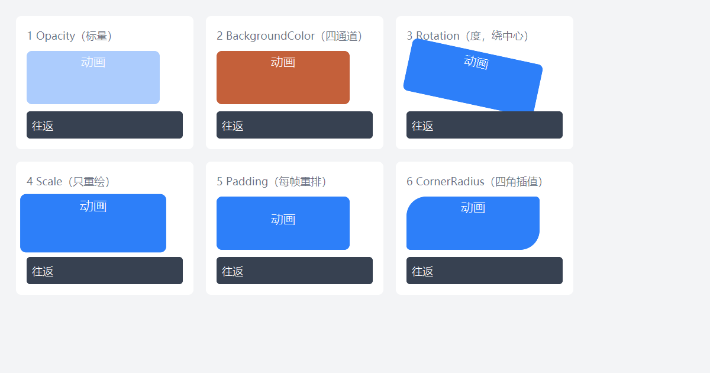

# DUI 动画指南（Animation 开发者文档）

> 状态：**已实现** —— 命令式属性动画：`Element::Animate()`。
> 可运行示例：`Samples/Animation`（12 个自包含示例）；本文配图 `Doc/Animation/ANM-1.png`。
> 架构契约见 [Arch/05-Animation.md](./Arch/05-Animation.md) —— 本文只讲**怎么用**。
> 本文有两处**必读**：§3.3（动画值在级联里的位置）、§8.1（`Opacity` 只作用于自身背景）。

---

## 1. 快速开始

### 1.1 一行代码

```cpp
card->Animate(dui::Opacity, 0.f, { .durationMs = 200 });
```

三段式：**属性标签 + 目标值 + 配置**。属性标签是 `dui::AnimProp<T>` 常量（`dui::Opacity`、`dui::BackgroundColor`…），目标值类型由标签决定 —— 类型不对，编译期就报错。

### 1.2 带配置与回调

```cpp
auto h = card->Animate(dui::BackgroundColor, 0xFFE8590C,
                       { .durationMs = 300, .easing = dui::Easing::EaseOut });
h.OnFinished([card] {
    card->Animate(dui::BackgroundColor, 0xFF2D7FF9, { .durationMs = 300 });
});
```

### 1.3 跑一下



六张卡片依次演示：标量（`Opacity`）、颜色四通道（`BackgroundColor`）、旋转（`Rotation`）、缩放（`Scale`）、四边间距（`Padding`）、四角圆角（`CornerRadius`）。窗口启动时自动播放 2.4 秒，便于截到"进行中"的状态；每张卡下方有"往返"按钮，演示 `OnFinished` 链式启动反向动画。

---

## 2. API 总览

### 2.1 `Element::Animate`

```cpp
template <class T>
AnimationHandle Animate(AnimProp<T> prop, std::type_identity_t<T> target, AnimConfig cfg);
```

- 返回 `AnimationHandle`（可拷贝、幂等取消、元素销毁后自动失效）。
- 值类型只允许 `float` / `dui::Color` / `dui::Thickness` / `dui::CornerRadii`，其余在 `static_assert` 阶段被拒。
- 目标值允许隐式转换（`0` 可以直接传给 `Color` 标签）。

### 2.2 `AnimConfig`

```cpp
struct AnimConfig {
    uint32_t durationMs = 200;      // 0 按 1ms 处理
    Easing   easing     = Easing::EaseOut;
};
```

C++20 聚合类型，用指派初始化。**成员顺序固定为 `durationMs` → `easing`**，指派初始化的书写顺序必须一致。`Easing` 定义在 `UI/Style.h`：`Linear / EaseIn / EaseOut / EaseInOut`。

### 2.3 `AnimationHandle`

| 方法 | 语义 |
| --- | --- |
| `AnimationHandle& OnFinished(std::function<void()> fn)` | 完成回调。进行中注册 → 完成时调用一次；已完成再注册 → **立即调用一次**；已取消 / 元素已销毁 → 忽略。重复注册以后者覆盖前者。 |
| `void Cancel() noexcept` | 取消动画并**回落基值**（动画值从级联第 1 层移除，回到样式层的值）。幂等；元素销毁后为 no-op。 |

回调在 **UI 线程**、统一 ticker 的 `Tick()` 内派发，且**延后到该元素本轮所有补间推进结束之后** —— 回调里可以安全地启动新动画、取消别的动画，甚至销毁元素。

> `OnFinished` 返回的是 `AnimationHandle&`（引用临时对象）。只写 `card->Animate(...).OnFinished(fn);` 是安全的（状态由内部 `shared_ptr` 持有）；要长期持有句柄就 `auto h = ...;` 按值保存。

---

## 3. 可动画的属性

### 3.1 白名单

| 标签 | 值类型 | 单位 / 语义 | 标脏 | 备注 |
| --- | --- | --- | --- | --- |
| `dui::Opacity` | `float` | 0..1 | Paint | 只作用于元素自身的背景与边框（§8.1） |
| `dui::BackgroundColor` | `dui::Color` | `0xAARRGGBB` | Paint | ARGB 四通道各自插值 |
| `dui::TextColor` | `dui::Color` | 同上 | Paint | 文本色（`Prop::Color`） |
| `dui::SelectionColor` | `dui::Color` | 同上 | Paint | 选区底色 |
| `dui::CaretColor` | `dui::Color` | 同上 | Paint | 插入符颜色 |
| `dui::TranslationX` | `float` | DIP | Paint | Paint 级平移，**不改布局盒** |
| `dui::TranslationY` | `float` | DIP | Paint | 同上 |
| `dui::Rotation` | `float` | 度 | Paint | 绕元素盒中心旋转 |
| `dui::Scale` | `float` | 倍率（1 = 原始大小） | Paint | 等比缩放，只改绘制顶点 |
| `dui::CornerRadius` | `dui::CornerRadii` | 左上 / 右上 / 右下 / 左下 | Paint | 四角各自插值，只重绘 |
| `dui::BorderWidth` | `dui::Thickness` | 四边 | Paint | 四边同时补间（边框是内描边，不占盒） |
| `dui::Width` | `float` | DIP | Layout | 每帧全量重排，兄弟跟着回流 |
| `dui::Height` | `float` | DIP | Layout | 同上 |
| `dui::Left` | `float` | DIP | Layout | 仅 `Relative` / `Absolute` / `Fixed` 生效 |
| `dui::Top` | `float` | DIP | Layout | 同上 |
| `dui::Padding` | `dui::Thickness` | 四边 | Layout | 每帧重排整棵子树 |
| `dui::Margin` | `dui::Thickness` | 四边 | Layout | 同上 |

白名单之外的属性（字号、字体族、文本、枚举类…）不能动画：要么没有自然的插值定义，要么每帧要重排版。

每个标签都对应一个同名的样式声明入口（静态值那一侧）：`dui::Style().Opacity(0.5f)`、`.Rotation(15.f)`、`.CornerRadius(8.f)`…… 动画只是把"一次性设值"换成"从当前值补间到目标值"。

### 3.2 Paint 级 vs Layout 级

| | Paint 级 | Layout 级 |
| --- | --- | --- |
| 标签 | `Opacity` / 颜色 / `Translation` / `Rotation` / `Scale` / `CornerRadius` / `BorderWidth` | `Width` / `Height` / `Left` / `Top` / `Padding` / `Margin` |
| 每帧成本 | 只重收集顶点 + 重绘 | 整棵子树重新 Measure / Arrange |
| 兄弟元素 | 不动 | 跟着回流 |
| `Bounds()` | 不变 | 变 |

**位移请用 `TranslationX` / `TranslationY`，不要用 `Left` / `Top`** —— 后者每帧重排整棵树。

### 3.3 动画值在级联里的位置 ★

动画值写入 `Element::animated_`，作为样式级联**第 1 层（最高优先级）**：

```
层 1  动画值（animated_）        ← 补间结果写这里
层 2  状态变体（Element::When）
层 3  本地覆盖（Element::Set）
层 4  Style 派生链（SetStyle / Style::Derive）
```

推论：

- 动画进行中，`Set()` 的本地覆盖**压不过**动画值（动画层更高）。
- 状态变体（hover 样式）同样压不过动画值。状态变体是"立即生效的差异集查表"，**不带任何过渡** —— 想让 hover 变色带过渡，要自己 `Animate`（§6.3）。
- `Cancel()` 会把动画值从层 1 移除 → 立刻回落到层 2 / 3 / 4 的值。

---

## 4. 缓动

`Easing` 用二次多项式近似（不是 CSS `cubic-bezier` 的精确解），\(t = clamp(elapsed / durationMs, 0, 1)\)：

| 枚举 | 公式 | 观感 |
| --- | --- | --- |
| `Linear` | \(t\) | 匀速 |
| `EaseIn` | \(t^2\) | 慢起快收 |
| `EaseOut` | \(1-(1-t)^2\) | 快起慢收（默认） |
| `EaseInOut` | \(2t^2\)（\(t<0.5\)）／\(1-2(1-t)^2\)（\(t\ge 0.5\)） | 两头慢 |

默认是 `EaseOut`。补间按 `GetTickCount64()` 的绝对时刻推进 —— 掉帧不会拖长总时长。

---

## 5. 语义契约

### 5.1 起点 = 当前显示值

启动时取 `ResolveProperty(element, prop)`，它已包含层 1 的当前动画值 → **中途反向不跳变**：

```cpp
card->Animate(dui::TranslationX, 100.f, { .durationMs = 500 });
card->Animate(dui::TranslationX, 0.f,   { .durationMs = 500 });   // 从当前值平滑回 0
```

### 5.2 同 `(元素, 属性)` 唯一

新动画替换旧动画（包括已完成但仍保留终值的那条）。旧句柄整体作废，**旧动画的 `OnFinished` 不会触发**。不同属性各占一个槽，可以并行（同时动 `Scale` 与 `Rotation` 没问题）。

### 5.3 完成 = fill forwards

终值留在层 1，不再 tick，直到被新动画替换 / `Cancel()` / 元素销毁。`OnFinished` 只触发一次。

### 5.4 取消与元素销毁

- `Cancel()`：移除该属性的动画槽 → 回落基值 → 标脏。幂等，可反复调用。
- 元素析构：`Lifetime` 令牌失效 + 从 ticker 注销；残留句柄的一切操作都是 no-op，回调不会派发到已销毁的元素。

### 5.5 回调时机

回调在**本元素本轮所有补间推进结束之后**派发（不是每条动画各自立刻派发）。因此在回调里启动新动画是安全的。

---

## 6. 常见配方

### 6.1 淡入淡出

```cpp
fade->Animate(dui::Opacity, 1.f, { .durationMs = 250, .easing = dui::Easing::EaseOut });
```

> ⚠ `Opacity` 只影响元素自身的背景与边框，不影响文字与子元素（§8.1）。要整块内容一起淡入，把文字颜色也一起补间：
>
> ```cpp
> fade->Animate(dui::Opacity, 1.f, { .durationMs = 250 });
> label->Animate(dui::TextColor, 0xFF111827, { .durationMs = 250 });
> ```

### 6.2 往返（`OnFinished` 链）

```cpp
card->Animate(dui::Scale, 1.12f, { .durationMs = 300 })
    .OnFinished([card] {
        card->Animate(dui::Scale, 1.f, { .durationMs = 300 });
    });
```

### 6.3 悬停高亮

状态变体不带过渡（§3.3），要过渡就自己补：

```cpp
card->OnPointerEnter([card](dui::PointerEvent&) {
    card->Animate(dui::BackgroundColor, 0xFF3B82F6, { .durationMs = 120 });
});
card->OnPointerLeave([card](dui::PointerEvent&) {
    card->Animate(dui::BackgroundColor, 0xFF2D7FF9, { .durationMs = 180 });
});
```

### 6.4 组合动画

不同属性各占一个槽，可同时运行：

```cpp
card->Animate(dui::TranslationY, -8.f, { .durationMs = 200 });
card->Animate(dui::Scale, 1.05f,       { .durationMs = 200 });
```

### 6.5 展开 / 收起

`Height` 是 Layout 级，每帧重排；树大时改用 `Padding` 或 `Scale` 更省：

```cpp
panel->Animate(dui::Height, 0.f, { .durationMs = 200, .easing = dui::Easing::EaseInOut });
```

### 6.6 打断与立即复位

重复点同一个按钮不跳变，因为起点取当前显示值（§5.1）；想"立刻回到原状"就 `Cancel()`：

```cpp
handle.Cancel();   // 立刻回到样式层的基值
```

### 6.7 圆角与边框

```cpp
card->Animate(dui::CornerRadius, dui::CornerRadii{26.f, 4.f, 26.f, 4.f}, { .durationMs = 250 });
card->Animate(dui::BorderWidth, dui::Thickness(2.f), { .durationMs = 250 });
```

`CornerRadii` / `Thickness` 的参数顺序：`CornerRadii(左上, 右上, 右下, 左下)`；`Thickness` 有三个构造 —— `Thickness(all)` / `Thickness(vertical, horizontal)`（CSS 顺序：先上下后左右）/ `Thickness(l, t, r, b)`。

---

## 7. 时间源与按需呈现

- `AnimationClock`（`UI/Image.h`）是**进程级单例**，与 GIF 帧动画、光标闪烁共用同一个窗口定时器（App 层只启停一个）。
- 有活动属性动画 → 20ms 一拍；只有光标闪烁 → 500ms；都没有 → **停表**（空闲零功耗）。
- 20ms 是 Windows 定时器粒度，不是 VSync 对齐帧；补间按绝对时刻求 \(t\)，掉帧不会拖长总时长，但中间帧会被跳过。

---

## 8. 已知边界与不支持项

### 8.1 `Opacity` 的作用范围

`Opacity` 只乘到元素自身的**背景填充**与**边框 alpha**，**不影响文字与子元素**。这是绘制层的实现边界（`App/Frame.cpp` 的 `DrawBackground` / `DrawBorder`），不是 bug —— 要整块淡入淡出请分别补间文字色（§6.1）。

### 8.2 transform 动画只改绘制

`TranslationX/Y`、`Rotation`、`Scale` 只改绘制顶点：`Bounds()`、布局结果、`Scroller` 的可滚动范围都不变；`PointerEvent::pos` 仍是客户区绝对坐标。

抗锯齿方面：形状走 SDF 的 **1 物理像素过渡带**（局部空间求距离场，旋转是等距变换 → 圆角与过渡带不失真）。两个注意点：

- 过渡带是**物理像素**：150% DPI 下 1 px = 0.67 DIP，观感比 100% DPI 糙；斜边（尤其小角度旋转）仍能看出台阶，只是已不是硬边。
- **旋转后的文字另有一层损失**：字形是整块旋转的图集位图、且图集用 POINT 采样 → 笔画呈块状；`Scale` 动画则是离散尺度光栅化后线性拉伸（放大略糊）。这两条与背景边缘的抗锯齿是不同问题。

### 8.3 明确不支持

声明式 `transition` / 关键帧 / `animation` 样式属性、延迟、迭代次数、方向、暂停恢复、seek、Spring、自定义贝塞尔曲线。

### 8.4 其它

- 同一属性只有一条动画槽：不能"padding 左边补间、右边单独补间"。四通道（四边 / 四角）各自插值，但**共用同一条时间轴与缓动**（CSS `transition` 的"同一属性一条时间轴"语义）。
- 颜色在打包的 8 位通道上插值，不做线性光空间混合。
- `durationMs = 0` 等价于 1ms：仍要等下一次 tick 才写终值、发回调。

---

## 9. API 速查

```cpp
// 启动
AnimationHandle Element::Animate(AnimProp<T> prop, T target, AnimConfig cfg);

// 属性标签
dui::Opacity / dui::BackgroundColor / dui::TextColor / dui::SelectionColor / dui::CaretColor
dui::TranslationX / dui::TranslationY / dui::Rotation / dui::Scale
dui::Width / dui::Height / dui::Left / dui::Top
dui::Padding / dui::Margin / dui::CornerRadius / dui::BorderWidth

// 配置
struct AnimConfig { uint32_t durationMs = 200; Easing easing = Easing::EaseOut; };
enum class Easing { Linear, EaseIn, EaseOut, EaseInOut };

// 句柄
AnimationHandle& OnFinished(std::function<void()> fn);
void Cancel() noexcept;
```

---

## 10. 相关文档

- [Arch/05-Animation.md](./Arch/05-Animation.md) —— 架构契约与决策记录
- [Styles.md](./Styles.md) —— 样式、状态变体与级联
- [Layout.md](./Layout.md) —— 布局盒模型、`Position` 语义
- [Font.md](./Font.md) —— 字体与图标
- `Samples/Animation` —— 12 个可运行示例（按功能拆开，可单独阅读）
