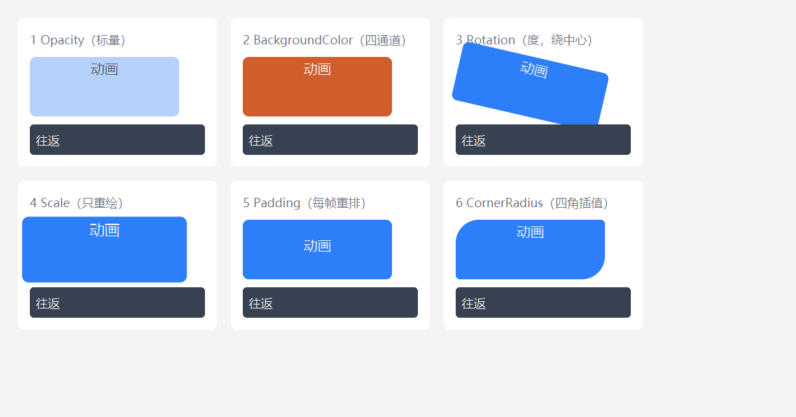

# DUI 动画指南（Animation 开发者文档）

## 1. 快速开始

```cpp
card->Animate(dui::Opacity, 0.f, { .durationMs = 200 }).Start();
```

三段式：**属性标签 + 目标值 + 配置**。属性标签是 `dui::AnimProp<T>` 常量（`dui::Opacity`、`dui::BackgroundColor`…），目标值类型由标签决定 —— 类型不对，编译期就报错。

**`Animate()` 只创建动画，不执行** —— 要真正跑起来得调 `Start()`。这样才能把一组动画先建好、再统一启动，或中途暂停 / 继续 / 停止。

带配置与回调：

```cpp
auto h = card->Animate(dui::BackgroundColor, 0xFFE8590C,
                       { .durationMs = 300, .easing = dui::Easing::EaseOut });
h.OnFinished([card] {
    card->Animate(dui::BackgroundColor, 0xFF2D7FF9, { .durationMs = 300 }).Start();
}).Start();
```

反复播放用 `Loop()`：

```cpp
card->Animate(dui::Opacity, 0.2f, { .durationMs = 600 }).Loop();   // 无限循环
```



六张卡片依次演示：标量（`Opacity`）、颜色（`BackgroundColor`）、旋转（`Rotation`）、缩放（`Scale`）、四边间距（`Padding`）、四角圆角（`CornerRadius`）。窗口启动时自动播放一轮，便于截到"进行中"的状态；每张卡下方有"往返"按钮，演示 `OnFinished` 链式启动反向动画。

---

## 2. 生命周期

```
        Animate()            Start() / Loop()         Pause()          Continue()
Idle ───────────────► Idle ───────────────► Running ──────────► Paused ──────────► Running
                                       │        ▲                   │
                                       └────────┴───────────────────┘
                                        （Continue 从断点续跑）

  Running ──跑完一轮──► Completed              （非循环：终值保留在动画层）
  Running ──跑完一轮──► 回到起点 → 下一轮        （Loop：每轮 OnFinished → OnStarted）
  Running ──Stop()────► Stopped               （立即落到终值，结束循环）
```

| 方法         | 值落点                  | 终态        | 说明                                                                        |
| ------------ | ----------------------- | ----------- | --------------------------------------------------------------------------- |
| `Start()`    | 回到起点 → 目标         | —           | **从头重播**：时间轴归零、值回到动画起点，再重新推进                        |
| `Pause()`    | 冻结在当前值            | `Paused`    | **仅 `Running` 有效**：停表（无活动补间时 ticker 停摆），恢复后从断点接着跑 |
| `Continue()` | 从当前值继续            | —           | `Paused` → 恢复推进；`Idle` → 等同 `Start()`；**已是终态 → 不再执行**       |
| `Stop()`     | **立即落到终值**        | `Stopped`   | 相当于"跳到末尾并完成"；触发 `OnStopped` 与 `OnFinished`；同时结束循环      |
| `Loop(n)`    | 回到起点 → 目标（反复） | —           | 开启循环并**从头开始第一轮**；`n` = 总播放轮数（`0` = 无限）                |
| `Cancel()`   | **回落基值**            | `Cancelled` | 移除动画值 → 回到样式层的值；不触发任何事件                                 |

要点：

- **`Start()` 是"重播"不是"启动"**：任何相位都能调 —— 时间轴归零、值回到动画起点再跑一遍（首次启动时起点取当前显示值，重播沿用原起点）。
- **循环**：`Loop(n)` 开启循环并从头开始第一轮；每轮结束触发 `OnFinished`、下一轮开始触发 `OnStarted`；最后一轮结束后进入 `Completed`。`Stop()` 可随时结束循环。
- **暂停不是从头再来**：`Pause()` 记下"已推进了多久"，`Continue()` 从断点接上，总时长不变。
- **终值保留**：`Completed` / `Stopped` 都把终值留在动画层（fill forwards），直到被新动画替换或 `Cancel()`。
- **同 `(元素, 属性)` 只有一条动画槽**：新建动画会顶掉旧的（旧句柄随即失效，其回调不再触发）。
- **事件的注册顺序**：建议先注册事件、再 `Start()`；若动画已到终态才注册 `OnFinished` / `OnStopped`，会**立即调用一次**。

```cpp
// 批量编排：先全部创建，再统一启动
std::vector<dui::AnimationHandle> handles;
handles.push_back(card->Animate(dui::TranslationX, 30.f, { .durationMs = 900 }));
handles.push_back(card->Animate(dui::Rotation,     30.f, { .durationMs = 900 }));
for (auto& h : handles) h.Start();     // 一起跑

// 之后还能整体暂停 / 继续 / 停止
for (auto& h : handles) h.Pause();
for (auto& h : handles) h.Continue();
for (auto& h : handles) h.Stop();      // 一起落在终值
```

---

## 3. API

### 3.1 `Element::Animate`

```cpp
template <class T>
AnimationHandle Animate(AnimProp<T> prop, std::type_identity_t<T> target, AnimConfig cfg);
```

- 返回 `AnimationHandle`（可拷贝、幂等控制、元素销毁后自动失效）。
- **只创建，不执行**；`Start()` 才推进。
- 值类型只允许 `float` / `dui::Color` / `dui::Thickness` / `dui::CornerRadii`。
- 目标值允许隐式转换（`0` 可以直接传给 `Color` 标签）。

### 3.2 `AnimConfig`

```cpp
struct AnimConfig {
    uint32_t durationMs = 200;      // 0 按 1ms 处理
    Easing   easing     = Easing::EaseOut;
};
```

C++20 聚合类型，用指派初始化。**成员顺序固定为 `durationMs` → `easing`**，指派初始化的书写顺序必须一致。`Easing`：`Linear / EaseIn / EaseOut / EaseInOut`。

### 3.3 `AnimationHandle`：控制

| 方法                                     | 语义                                                             |
| ---------------------------------------- | ---------------------------------------------------------------- |
| `void Start() noexcept`                  | **从头重播**：时间轴归零、回到动画起点再推进                     |
| `void Pause() noexcept`                  | 冻结在当前值（仅 `Running` 有效）                                |
| `void Continue() noexcept`               | 从当前值继续；`Idle` 等同 `Start()`；终态不再执行                |
| `void Stop() noexcept`                   | 立即落到终值；同时结束循环模式                                   |
| `void Loop(uint32_t times = 0) noexcept` | 开启循环播放并从头开始第一轮；`times` = 总播放轮数（`0` = 无限） |
| `void Cancel() noexcept`                 | 取消并**回落基值**。幂等；元素销毁后为 no-op                     |

### 3.4 `AnimationHandle`：事件

| 方法                                                   | 触发时机                                                                    |
| ------------------------------------------------------ | --------------------------------------------------------------------------- |
| `AnimationHandle OnStarted(std::function<void()> fn)`  | 开始推进（首次 `Start()`、重播、`Continue()` 恢复，或**循环的每一轮开始**） |
| `AnimationHandle OnPaused(std::function<void()> fn)`   | 暂停                                                                        |
| `AnimationHandle OnStopped(std::function<void()> fn)`  | 被 `Stop()` 打断                                                            |
| `AnimationHandle OnFinished(std::function<void()> fn)` | 到达终点（自然跑完，或 `Stop()` 立即完成；**循环时每轮结束各触发一次**）    |

- 事件注册返回**句柄副本**，可链式写：`.OnStarted(a).OnPaused(b).OnFinished(c)`。
- 注册时若对应状态已成立 → **立即调用一次**；重复注册以后者覆盖前者；已取消 / 元素已销毁 → 忽略。
- **回调会被保留**：循环的每一轮、重播都会再次触发同一个回调。
- 回调在 **UI 线程**派发：`OnFinished` 延后到该元素本轮所有补间推进结束之后；其余（`OnStarted` / `OnPaused` / `OnStopped`）在控制命令的调用点同步触发。
- 回调里可以安全地再操作动画（启动 / 暂停 / 停止别的动画）。

### 3.5 `AnimationHandle`：查询

| 方法                      | 语义                                                                            |
| ------------------------- | ------------------------------------------------------------------------------- |
| `AnimPhase Phase() const` | 当前相位：`Idle` / `Running` / `Paused` / `Completed` / `Stopped` / `Cancelled` |
| `bool IsRunning() const`  | 是否正在推进                                                                    |
| `bool IsFinished() const` | 是否已到终态（`Completed` / `Stopped` / `Cancelled`）                           |

---

## 4. 可动画的属性

### 4.1 白名单

| 标签                                 | 值类型             | 单位 / 语义               | 成本   | 备注                                                          |
| ------------------------------------ | ------------------ | ------------------------- | ------ | ------------------------------------------------------------- |
| `dui::Opacity`                       | `float`            | 0..1                      | Paint  | 作用于整棵子树：自身背景 / 边框 / 阴影 / 文字与子元素一起淡出 |
| `dui::BackgroundColor`               | `dui::Color`       | `0xAARRGGBB`              | Paint  | ARGB 四通道各自插值                                           |
| `dui::TextColor`                     | `dui::Color`       | 同上                      | Paint  | 文本色                                                        |
| `dui::SelectionColor`                | `dui::Color`       | 同上                      | Paint  | 选区底色                                                      |
| `dui::CaretColor`                    | `dui::Color`       | 同上                      | Paint  | 插入符颜色                                                    |
| `dui::TranslationX` / `TranslationY` | `float`            | DIP                       | Paint  | 平移，**不改布局盒**                                          |
| `dui::Rotation`                      | `float`            | 度                        | Paint  | 绕元素盒中心旋转                                              |
| `dui::Scale`                         | `float`            | 倍率（1 = 原始大小）      | Paint  | 等比缩放，只改绘制                                            |
| `dui::CornerRadius`                  | `dui::CornerRadii` | 左上 / 右上 / 右下 / 左下 | Paint  | 四角各自插值                                                  |
| `dui::BorderWidth`                   | `dui::Thickness`   | 四边                      | Paint  | 四边同时补间（边框是内描边，不占盒）                          |
| `dui::Width` / `Height`              | `float`            | DIP                       | Layout | 每帧全量重排，兄弟跟着回流                                    |
| `dui::Left` / `Top`                  | `float`            | DIP                       | Layout | 仅 `Relative` / `Absolute` / `Fixed` 生效                     |
| `dui::Padding` / `Margin`            | `dui::Thickness`   | 四边                      | Layout | 每帧重排整棵子树                                              |

白名单之外的属性（字号、字体族、文本、枚举类…）不能动画。每个标签都对应一个同名的样式声明入口（`dui::Style().Opacity(0.5f)`、`.Rotation(15.f)`…），动画只是把"一次性设值"换成"从当前值补间到目标值"。

### 4.2 Paint 级 vs Layout 级

|            | Paint 级                                                                                 | Layout 级                                                  |
| ---------- | ---------------------------------------------------------------------------------------- | ---------------------------------------------------------- |
| 标签       | `Opacity` / 颜色 / `Translation` / `Rotation` / `Scale` / `CornerRadius` / `BorderWidth` | `Width` / `Height` / `Left` / `Top` / `Padding` / `Margin` |
| 每帧成本   | 只重绘                                                                                   | 整棵子树重新 Measure / Arrange                             |
| 兄弟元素   | 不动                                                                                     | 跟着回流                                                   |
| `Bounds()` | 不变                                                                                     | 变                                                         |

**位移请用 `TranslationX` / `TranslationY`，不要用 `Left` / `Top`** —— 后者每帧重排整棵树。

### 4.3 动画值压得住其它来源

动画值的优先级**最高**：

- 动画进行中，`Set()` 的本地覆盖压不过动画值；状态变体（hover 样式）同样压不过。
- 状态变体是"立即生效的差异集"，**不带过渡** —— 想让 hover 变色带过渡，要自己 `Animate`（§6.3）。
- `Cancel()` 会移除动画值 → 立刻回落到样式层的值。

---

## 5. 缓动

| 枚举        | 观感             |
| ----------- | ---------------- |
| `Linear`    | 匀速             |
| `EaseIn`    | 慢起快收         |
| `EaseOut`   | 快起慢收（默认） |
| `EaseInOut` | 两头慢           |

补间按绝对时刻推进 —— 掉帧不会拖长总时长（暂停时长不计入）。

---

## 6. 常见配方

### 6.1 淡入淡出

```cpp
fade->Animate(dui::Opacity, 1.f, { .durationMs = 250, .easing = dui::Easing::EaseOut }).Start();
```

`Opacity` 作用于**整棵子树**：背景 / 边框 / 阴影 / 文字与所有子元素一起淡出。一条补间即可，**不必再单独补文字色**。

需要"背景淡出但文字保持清晰"时，把文字挪到不透明的兄弟容器里，而不是给文字单独补色 —— 父级的淡出会覆盖文字。

### 6.2 往返（`OnFinished` 链）

```cpp
card->Animate(dui::Scale, 1.12f, { .durationMs = 300 })
    .OnFinished([card] {
        card->Animate(dui::Scale, 1.f, { .durationMs = 300 }).Start();
    })
    .Start();
```

### 6.3 悬停高亮

状态变体不带过渡，要过渡就自己补：

```cpp
card->OnPointerEnter([card](dui::PointerEvent&) {
    card->Animate(dui::BackgroundColor, 0xFF3B82F6, { .durationMs = 120 }).Start();
});
card->OnPointerLeave([card](dui::PointerEvent&) {
    card->Animate(dui::BackgroundColor, 0xFF2D7FF9, { .durationMs = 180 }).Start();
});
```

### 6.4 组合动画

不同属性各占一个槽，可同时运行：

```cpp
card->Animate(dui::TranslationY, -8.f, { .durationMs = 200 }).Start();
card->Animate(dui::Scale, 1.05f,       { .durationMs = 200 }).Start();
```

### 6.5 展开 / 收起

`Height` 是 Layout 级，每帧重排；树大时改用 `Padding` 或 `Scale` 更省：

```cpp
panel->Animate(dui::Height, 0.f, { .durationMs = 200, .easing = dui::Easing::EaseInOut }).Start();
```

### 6.6 打断与立即复位

重复点同一个按钮不跳变，因为起点取**当前显示值**（中途反向也平滑）：

```cpp
card->Animate(dui::TranslationX, 100.f, { .durationMs = 500 }).Start();
card->Animate(dui::TranslationX, 0.f,   { .durationMs = 500 }).Start();   // 从当前值平滑回 0
```

想"立刻回到原状"就 `Cancel()`（回落基值），想"立刻跳到目标"就 `Stop()`（落在终值）：

```cpp
handle.Cancel();   // 立刻回到样式层的基值
handle.Stop();     // 立刻落到终值（并触发 OnStopped / OnFinished）
```

### 6.7 圆角与边框

```cpp
card->Animate(dui::CornerRadius, dui::CornerRadii{26.f, 4.f, 26.f, 4.f}, { .durationMs = 250 }).Start();
card->Animate(dui::BorderWidth, dui::Thickness(2.f), { .durationMs = 250 }).Start();
```

`CornerRadii` / `Thickness` 的参数顺序：`CornerRadii(左上, 右上, 右下, 左下)`；`Thickness` 有三个构造 —— `Thickness(all)` / `Thickness(vertical, horizontal)`（CSS 顺序：先上下后左右）/ `Thickness(l, t, r, b)`。

### 6.8 循环播放

```cpp
auto h = card->Animate(dui::TranslationX, 40.f, { .durationMs = 700 });
h.OnStarted([&] { /* 每轮开始 */ })
 .OnFinished([&] { /* 每轮结束 */ });
h.Loop();        // 无限循环；h.Loop(3) = 一共 3 轮
h.Stop();        // 结束循环，落在终值
```

每轮都从动画起点开始（轮与轮之间值从终点跳回起点，与 CSS `animation-iteration` 同语义）；`OnFinished` 在每轮结束时触发，`OnStarted` 在下一轮开始时触发。

---

## 7. 已知边界与不支持项

- **`Animate()` 不自动执行**：必须 `Start()`（或 `Loop()`）；忘了调就是"创建了但没跑"（不会报错，元素也不变）。
- **同 `(元素, 属性)` 只有一条动画槽**：新动画替换旧动画，旧句柄作废（其回调不再触发）。不同属性可以并行。
- **`Start()` 是"重播"**：任何相位都能调 —— 时间轴归零、值回到动画起点；`Loop()` 同理，只是额外开启循环。
- **循环每轮都从起点开始**：轮与轮之间值从终点跳回起点；轮数由 `Loop(n)` 指定（`n = 0` 无限）。
- **掉帧跨多轮时事件会折叠**：一帧内跑完多轮时，最多展开 4 轮的 `OnFinished` / `OnStarted`。
- **`Stop()` 与 `Cancel()` 不同**：前者落在**终值**（并触发 `OnStopped` + `OnFinished`），后者**回落基值**（不触发任何事件）。
- **`Cancel()` 不触发事件**：没有 `OnCancelled`；需要感知取消得自己在业务里记状态。
- **完成 = 保留终值**：终值留在样式层，直到被新动画替换 / `Cancel()` / 元素销毁。
- **`transform` 类标签只改绘制**：`Bounds()`、布局结果、`Scroller` 的可滚动范围都不变；`PointerEvent::pos` 仍是客户区绝对坐标。
- **旋转后的文字是整块旋转的位图**：笔画呈块状；`Scale` 动画放大略糊。150% DPI 下形状的抗锯齿过渡带只有 1 物理像素，斜边可见台阶。
- **同一属性只有一条时间轴**：不能"padding 左边补间、右边单独补间"。四通道（四边 / 四角）各自插值但共用同一条时间轴与缓动。
- **颜色在打包的 8 位通道上插值**，不做线性光空间混合。
- **`durationMs = 0` 等价于 1ms**：仍要等下一次 tick 才写终值、发回调。
- **不支持**：声明式 `transition` / 关键帧 / `animation` 样式属性、延迟、方向、seek、Spring、自定义贝塞尔曲线、变速（playback rate）、时间轴反转。
