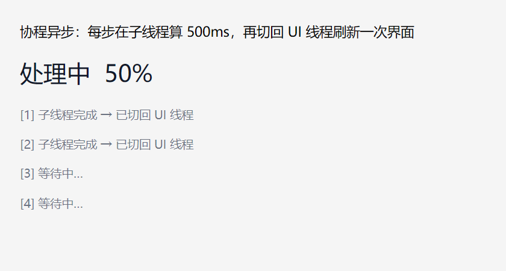

# DUI 异步使用指南（Async 开发者文档）

## 1. 快速开始

把耗时活儿丢到子线程，算完切回 UI 线程刷界面 —— 用协程写成一段直线代码：

```cpp
dui::Task<void> Work(dui::Text* ctrl) {
    auto life = ctrl->Lifetime();       // UI 线程取令牌
    for (int i = 1; i <= 10; ++i) {
        co_await dui::Background();        // 切到子线程
        Sleep(600);                         // 耗时计算（只碰纯数据）
        co_await dui::Foreground();        // 切回 UI 线程
        if (!life) co_return;              // 元素已销毁 → 收工
        ctrl->SetText(L"处理中  " + std::to_wstring(i * 10) + L"%");
    }
    ctrl->SetText(L"完成：10 步全部结束");
}
```

在事件处理器里直接调用就启动（eager 协程，无需 `Start()`）：

```cpp
start->OnClick([ctrl](dui::PointerEvent&) {
    Work(ctrl);
});
```



截图是任务跑到一半的样子：子线程算完一步，切回 UI 线程刷一次界面（"处理中 50%"），还没轮到的步骤仍显示"等待中…"。

---

## 2. 线程铁律

框架的 UI 是**单线程**的：元素树、排版、绘制全在 UI 线程。

| 线程     | 能碰什么                                         |
| -------- | ------------------------------------------------ |
| UI 线程  | 一切：元素树、样式、文本、图像、绘制             |
| 后台线程 | **只有纯数据**：字节、计算结果、解码后的位图内存 |

要更新界面 → 必须切回 UI 线程（`co_await dui::Foreground()` 或 `PostUi`）。

**没有运行时防护**：后台线程误碰元素树不会被拦截 —— 写错不会当场报错，只会在某次时序下崩掉或画错。规矩靠自觉。

---

## 3. 协程风格（主路径）

### 3.1 `Task<T>` / `Task<void>`

```cpp
dui::Task<void> DoWork();      // 无返回值：co_return; 或自然结束
dui::Task<int>  Compute();     // 有返回值：co_return 42;
```

| 语义               | 说明                                                           |
| ------------------ | -------------------------------------------------------------- |
| **eager**          | 调用即运行到首个 `co_await` → `DoWork();` 这一行就启动了前半段 |
| **不需要保留对象** | 协程帧自持有；`Work(status);` 直接丢弃返回值，任务照样跑完     |
| **不用 `Start()`** | `Task::Start()` 是空函数，调不调都一样                         |

### 3.2 切换点：`Background()` / `Foreground()`

```cpp
co_await dui::Background();     // 挂起 → 进程级固定线程池恢复（子线程）
co_await dui::Foreground();     // 挂起 → UI 线程队列恢复（回 UI）
```

两个 awaiter 的 `await_ready()` 恒为 `false` → 一定会挂起一次（即使你当前就在目标线程）。UI 已退出时 `Foreground()` 直接销毁挂起的协程帧 → 后续代码不再执行。

### 3.3 `Then`：完成回调

```cpp
Compute().Then([](int v) { /* 在 UI 线程执行 */ });
```

| 行为     | 说明                                                                         |
| -------- | ---------------------------------------------------------------------------- |
| 执行线程 | **UI 线程**                                                                  |
| 触发时机 | 协程**完成时一次**；`Task<void>` 的回调不带参数                              |
| 过程更新 | `Then` 不管过程 —— 过程中的界面更新靠循环里每轮 `co_await dui::Foreground()` |
| 槽位     | **只有一个** —— 后注册的覆盖先注册的                                         |

### 3.4 一个完整例子

```cpp
dui::Task<void> Work(dui::Text* status, dui::Text** steps, int count) {
    auto life = status->Lifetime();          // UI 线程取令牌：元素销毁后据此收工
    for (int i = 0; i < count; ++i) {
        co_await dui::Background();           // 切到后台线程池
        Sleep(500);                            // 耗时计算：这段只碰纯数据
        co_await dui::Foreground();           // 切回 UI 线程
        if (!life) co_return;                 // 元素已销毁 → 直接退出，别再碰界面
        status->SetText(L"处理中  " + std::to_wstring((i + 1) * 100 / count) + L"%");
        steps[i]->SetText(L"[" + std::to_wstring(i + 1) + "] 子线程完成 → 已切回 UI 线程");
    }
    status->SetText(L"完成：全部步骤结束");
}
```

> **注意**：协程参数只拷**指针值**，不拷 pointee。`steps` 若指向 `OnCreate` 的栈上局部数组，`OnCreate` 一返回数组就失效，协程恢复时读到的是垃圾指针（实测直接崩在 `SetText` 里）。元素指针数组要放在更长生命周期的存储里（窗口成员）。

---

## 4. 回调风格（等价备选）

投到后台：

```cpp
dui::ThreadPool::Shared().Post([] {
    int sum = 0;
    for (int i = 1; i <= 1'000'000; ++i) sum += i;   // 子线程：只碰纯数据
});
```

安全回投 UI 线程（带令牌）：

```cpp
dui::Text* status = /* ... */;
auto life = status->Lifetime();             // UI 线程取令牌
dui::ThreadPool::Shared().Post([status, life] {
    int sum = 0;
    for (int i = 1; i <= 1'000'000; ++i) sum += i;   // 子线程：只碰纯数据
    dui::PostUi(life, [status, sum] {                // 回投 UI 线程
        status->SetText(L"结果：" + std::to_wstring(sum));   // 碰 UI，安全
    });
});
```

`PostUi(life, fn)` **执行前检查令牌**：元素已销毁（或 UI 已退出）→ 直接丢弃，不碰悬空元素。

裸回投（无令牌，自己保证不碰已销毁的元素）：

```cpp
dui::Dispatcher::Ui()->Post(fn);          // 未安装时返回 nullptr —— 调用前先判空
```

---

## 5. 生命周期与取消

`Element::Lifetime()` 返回一个 `dui::Lifetime`：默认存活，元素析构时置否。令牌可拷贝（共享同一标志）。**必须在 UI 线程取**。

```cpp
auto life = status->Lifetime();
if (!life) { /* 元素没了 */ }
```

`PostUi` 会自动丢弃失效令牌的任务；**协程风格没有这层自动保护**，切回 UI 后要自己查：

```cpp
co_await dui::Foreground();
if (!life) co_return;      // 元素已销毁 → 直接结束，别再碰界面
```

框架**没有**取消令牌机制：排队中的任务不能撤销；运行中的任务不会被强杀（框架不杀线程）—— 它只碰纯数据，靠业务自己检查令牌退出。元素销毁 = 令牌置否 = 回投被丢弃，这就是"取消"的全部含义。

---

## 6. 已知限制与坑

1. **后台线程只碰纯数据**：元素树、样式、绘制、字体只在 UI 线程可碰；**没有运行时防护**，写错不会报错，只会偶发崩溃。
2. **协程参数只拷指针值**：把 `OnCreate` 栈上局部数组的地址传给协程（如 `dui::Text** steps`），`OnCreate` 返回后数组失效 → 协程恢复时读垃圾指针崩溃。元素指针要放在更长生命周期的存储里（窗口成员）。
3. **`Then` 只有一个槽位**：后注册的覆盖先注册的，还没执行的先注册者会被挤掉。别链式挂多个 `Then`。
4. **`Then` 只在完成时触发一次**：过程中的界面更新靠循环里的 `co_await dui::Foreground()`。
5. **`Task` 不能被 `co_await`**：没有 awaiter，也没有 `WhenAll` / `WhenAny` 组合子 → 只能靠 `Then` 串联。
6. **`Task<T>` 没有错误通道**：错误用 `bool` / 输出参数 / 自定义结构体传。
7. **异常 = 终止进程**：协程体里抛异常走 `unhandled_exception` → `std::terminate`；协程里不要 try/catch。
8. **UI 退出后 `Foreground()` 销毁协程帧**：未完成的任务静默丢弃（不崩溃、不泄漏帧），但也不会再执行后续代码。
9. **没有取消令牌**：排队中的任务不能撤销；运行中的任务不被强杀。
10. **回投延迟到下一帧**：界面更新不是立刻可见。
11. **线程池并发度固定 `min(4, 硬件并发)`**：长任务占满池 → 短任务排队；无优先级、无专线程。
12. **UI 队列无上限**：草案里的"1024 上限 + 丢最旧"未实现。
