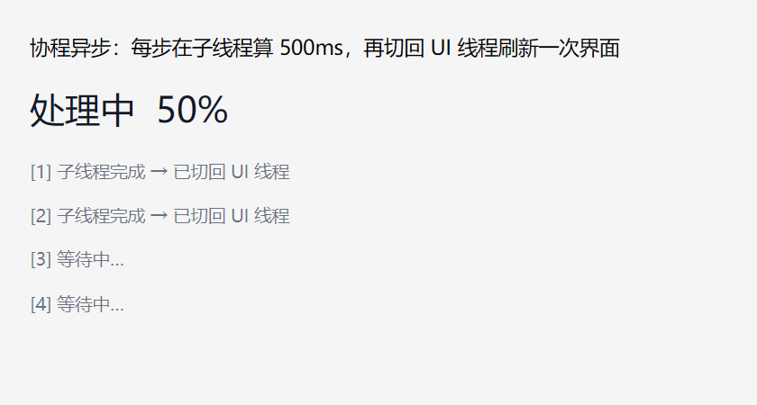

# DUI 异步使用指南（Async 开发者文档）

> 状态：**已实现** —— M4（Dispatcher + 线程池 + 协程）→ M5.12（`PostUi` 安全回投 + `Task<void>` + `Samples/Async`）。
> C++20 协程（`dui::Task`）+ 固定后台线程池 + UI 线程任务队列。
> **协程是主路径**；回调风格（`ThreadPool::Post` / `PostUi`）作为等价备选并存。
> 可运行示例 `Samples/Async/main.cpp`。

---

## 1. 快速开始

### 1.1 一句话

把耗时活儿丢到子线程，算完切回 UI 线程刷界面 —— 用协程写成一段直线代码：

```cpp
dui::Task<void> Work(dui::Text* status) {
    auto life = status->Lifetime();       // UI 线程取令牌
    for (int i = 1; i <= 10; ++i) {
        co_await dui::Background();        // 切到子线程
        Sleep(600);                         // 耗时计算（只碰纯数据）
        co_await dui::Foreground();        // 切回 UI 线程
        if (!life) co_return;              // 元素已销毁 → 收工
        status->SetText(L"处理中  " + std::to_wstring(i * 10) + L"%");
    }
    status->SetText(L"完成：10 步全部结束");
}
```

在事件处理器里直接调用就启动（eager 协程，无需 `Start()`）：

```cpp
start->OnClick([status](dui::PointerEvent&) {
    Work(status);
});
```

### 1.2 跑一下



截图是任务跑到一半的样子：子线程算完一步，切回 UI 线程刷一次界面（"处理中 50%"），还没轮到的步骤仍显示"等待中…"。

---

## 2. 线程铁律

### 2.1 后台线程只碰数据

框架的 UI 是**单线程**的：元素树、排版、绘制全在 UI 线程。异步只有一条通道：

| 线程 | 能碰什么 |
| --- | --- |
| UI 线程 | 一切：元素树、样式、文本、图像、绘制 |
| 后台线程 | **只有纯数据**：字节、计算结果、解码后的位图内存 |

要更新界面 → 必须切回 UI 线程（`co_await dui::Foreground()` 或 `PostUi`）。

### 2.2 没有运行时防护

后台线程误碰元素树**不会被拦截**：没有 `AssertUiThread()`、没有断言、没有 Debug 断点。写错了不会当场报错，只会在某次时序下崩掉或画错 —— 规矩靠文档和自觉。

---

## 3. 协程风格（主路径）

### 3.1 `Task<T>` / `Task<void>`

`dui::Task<T>` 是框架的协程返回类型：

```cpp
dui::Task<void> DoWork();      // 无返回值：co_return; 或自然结束
dui::Task<int>  Compute();     // 有返回值：co_return 42;
```

三条关键语义：

| 语义 | 说明 |
| --- | --- |
| **eager** | 调用即运行到首个 `co_await`（`initial_suspend` = `suspend_never`）→ `DoWork();` 这一行就启动了前半段，跑在**调用方线程**上 |
| **不需要保留对象** | 协程帧自持有；`Work(status);` 直接丢弃返回值，任务照样跑完 |
| **不用 `Start()`** | `Task::Start()` 是空函数（只为保留入口签名），调不调都一样 |

### 3.2 切换点：`Background()` / `Foreground()`

两个**命名空间函数**，调用点读起来就是"动作"：

```cpp
co_await dui::Background();     // 挂起 → 进程级固定线程池恢复（子线程）
co_await dui::Foreground();     // 挂起 → UI 线程队列恢复（回 UI）
```

- awaiter 类型是实现细节，你只写函数名，不用写类型名；
- 两个 awaiter 的 `await_ready()` 恒为 `false` → 一定会挂起一次（即使你当前就在目标线程）；
- `Foreground()` 在 **UI 已退出**（Dispatcher 已卸载）时**直接销毁挂起的协程帧** → 协程不再恢复，后续代码不执行。这是有意的：不销毁就会永远挂着、泄漏帧。

### 3.3 `Then`：完成回调

```cpp
Compute().Then([](int v) { /* 在 UI 线程执行 */ });
```

| 行为 | 说明 |
| --- | --- |
| 执行线程 | **UI 线程**（经 Dispatcher 回投） |
| 触发时机 | 协程**完成时一次**；`Task<void>` 的回调不带参数 |
| 过程更新 | `Then` 不管过程 —— 过程中的界面更新靠循环里每轮 `co_await dui::Foreground()` |
| 注册时机 | 完成前后都可注册（完成后注册会立刻调度） |
| 槽位 | **只有一个** —— 后注册的覆盖先注册的（见 §8） |

`Task<T>` 的值在完成时按值传给回调。

### 3.4 一个完整例子

```cpp
dui::Task<void> Work(dui::Text* status, dui::Text** steps, int count) {
    auto life = status->Lifetime();          // UI 线程取令牌：元素销毁后据此收工
    for (int i = 0; i < count; ++i) {
        co_await dui::Background();           // 切到后台线程池
        Sleep(500);                            // 耗时计算：这段只碰纯数据
        co_await dui::Foreground();           // 切回 UI 线程
        if (!life) co_return;                 // 元素已销毁 → 直接退出，别再碰界面
        status->SetText(L"处理中  " + std::to_wstring((i + 1) * 100 / count) + L"%");
        steps[i]->SetText(L"[" + std::to_wstring(i + 1) + L"] 子线程完成 → 已切回 UI 线程");
    }
    status->SetText(L"完成：全部步骤结束");
}
```

> **注意**：协程参数只拷**指针值**，不拷 pointee。`steps` 若指向 `OnCreate` 的栈上局部数组，`OnCreate` 一返回数组就失效，协程恢复时读到的是垃圾指针（实测直接崩在 `SetText` 里）。元素指针数组要放在更长生命周期的存储里（窗口成员）。详见 §8。

---

## 4. 回调风格（等价备选）

不想用协程时，等价写法：

### 4.1 投到后台

```cpp
dui::ThreadPool::Shared().Post([] {
    int sum = 0;
    for (int i = 1; i <= 1'000'000; ++i) sum += i;   // 子线程：只碰纯数据
    // ... 结果要回 UI 线程才能碰界面，见下
});
```

### 4.2 安全回投（带令牌）

```cpp
dui::Text* status = /* ... */;
auto life = status->Lifetime();             // UI 线程取令牌
dui::ThreadPool::Shared().Post([status, life] {
    int sum = 0;
    for (int i = 1; i <= 1'000'000; ++i) sum += i;   // 子线程：只碰纯数据
    dui::PostUi(life, [status, sum] {                // 回投 UI 线程
        status->SetText(L"结果：" + std::to_wstring(sum));   // 碰 UI，安全
    });
});
```

`PostUi(life, fn)` 把 `fn` 投进 UI 队列，**执行前检查令牌**：元素已销毁（或 UI 已退出）→ 直接丢弃，不碰悬空元素。检查与元素析构同在 UI 线程，无需加锁。

### 4.3 裸回投（无令牌）

```cpp
dui::Dispatcher::Ui()->Post(fn);          // 自己保证不碰已销毁的元素
```

`Dispatcher::Ui()` 返回进程级 UI 队列；未安装（`Application::Run` 之外）时返回 `nullptr` —— 调用前先判空。

---

## 5. 生命周期与取消

### 5.1 `Lifetime` 令牌

`Element::Lifetime()` 返回一个 `dui::Lifetime`：默认存活，元素析构时置否。令牌可拷贝（共享同一标志）。

```cpp
auto life = status->Lifetime();   // 必须在 UI 线程取
if (!life) { /* 元素没了 */ }
```

### 5.2 协程里的自查

`PostUi` 会自动丢弃失效令牌的任务；**协程风格没有这层自动保护**，切回 UI 后要自己查：

```cpp
co_await dui::Foreground();
if (!life) co_return;      // 元素已销毁 → 直接结束，别再碰界面
```

### 5.3 没有取消令牌

框架**没有**取消令牌机制：

- 排队中的任务不能撤销；
- 运行中的任务不会被强杀（框架不杀线程）—— 它只碰纯数据，靠业务自己检查令牌退出；
- 元素销毁 = 令牌置否 = 回投被丢弃 —— 这就是"取消"的全部含义。

---

## 6. 底层设施

### 6.1 `Dispatcher`：UI 线程任务队列

| 成员 | 说明 |
| --- | --- |
| `Post(fn)` | 线程安全；`fn` 在 UI 线程执行（下一次 `Drain` 时） |
| `Drain()` | 仅 UI 线程：执行当前积压任务（执行期间新 Post 的进下一轮） |
| `SetWakeTarget(hwnd, msg)` | 跨线程 Post 后用 `PostMessage` 唤醒消息泵（多次唤醒天然合并） |
| `Dispatcher::Ui()` | 进程级 UI 队列（`Application::Run` 安装、退出时卸载）；未安装返回 `nullptr` |
| `Dispatcher::SetUi(d)` | 安装 / 卸载（`Application` 内部调用，业务不用管） |

排空时机在主循环里：

```
[消息泵] → [调度] dispatcher_.Drain() → [失活处理 / 节拍] → [有失效才渲染，否则 WaitMessage]
```

→ **后台完成的界面更新在下一帧可见**（不是立刻）。

### 6.2 `ThreadPool`：后台固定线程池

| 成员 | 说明 |
| --- | --- |
| `ThreadPool::Shared()` | 进程级单例（首次使用时创建） |
| `Post(fn)` | 线程安全；FIFO 排队 |
| 并发度 | `min(4, 硬件并发)`，固定不变 |

池是**共享**的：长任务会占满 4 条线程，短任务只能排队。没有优先级、没有专线程接口。

### 6.3 一次回投的完整路径

```
后台线程                          UI 线程
──────────                       ────────
co_await Background()
  → 挂起，投到线程池
线程池取任务 → h.resume()
  → 协程在子线程继续跑
  → co_await Foreground()
      → 挂起，Dispatcher::Post(...)
      → PostMessage(WM_APP) 唤醒消息泵
                                   消息泵醒来
                                   dispatcher_.Drain()
                                     → h.resume()
                                       → 协程在 UI 线程继续跑 → 刷界面
```

---

## 7. API 速查

### 7.1 协程

| 类型 / 函数 | 说明 |
| --- | --- |
| `dui::Task<T>` | 协程返回类型；eager；`Then(std::function<void(T)>)` |
| `dui::Task<void>` | 无返回值的协程；`Then(std::function<void()>)` |
| `dui::Background()` | awaiter：切到后台线程池 |
| `dui::Foreground()` | awaiter：切回 UI 线程 |

### 7.2 回调风格

| 函数 | 说明 |
| --- | --- |
| `dui::ThreadPool::Shared().Post(fn)` | 投到后台线程池 |
| `dui::PostUi(life, fn)` | 带令牌回投 UI 线程（令牌失效则丢弃） |
| `dui::Dispatcher::Ui()->Post(fn)` | 裸回投 UI 线程（无令牌检查） |

### 7.3 生命周期

| 成员 | 说明 |
| --- | --- |
| `dui::Lifetime` | 存活令牌，可拷贝，`operator bool` 判活 |
| `Element::Lifetime()` | 取元素令牌（必须在 UI 线程取） |
| `Lifetime::Kill()` | 置否（元素析构时自动调用） |

---

## 8. 已知限制与坑

1. **后台线程只碰纯数据**：元素树、样式、绘制、字体只在 UI 线程可碰；**没有运行时防护**，写错不会报错，只会偶发崩溃。
2. **协程参数只拷指针值**：把 `OnCreate` 栈上局部数组的地址传给协程（如 `dui::Text** steps`），`OnCreate` 返回后数组失效 → 协程恢复时读垃圾指针崩溃。元素指针要放在更长生命周期的存储里（窗口成员）。
3. **`Then` 只有一个槽位**：后注册的覆盖先注册的，还没执行的先注册者会被挤掉。别链式挂多个 `Then`。
4. **`Then` 只在完成时触发一次**：过程中的界面更新靠循环里的 `co_await dui::Foreground()`。
5. **`Task` 不能被 `co_await`**：没有 awaiter，也没有 `WhenAll` / `WhenAny` 组合子 → 只能靠 `Then` 串联。
6. **`Task<T>` 没有错误通道**：没有 `Result<T>`（ADR-007 的方向，尚未实现）→ 错误用 `bool` / 输出参数 / 自定义结构体传。
7. **异常 = 终止进程**：协程体里抛异常走 `unhandled_exception` → `std::terminate`；ADR-007 禁用异常，协程里不要 try/catch。
8. **UI 退出后 `Foreground()` 销毁协程帧**：未完成的任务静默丢弃（不崩溃、不泄漏帧），但也不会再执行后续代码。
9. **没有取消令牌**：排队中的任务不能撤销；运行中的任务不被强杀。
10. **回投延迟到下一帧**：`Drain` 在消息循环每轮开头执行 → 界面更新不是立刻可见。
11. **线程池并发度固定 `min(4, 硬件并发)`**：长任务占满池 → 短任务排队；无优先级、无专线程。
12. **UI 队列无上限**：草案里的"1024 上限 + 丢最旧"未实现。

---

## 9. 相关文档

- [Event.md](Event.md) —— 事件处理器里发起异步（本文 §3.4 的场景）、指针事件
- [Input.md](Input.md) —— 输入控件的语义事件
- [Arch/07-Threading.md](Arch/07-Threading.md) —— 线程与异步架构稿（设计意图，含尚未实现的规划）
- [Arch/06-Events.md](Arch/06-Events.md) —— D7 生命周期令牌
- [Arch/02-Decisions.md](Arch/02-Decisions.md) —— ADR-007（异常关闭）
- `Samples/Async/main.cpp` —— 可运行示例：10 步任务，每步切回 UI 更新文字
