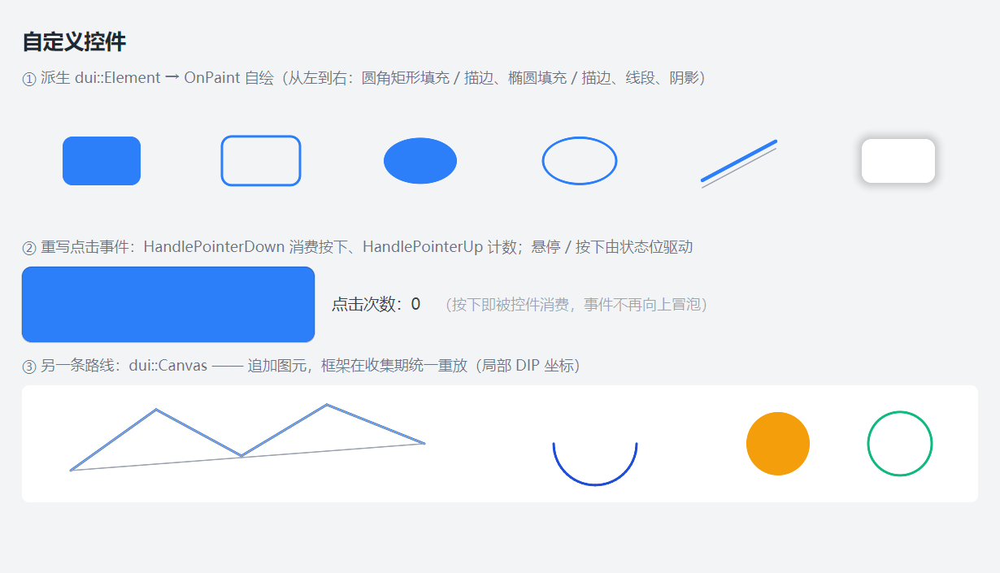

# DUI 自定义控件指南（CustomCtrl 开发者文档）

> 状态：**已实现** —— 派生 `dui::Element` + `OnPaint` 自绘 + `Handle*` 钩子重写交互。
> 可运行示例：`Samples/CustomCtrl`（ValueSlider）、`Samples/Canvas`（图元列表）；本文配图 `Doc/CustomCtrl/CTL-1.png`。
> 架构契约：[Arch/03-Style.md](./Arch/03-Style.md) §6.3（定制点 2）、[Arch/06-Events.md](./Arch/06-Events.md)、ADR-018。

---

## 1. 快速开始

最小可用控件（派生 + 自绘 + 点击）：

```cpp
class Badge final : public dui::Element {
public:
    void OnPaint(dui::graphics::Painter& p, const dui::StyleContext& ctx, float scale) override {
        const dui::Rect b = Bounds();
        p.FillRoundedRect(b, 6.f, dui::ResolveProperty(this, dui::Prop::Color, ctx).u, 1.f, scale);
    }

    bool HandlePointerDown(dui::PointerEvent&) override {
        return true;               // 消费这次按下（不再向上冒泡）
    }

protected:
    dui::Vec2 MeasureContent(const dui::StyleContext&, const dui::Vec2&) const override {
        return dui::Vec2{80.f, 24.f};
    }
};
```

挂载（样式必须是**最后一个**参数）：

```cpp
root->AddChild<Badge>(dui::Style().Color(0xFF2D7FF9));
```

三条主线：

| 要做的事 | 重写什么 |
| --- | --- |
| 画自己的外观 | `OnPaint`（§3） |
| 处理按下 / 拖拽 / 键盘 | `Handle*` 钩子（§4） |
| 决定内容尺寸 | `MeasureContent`（§2.2） |

### 1.1 跑一下



三段演示：① `OnPaint` 用六种绘图指令画的一排图元；② 重写点击事件的按钮（按下变深色，点击次数用小圆点表示）；③ `dui::Canvas` 的声明式图元。

---

## 2. 控件骨架

### 2.1 派生与挂载

- 从 `dui::Element` 派生；框架已有的 `dui::Panel`（容器）、`dui::Text`、`dui::Image` 等也可直接继承。
- 挂载用 `Panel::AddChild<T>(...)`，四种形态：`AddChild<T>()` / `AddChild<T>(const Style&)` / `AddChild<T>(const wchar_t*)` / `AddChild<T>(const wchar_t*, const Style&)`。
- 样式由控件**拷贝持有**，链式临时可直接传。

```cpp
dui::Panel* card = root->AddChild<dui::Panel>(dui::Style().Padding(12.f));
card->AddChild<Badge>(dui::Style().Color(0xFF2D7FF9));
```

### 2.2 自然尺寸（`MeasureContent`）

不设 `Width` / `Height` 时，元素尺寸由 `MeasureContent` 决定（protected 虚函数）：

```cpp
protected:
    dui::Vec2 MeasureContent(const dui::StyleContext& ctx, const dui::Vec2& contentAvail) const override;
```

- 返回**内容盒**尺寸（不含 padding / margin —— padding 由布局外加）。
- 基类默认 = 子项聚合（容器语义）；`dui::Text` 覆盖为排版占位。
- `contentAvail` 是本次可用空间，控件可据此自适应。

### 2.3 绘制顺序（你的 `OnPaint` 在哪一层）

```
阴影 → 背景填充 → 边框 → 元素自身内容（dui::Text 文本 / 你的 OnPaint）→ 子元素 → 脱离流子项
```

- `OnPaint` 在**背景之后、子元素之前** → 子元素会盖在你的自绘内容上。
- 想让自绘内容压在子元素之上，就别把子元素加到这个控件里。

### 2.4 刷新

| 方法 | 含义 |
| --- | --- |
| `InvalidatePaint()` | 只标 Paint 脏 → 只重绘、不重排（自绘控件改外观用这个） |
| `InvalidateLayout()` | 标 Layout 脏 → 重新 Measure / Arrange（尺寸变了用这个） |

⚠ 自绘控件改状态后必须自己调 `InvalidatePaint()`：框架的 `SetState` 只按**状态变体**的属性标脏，没有变体就不标脏（§4.7）。

### 2.5 读样式属性

自绘时取样式值（颜色、圆角、边框宽…）用 `ResolveProperty`：

```cpp
const dui::Color accent = dui::ResolveProperty(this, dui::Prop::Color, ctx).u;
const dui::CornerRadii radii =
    dui::ValueAsCornerRadii(dui::ResolveProperty(this, dui::Prop::CornerRadius, ctx));
```

- 带 `StyleContext` 的重载 → **继承属性已算好**（`Color`、`FontSize` 等）。
- `ValueAsThickness` / `ValueAsCornerRadii` 是 `UI/Style.h` 里的内联转换（`StyleValue` → 结构体）。

### 2.6 状态变体

```cpp
element->When(dui::State::Hover, dui::Style().Color(0xFF3B82F6));
```

状态变体是**立即生效的差异集**，**不带过渡**（要过渡用 `Animate`，见 [Animation.md](./Animation.md)）。级联优先级：动画值 > 状态变体 > 本地 `Set()` > 元素 Style。

---

## 3. 自绘：`OnPaint` 与绘图指令

### 3.1 签名与坐标系

```cpp
void OnPaint(dui::graphics::Painter& p, const StyleContext& ctx, float scale) override;
```

- **坐标是绝对布局坐标（DIP）**，不是元素局部坐标 —— 用 `Bounds()` 取自己的盒子。
- 滚动偏移由 Painter 的 origin 状态槽处理，**不要自己减滚动偏移**。
- `scale` 是 DPI 缩放：所有绘图指令的**最后一个参数**都是它（内部把 DIP 换成物理像素）。
- `ctx` 是继承后的样式上下文，用来 `ResolveProperty` 取样式值。

### 3.2 绘图指令清单

| 指令 | 签名（坐标与宽度都是 DIP） | 批 / 抗锯齿 |
| --- | --- | --- |
| 圆角矩形填充 | `FillRoundedRect(Rect, CornerRadii \| radiusDip, Color, opacity, scale)` | Rect 批（SDF + 1px 过渡带） |
| 圆角矩形描边 | `StrokeRoundRect(Rect, radiusDip, widthDip, Color, scale)` | Shape 批 kind=2 |
| 椭圆填充 | `FillEllipse(center, rxDip, ryDip, Color, scale)` | Shape 批 kind=1 |
| 椭圆描边 | `StrokeEllipse(center, rxDip, ryDip, widthDip, Color, scale)` | Shape 批 kind=1 |
| 线段 | `StrokeLine(p0, p1, Color, widthDip, scale)` | Shape 批 kind=0（胶囊 SDF，圆头端点） |
| 阴影 | `ShadowRoundRect(Rect, radiusDip \| CornerRadii, blurDip, Color, scale)` | Shape 批 kind=3（box-shadow 子集） |
| 图像 | `AddImageQuad(textureId, Rect, Color, scale)` | Image 批（纹理采样）—— 业务层拿不到纹理 id |
| 字形 | `AddGlyphQuad(page, x, y, w, h, u0, v0, u1, v1, Color)` | Glyph 批（图集 + 子像素 AA）—— 业务层不建议直接用 |

统一约定：

- **颜色是 `0xAARRGGBB`**（低字节 R、高字节 A）。
- **描边路径居中于描边带**：`StrokeRoundRect(r, radius, w)` 的线宽向内外各占一半，`radius` 是描边带**中心线**的圆角半径。
- **线宽最小 1 物理像素**（不足 1px 会抬到 1px），单位 DIP。
- `FillRoundedRect` 的 `opacity` 只乘本图元的 alpha（0..1）。
- 圆角半径传 0 就是直角矩形，不必额外分支。
- `StrokeLine` 的端点是**圆头**（胶囊 SDF），不是平头。

### 3.3 背景 / 边框不用自己画

`OnPaint` 只画**内容**；背景、圆角、边框、阴影由框架按样式画（`App/Frame.cpp` 的 `DrawBackground`）。自绘控件里设 `Style().Background(...)` 即可，**不要**在 `OnPaint` 里再画一遍背景。

### 3.4 画文字

业务层画文字的**正确做法**是加一个 `dui::Text` 子元素：

```cpp
label->AddChild<dui::Text>(L"12", dui::Style().FontSize(12.f).Color(0xFF111827));
```

原因：

- `AddGlyphQuad` 要**物理像素**坐标 + 字形图集页 id + 4 亚像素相位，这些是内部实现（`Graphics/TextEngine.h` 是内部头，不在 `DUI.h` 里）。
- `dui::Text` 自带排版、继承、`TextAlign`、省略号截断与基线对齐。

需要在自绘内容上"嵌"文字（如滑块上方的数值），把 `dui::Text` 作为子元素加进来再定位即可。

### 3.5 画图片

- 用 `dui::Image`（位图 / GIF）或 `dui::Svg`（矢量）控件 —— 它们自己实现了 `OnPaint`。
- `AddImageQuad` 需要内部纹理 id（`TextureStore`），业务层拿不到 → 不要直接用。

### 3.6 裁剪

自绘内容超出盒子时框架**不自动裁剪**（`Overflow` 默认 Visible，同 CSS）。需要裁剪就重写：

```cpp
protected:
    bool ContentClipRect(dui::Rect& out) const override {
        out = Bounds();        // 绝对 DIP
        return true;
    }
```

（`TextBox` / `RichEditor` 就是这么裁文本溢出的。）

---

## 4. 点击与指针事件

### 4.1 三种机制怎么选

| 机制 | 位置 | 适合 |
| --- | --- | --- |
| `HandlePointerDown/Move/Up` 钩子 | 派生类重写 | **控件自身行为**：按下高亮、拖拽、命中判定 |
| `OnClick` 绑定 | `OnClick(handler)` / `OnClick(ctx, &C::fn)` | 外部对控件的"点击"反应（业务回调） |
| `OnPointerDown/Up/Move/Enter/Leave`、`OnWheel` 绑定 | 同上 | 外部需要更细粒度的指针事件 |

关键区别：

- **钩子先于绑定执行**；钩子返回 true = 事件不再向上冒泡，**但同一元素上的绑定仍会收到**（能看到 `ev.handled`）。
- **Click 不经过 `Handle*` 钩子** —— Click 是框架在"同一元素上按下 + 抬起"后合成的独立事件，只走 `OnClick` 绑定。
- `Handle*` 钩子只在**冒泡阶段**执行（隧道阶段不执行）。

### 4.2 钩子清单

```cpp
bool HandlePointerDown(dui::PointerEvent&) override;   // 按下
bool HandlePointerMove(dui::PointerEvent&) override;   // 移动
bool HandlePointerUp(dui::PointerEvent&) override;     // 抬起
bool HandleKeyDown(dui::KeyEvent&) override;           // 键盘按下
bool HandleKeyUp(dui::KeyEvent&) override;             // 键盘抬起
bool HandleChar(dui::KeyEvent&) override;              // 字符输入
```

返回 `true` = 已消费（事件不再向上冒泡）；返回 `false` = 交给父级继续处理。

### 4.3 典型的"重写点击"：按下高亮 + 抬起计数

```cpp
bool HandlePointerDown(dui::PointerEvent&) override {
    down_ = true;
    InvalidatePaint();
    return true;                       // 消费：父级收不到这次按下
}

bool HandlePointerUp(dui::PointerEvent&) override {
    if (!down_) return false;
    down_ = false;
    ++clicks_;
    InvalidatePaint();
    if (onClicked_) onClicked_(clicks_);   // 结果交给外部（控件不耦合业务 UI）
    return true;
}
```

### 4.4 指针捕获（拖拽必备）

```cpp
bool HandlePointerDown(dui::PointerEvent&) override {
    SetCapture();      // 捕获：拖出控件边界仍能收到 Move / Up
    dragging_ = true;
    return true;
}

bool HandlePointerUp(dui::PointerEvent&) override {
    dragging_ = false;
    return true;       // 抬起时框架自动释放捕获
}
```

- `SetCapture()` / `ReleaseCapture()` / `HasCapture()`：捕获期间 Move / Up **不再做命中测试**，直达该元素（仍从它开始冒泡）。
- 捕获是**窗口级唯一**的；元素销毁时自动失效。

### 4.5 事件对象

```cpp
struct PointerEvent {
    dui::Element* source = nullptr;   // 当前收到事件的元素（冒泡中会变）
    dui::Vec2     pos{};               // 客户区绝对 DIP 坐标
    dui::PointerButton button = dui::PointerButton::None;   // 按下 / 抬起有效
    bool handled = false;             // 置 true 终止冒泡
};
```

- `pos` 是**客户区绝对坐标**，不是元素局部坐标 → 自己做命中判定要用 `pos - Bounds().x/y`。
- `WheelEvent` 多一个 `delta`（格数，+ 向上 / − 向下）与 `horizontal`；它的 `handled` 还能阻止滚动容器消费该次滚轮。
- `KeyEvent`：`key`（虚拟键码）/ `ch`（字符）/ `ctrl` / `shift` / `alt`。

### 4.6 阶段：Tunnel / Bubble

```cpp
element->OnClick(handler, dui::Phase::Tunnel);   // 隧道：根 → 命中元素
element->OnClick(handler);                       // 冒泡（默认）：命中元素 → 根
```

- `Phase::Tunnel` 先于 `Phase::Bubble` 执行，适合"父级先拦截"。
- 任一处理者置 `ev.handled = true` → 终止**其余全部**派发。
- `OnPointerEnter` / `OnPointerLeave` 是**直达事件**（悬停链差分驱动），没有阶段。

### 4.7 状态位：自动维护 vs 手动

`State` 共 8 个：`Hover / Pressed / Focused / Disabled / Selected / ReadOnly / Invalid / Open`。

| 状态 | 谁维护 |
| --- | --- |
| `Hover` | 框架：指针在元素上时，沿祖先链设置 |
| `Pressed` | 框架：按下时沿祖先链设置，抬起时清除 |
| `Focused` | 框架：焦点变化时设置 |
| 其余 5 个 | **业务自己** `SetState(State::Selected, true)` |

自绘控件读状态位换配色：

```cpp
const bool hover = HasState(dui::State::Hover);
```

⚠ 框架的 `SetState` 只按**状态变体**的属性标脏。自绘控件若靠状态位换外观，必须重写：

```cpp
void SetState(dui::State s, bool on) override {
    dui::Element::SetState(s, on);
    InvalidatePaint();          // 自绘控件必须显式刷新
}
```

### 4.8 自定义命中区域

命中测试是框架的自由函数（`dui::HitTest`），**纯矩形命中、不可重写**。自绘控件想要非矩形命中，两条路：

1. 把形状做成**子元素**（各自有自己的盒子，命中自然按子元素走）；
2. 在 `HandlePointerDown` 里**手工判定**（`ev.pos` 减 `Bounds()` 落在不在形状内），不在就 `return false` 让事件继续冒泡。

---

## 5. 完整示例：ValueSlider

`Samples/CustomCtrl` 的核心（可拖拽滑块）：

```cpp
class ValueSlider final : public dui::Element {
public:
    float Value() const noexcept { return value_; }

    void SetValue(float v) {
        const float nv = v < 0.f ? 0.f : (v > 1.f ? 1.f : v);
        if (nv == value_) return;
        value_ = nv;
        InvalidatePaint();          // 只标 Paint 脏：不触发 Measure / Arrange
        if (onChanged_) onChanged_(value_);
    }

    void OnChanged(std::function<void(float)> f) { onChanged_ = std::move(f); }

    void OnPaint(dui::graphics::Painter& p, const dui::StyleContext& ctx, float scale) override {
        const dui::Rect b = Bounds();   // 绝对布局坐标（DIP）
        const dui::Color accent = dui::ResolveProperty(this, dui::Prop::Color, ctx).u;
        const float x0 = b.x + 16.f;
        const float cy = b.y + b.h * 0.5f;
        const float span = b.w - 32.f;
        const float knobX = x0 + span * value_;

        p.FillRoundedRect(dui::Rect{x0, cy - 4.f, span, 8.f}, 4.f, 0xFFD4D4D4, 1.f, scale);
        p.FillRoundedRect(dui::Rect{x0, cy - 4.f, span * value_, 8.f}, 4.f, accent, 1.f, scale);
        for (int i = 0; i <= 4; ++i) {
            const float tx = x0 + span * static_cast<float>(i) / 4.f;
            p.StrokeLine(dui::Vec2{tx, cy + 12.f}, dui::Vec2{tx, cy + 18.f}, 0xFF999999, 1.f, scale);
        }
        p.FillEllipse(dui::Vec2{knobX, cy}, 11.f, 11.f, accent, scale);
        p.StrokeEllipse(dui::Vec2{knobX, cy}, 11.f, 11.f, 0xFFFFFFFF, 2.f, scale);
    }

    bool HandlePointerDown(dui::PointerEvent& ev) override {
        dragging_ = true;
        SetCapture();               // 拖出控件边界仍能收到 Move / Up
        SetValueAt(ev.pos.x);
        return true;
    }
    bool HandlePointerMove(dui::PointerEvent& ev) override {
        if (!dragging_) return false;
        SetValueAt(ev.pos.x);
        return true;
    }
    bool HandlePointerUp(dui::PointerEvent&) override {
        if (!dragging_) return false;
        dragging_ = false;          // 捕获由框架在抬起时自动释放
        return true;
    }

protected:
    dui::Vec2 MeasureContent(const dui::StyleContext&, const dui::Vec2&) const override {
        return dui::Vec2{280.f, 56.f};
    }

private:
    void SetValueAt(float x) {
        const dui::Rect b = Bounds();
        SetValue((x - (b.x + 16.f)) / (b.w - 32.f));
    }

    float value_ = 0.35f;
    bool dragging_ = false;
    std::function<void(float)> onChanged_;
};
```

---

## 6. 另一条路线：`dui::Canvas`

`dui::Canvas` 是**声明式图元列表**：业务追加图元，框架在收集期统一重放（它自己也是 `OnPaint` 的实现）。适合"画一张静态矢量图"，不适合每帧按状态重算。

### 6.1 图元 API

| 方法 | 说明 |
| --- | --- |
| `AddLine(p0, p1, color, width)` | 直线 |
| `AddPolyline(points, count, color, width)` | 折线（**不闭合**） |
| `AddPolygon(points, count, color, width)` | 多边形（闭合**描边**；不支持填充） |
| `AddRect(r, color)` / `AddRectOutline(r, color, width)` | 矩形填充 / 描边 |
| `AddRoundRect(r, radius, color)` / `AddRoundRectOutline(r, radius, color, width)` | 圆角矩形填充 / 描边 |
| `AddEllipse(center, rx, ry, color)` / `AddEllipseOutline(...)` | 椭圆填充 / 描边 |
| `AddCircle(center, r, color)` / `AddCircleOutline(center, r, color, width)` | 圆填充 / 描边 |
| `AddArc(center, r, startDeg, endDeg, color, width)` | 圆弧（按 6° 一段折线化） |
| `Clear()` | 清空图元 |
| `Items()` | 只读图元列表 |

### 6.2 坐标与取舍

- 坐标是**画布局部 DIP**，原点 = 画布左上角（与 `OnPaint` 里的 `Bounds()` 语义不同）。
- Canvas 既可纯作绘图表面，也可当**容器**放子元素（`Canvas : public Panel`）。
- 改图元后要 `Clear()` + 重新 `AddXxx()`（内部会标脏重绘）。
- **取舍**：`Canvas` 适合一次画好的矢量图；需要每帧按状态重画、或需要交互命中 → 派生 `Element` + `OnPaint`。

---

## 7. 已知边界与坑

1. **`OnPaint` 的坐标是绝对布局坐标**（不是元素局部）—— 用 `Bounds()`；滚动偏移别自己减。
2. **`AddChild<T>` 的样式参数必须最后**。
3. **`Handle*` 钩子不参与 Click 派发**，也不参与隧道阶段。
4. **`SetState` 同值幂等**，没有状态变体时不标脏 → 自绘控件要自己 `InvalidatePaint()`。
5. **命中测试不可重写**（纯矩形）→ 自定义命中区域靠子元素或手工判定。
6. **`OnClick` 等绑定当前不返回 `Element&`**（链式未落地），别按链式写。
7. **没有 `FillRect`**：用 `FillRoundedRect(r, 0.f, ...)`。
8. **多边形填充不支持**（Canvas 与 Painter 都没有）→ 需要填充多边形得自己拆成圆角矩形 / 三角形拼。
9. **文字不要自己上 `AddGlyphQuad`**（要物理像素坐标 + 图集页 + 亚像素相位，且 `TextEngine.h` 是内部头）→ 用 `dui::Text` 子元素。
10. **`Style::FontFamily` 只存指针不拷字符串**（见 [Font.md](./Font.md) §2.2）。
11. `OnPaint` 在子元素**之前**执行 → 子元素盖在自绘内容上。

---

## 8. API 速查

```cpp
// 派生自定义控件
class MyCtrl final : public dui::Element {
public:
    void OnPaint(dui::graphics::Painter& p, const dui::StyleContext& ctx, float scale) override;
    bool HandlePointerDown(dui::PointerEvent& ev) override;
    bool HandlePointerMove(dui::PointerEvent& ev) override;
    bool HandlePointerUp(dui::PointerEvent& ev) override;
    bool HandleKeyDown(dui::KeyEvent& ev) override;
    void SetState(dui::State s, bool on) override;
protected:
    dui::Vec2 MeasureContent(const dui::StyleContext& ctx, const dui::Vec2& avail) const override;
    bool ContentClipRect(dui::Rect& out) const override;
};

// 绘图指令（DIP 坐标 + 末尾 scale）
p.FillRoundedRect(rect, radii, color, opacity, scale);
p.StrokeRoundRect(rect, radii, widthDip, color, scale);
p.FillEllipse(center, rx, ry, color, scale);
p.StrokeEllipse(center, rx, ry, widthDip, color, scale);
p.StrokeLine(p0, p1, color, widthDip, scale);
p.ShadowRoundRect(rect, radius, blurDip, color, scale);

// 其它
element->InvalidatePaint();       // 只重绘
element->InvalidateLayout();      // 重排
element->SetCapture();            // 指针捕获
element->When(dui::State::Hover, style);
dui::ResolveProperty(element, dui::Prop::Color, ctx);
```

---

## 9. 相关文档

- [Styles.md](./Styles.md) —— 样式、状态变体、级联
- [Animation.md](./Animation.md) —— 命令式属性动画（状态变体不带过渡）
- [Layout.md](./Layout.md) —— 布局与盒模型
- [Event.md](./Event.md) —— 事件系统与派发
- [Font.md](./Font.md) —— 字体与图标（含 `dui::Icon`）
- `Samples/CustomCtrl` / `Samples/Canvas` —— 可运行示例
