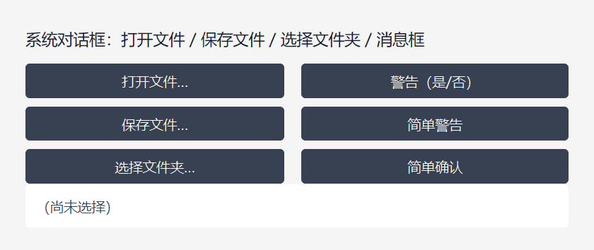

# DUI 对话框使用指南（Dialog 开发者文档）

> 状态：**v1.0 — 已实现**（2026-11-07），Debug/Release x64 编译通过。
> 四种系统对话框：打开文件、保存文件、选择文件夹、消息框；另有两个便捷糖 `Warn` / `Confirm`。
> 对话框由 Windows 提供（Common Item Dialog / `MessageBoxW`），DPI 自动适配，**无需任何初始化**。
> 设计、分层与取舍见 [Arch/17-Dialogs.md](Arch/17-Dialogs.md)；调用契约速查见 [Arch/Dialogs.md](Arch/Dialogs.md)。

---

## 1. 快速开始

### 1.1 一句话

在 `dui::Window` 派生类里直接调成员方法，同步拿到结果：

```cpp
auto files   = OpenFile(...);     // 打开文件（可多选）→ DialogResult<std::vector<String>>
auto target  = SaveFile(...);     // 保存文件          → DialogResult<String>
auto folder  = OpenFolder(...);   // 选择文件夹        → DialogResult<String>
auto clicked = MessageBox(...);   // 消息/警告         → MessageResult
```

只返回**路径**和**用户按了哪个按钮**，不替你读写文件 —— 保存对话框也**不会创建文件**。

### 1.2 四种对话框一览

| 能力 | 方法 | 返回 | 系统窗口 |
| --- | --- | --- | --- |
| 打开文件 | `OpenFile(OpenFileOptions)` | `DialogResult<std::vector<String>>` | 打开文件 |
| 保存文件 | `SaveFile(SaveFileOptions)` | `DialogResult<String>` | 另存为 |
| 选择文件夹 | `OpenFolder(OpenFolderOptions)` | `DialogResult<String>` | 浏览文件夹 |
| 消息框 | `MessageBox(MessageOptions)` | `MessageResult` | 消息框 |
| 便捷警告 | `Warn(text, title = nullptr)` | `MessageResult` | 警告图标 + 确定 |
| 便捷确认 | `Confirm(text, title = nullptr)` | `bool` | 问号图标 + 是/否 |



---

## 2. 文件类对话框

三个文件类对话框共用同一套底层实现（`IFileDialog`），差别只在**强制选项**上。对话框是 **Windows 原生 Common Item Dialog**，由系统绘制 —— 框架不自定义外观、不接管绘制，换系统主题就跟着换；DPI 由系统按 Per-Monitor V2 自动缩放，无需任何额外代码。

| 模式 | 框架强制的系统选项 | 含义 |
| --- | --- | --- |
| 打开 | `FOS_FILEMUSTEXIST` | 选中的文件**必须已存在** |
| 打开（多选） | `+ FOS_ALLOWMULTISELECT` | 允许 Ctrl / Shift 多选 |
| 保存 | `FOS_OVERWRITEPROMPT` | 覆盖已有文件由**系统**弹确认 |
| 文件夹 | `FOS_PICKFOLDERS` | 只能选目录 |
| 全部 | `FOS_FORCEFILESYSTEM` `FOS_PATHMUSTEXIST` | **只返回文件系统路径**（见 §8） |

### 2.1 打开文件

```cpp
auto r = OpenFile(dui::OpenFileOptions{
    .title        = L"选择文件",
    .filters      = kFilters,
    .filterIndex  = 0,          // 0-based
    .multiSelect  = true,
});
if (r.IsOk()) {
    for (const dui::String& p : r.Value()) { /* 选中路径 */ }
}
```

- 单选时 `Value()` 只有一个元素，取 `Value()[0]` 即可。
- 多选时按**系统返回顺序**排列，不是点击顺序。
- 打开模式强制"文件必须存在"，所以不会出现"选了一个不存在的文件"。
- 对话框右下角是**过滤器下拉**，`filterIndex = 0` 表示默认选中第一项（如「文本文件 (*.txt;*.md)」）。

### 2.2 保存文件

```cpp
auto r = SaveFile(dui::SaveFileOptions{
    .title            = L"保存为",
    .filters          = kFilters,
    .defaultExtension = L"txt",   // 不带点
});
if (r.IsOk()) {
    const dui::String& target = r.Value();   // 目标路径，框架不创建文件
}
```

- `defaultExtension` 在用户没填扩展名时由系统补上（`L"txt"`，**不带点**）。
- **框架不写文件、不创建文件** —— 拿到路径后由业务自己写。
- 覆盖已有文件的确认由系统弹出；在"另存为"里点"否"（不覆盖）会被系统内部消化，**不会**变成框架的 `Cancelled`。
- 对话框底部是「文件名(N)」+「保存类型(T)」，后者就是过滤器下拉。

### 2.3 选择文件夹

```cpp
auto r = OpenFolder(dui::OpenFolderOptions{ .title = L"选择目录" });
if (r.IsOk()) { /* r.Value() 是目录绝对路径 */ }
```

一期**单选**。目录模式不提供过滤器。对话框底部是「文件夹:」而不是「文件名」—— 这是 `FOS_PICKFOLDERS` 的效果。

### 2.4 文件类型过滤器

```cpp
struct dui::FileTypeFilter { const wchar_t* name; const wchar_t* pattern; };

// 多个扩展名用 ';' 分隔
static constexpr dui::FileTypeFilter kFilters[] = {
    { L"文本文件", L"*.txt;*.md" },
    { L"图片文件", L"*.png;*.jpg;*.gif" },
    { L"所有文件", L"*.*" },
};
```

`filters` 的类型是 `std::span<const FileTypeFilter>`，**数组 / `std::array` / `std::vector` 都可以直接传**（C++20，无需再传 `filterCount`）：

```cpp
auto r = OpenFile(dui::OpenFileOptions{ .filters = kFilters });   // ✅
auto r = OpenFile(dui::OpenFileOptions{ .filters = { {L"文本", L"*.txt"} } });  // ❌ 编译不过
```

`std::span` 没有从花括号列表直接构造的推导路径，且临时量生命周期易踩坑 —— **先声明具名数组 / `std::array`**。

- `filterIndex` 是 **0-based** 的默认选中项；越界会被钳到 0。
- `filters` 为空 = 不设过滤器（系统显示"所有文件"）。

---

## 3. 消息框

### 3.1 `MessageBox`

`defaultButton = 2` 让「否(N)」成为默认按钮（带焦点框）—— 危险操作用它防误触。

```cpp
auto r = MessageBox(dui::MessageOptions{
    .text          = L"确定要删除所选内容吗？",
    .title         = L"警告",
    .icon          = dui::MessageIcon::Warning,
    .buttons       = dui::MessageButtons::YesNo,
    .defaultButton = 2,          // 默认「否」，防误触
});
if (r == dui::MessageResult::Yes) { /* 用户点了「是」 */ }
```

| 字段 | 取值 | 默认 | 说明 |
| --- | --- | --- | --- |
| `text` | 字符串 | `L""` | 正文，支持 `L"\n"` 换行 |
| `title` | 字符串 | `nullptr` | 标题；见下方"标题回退" |
| `icon` | `None` / `Information` / `Warning` / `Error` / `Question` | `Warning` | 图标 |
| `buttons` | `Ok` / `OkCancel` / `YesNo` / `YesNoCancel` / `RetryCancel` / `AbortRetryIgnore` / `CancelRetryContinue` | `Ok` | 按钮组 |
| `defaultButton` | 1..4 | `1` | 默认按钮，从左往右数；越界钳到 1 |

> **标题回退**：`Window::MessageBox` 的 `title` 为空时 → 用**窗口标题** → 窗口标题也为空时用 `L"提示"`。
> 自由函数 `dui::ShowMessageBox` 不做这层回退（空标题就是空标题）。

### 3.2 便捷糖：`Warn` / `Confirm`

```cpp
Warn(L"操作已完成。");                      // 警告图标 + 确定
if (Confirm(L"要继续吗？")) { /* 是 */ }     // 问号图标 + 是/否 → bool
```

两个都是 `Window` 成员方法，第二个参数是可选标题。

---

## 4. 结果：三态与按钮

### 4.1 `DialogResult<T>` —— 文件类对话框

```cpp
auto r = OpenFile(opt);
if (r.IsCancelled()) { /* 用户点了取消/关闭：不是错误，通常直接 return */ }
if (r.IsError())    { result_->SetText(r.Error()); }   // 失败原因（含 HRESULT）
if (r.IsOk())       { /* 用 r.Value() */ }
```

| 结果 | `IsOk` | `IsCancelled` | `IsError` | `Value()` | `Error()` |
| --- | --- | --- | --- | --- | --- |
| 确认选择 | ✔ | | | 路径列表 / 路径 | 空串 |
| 取消 / 关闭 | | ✔ | | 空 | 空串 |
| 系统错误 | | | ✔ | 空 | `L"… (HRESULT 0x80040154)"` 等 |

- 也可以用 `Status()` 做 `switch`：`DialogStatus::Ok` / `Cancelled` / `Error`。
- `DialogResult` 带 `[[nodiscard]]` —— 忘了检查返回值会有编译警告。
- 默认构造的状态是 `Error`（无消息），与 `Core::Result<T>` 的"默认失败"风格一致。

### 4.2 `MessageResult` —— 消息框

直接比较枚举即可：

```
Failed / Ok / Cancel / Yes / No / Retry / Abort / Ignore / TryAgain / Continue
```

注意 **`Cancel` 是"用户按了取消按钮"，不是"调用失败"**；调用失败是 `Failed`。

---

## 5. 使用约束

### 5.1 线程与时机

1. **只在 UI 线程调用** —— `OnCreate()`、`OnClick` 等事件回调里。协程中须先 `co_await dui::Foreground()` 切回 UI 线程；后台线程直接调用不在支持范围。
2. **必须在 `Application::Run` 建好 HWND 之后** —— 构造了 `Window` 但还没 `Run` 时调用，`OpenFile` / `SaveFile` / `OpenFolder` 返回 `Error`（文本：`窗口尚未创建（需在 Application::Run 之后调用）`），`MessageBox` 返回 `Failed`。
3. `OnCreate()` 里 HWND 已建但窗口尚未显示，此时弹窗会挡住首帧显示 —— **允许但不推荐**。
4. **UI 线程必须是 STA** —— `Application::Run` 内部用 `OleInitialize` 建立 STA，业务不需要初始化 COM。若自建宿主，必须自己 `OleInitialize`；否则文件类对话框会返回：
   - `文件对话框需要 STA 单元（UI 线程 COM 已被初始化为 MTA）`，或
   - `文件对话框需要 STA 单元（UI 线程 COM 单元异常）`

   （MTA 下 `IFileDialog::Show` 会在创建窗口前**死锁**，框架提前检测并明确报错，而不是把界面挂死。）

### 5.2 同步阻塞

函数返回 = 对话框已关闭，无需回调。期间**框架主消息循环挂起**：

- 界面不刷新，动画 / GIF / 光标闪烁停摆；
- 后台任务的 `PostUi` 回投**延后**到关闭后执行（**不会丢**）；
- 不要在此期间依赖持续 UI 更新。

### 5.3 字符串与生命周期

- 一律 **UTF-16**（`dui::String` / `const wchar_t*` / `L"..."`），中文路径直接可用；返回的也是**绝对路径**。
- `title` / `initialPath` / `defaultExtension` / `filters[].name|pattern` 只需在**调用期间**有效，框架不长期持有。
- `filters` 是 `std::span` 视图 —— 底层数组必须活到调用返回。用字面量或 `static` / 具名数组，别把即将销毁的 `String::c_str()` 传进去。

### 5.4 DPI 与所有权

- 系统对话框由 Per-Monitor V2 自动缩放，框架不传坐标、不做换算 —— **无需为高 DPI 写任何额外代码**。
- owner 窗口由框架内部取：系统会自动禁用宿主窗口并在关闭后恢复；**不传、也不能传**自定义 HWND。

### 5.5 `MessageBox` 与 Win32 宏

`winuser.h` 在 UNICODE 下把 `MessageBox` 定义成 `MessageBoxW` 宏，与成员方法同名。框架在公共头里 `#undef MessageBox` 并额外提供兼容别名，因此：

- **先 `#include <windows.h>`，再 `#include "DUI/DUI.h"`**（与现有全部示例一致）；
- 包含 `DUI.h` 之后若要调 Win32 原生弹窗，用显式 `::MessageBoxW(...)`，别写 `MessageBox(...)`；
- 万一 `windows.h` 在 `DUI.h` 之后才包含导致宏重新生效，调用会被替换成 `MessageBoxW(...)`，由框架的兼容别名 `Window::MessageBoxW` 接住，行为不变（**业务不要主动调用它**）。

---

## 6. 常见情形对照

| 需求 | 写法 |
| --- | --- |
| 只选一个图片 | `static constexpr dui::FileTypeFilter kImg[] = {{L"图片", L"*.png;*.jpg"}};` → `OpenFile({.filters = kImg})` → `r.Value()[0]` |
| 记住上次目录 | 业务自己保存上次返回的目录，下次填 `initialPath` |
| 另存为并补扩展名 | `SaveFile({.filters = kFilters, .defaultExtension = L"txt"})`；**写文件由业务自己做** |
| 让用户确认危险操作 | `MessageIcon::Warning` + `MessageButtons::YesNo` + `defaultButton = 2` |
| 仅通知，无需选择 | `Warn(L"操作已完成。")` |
| 失败原因给用户看 | `if (r.IsError()) Warn(r.Error().c_str());` |
| 初始路径可能不存在 | 直接传；框架忽略无效的 `initialPath`，退回系统默认位置 |
| 用户取消时的正确处理 | `if (r.IsCancelled()) return;` —— 取消**不是错误**，别弹错误框 |

---

## 7. API 速查

### 7.1 `Window` 成员方法

| 方法 | 参数 | 返回 |
| --- | --- | --- |
| `OpenFile(const OpenFileOptions& = {})` | 见 §2 | `DialogResult<std::vector<String>>` |
| `SaveFile(const SaveFileOptions& = {})` | 见 §2 | `DialogResult<String>` |
| `OpenFolder(const OpenFolderOptions& = {})` | 见 §2 | `DialogResult<String>` |
| `MessageBox(const MessageOptions&)` | 见 §3 | `MessageResult` |
| `Warn(const wchar_t* text, const wchar_t* title = nullptr)` | | `MessageResult` |
| `Confirm(const wchar_t* text, const wchar_t* title = nullptr)` | | `bool` |
| `MessageBoxW(const MessageOptions&)` | | Win32 宏兼容别名，**业务不要主动调用** |

### 7.2 自由函数（自带 owner）

需要跨窗口调用、或 owner 不是 `Window` 时可用。`owner` 传 `HWND`（`void*`），传 `nullptr` 直接得到失败语义的结果。

| 函数 | 返回 |
| --- | --- |
| `dui::PickFiles(void* owner, const OpenFileOptions&)` | `DialogResult<std::vector<String>>` |
| `dui::SaveFile(void* owner, const SaveFileOptions&)` | `DialogResult<String>` |
| `dui::PickFolder(void* owner, const OpenFolderOptions&)` | `DialogResult<String>` |
| `dui::ShowMessageBox(void* owner, const MessageOptions&)` | `MessageResult` |

> 成员方法只是薄封装：取 owner 句柄 + 维护"弹窗深度计数"（弹窗期间宿主失活不清编辑控件焦点）。自由函数**不做**深度计数。

### 7.3 选项字段

| 结构 | 字段 | 默认 | 语义 |
| --- | --- | --- | --- |
| `OpenFileOptions` | `title` | `nullptr` | 对话框标题；空 = 系统默认「打开」 |
| | `initialPath` | `nullptr` | 初始目录，或含文件名的完整路径（预填文件名）；**无效路径被忽略** |
| | `filters` | `{}` | `std::span<const FileTypeFilter>`；空 = 所有文件 |
| | `filterIndex` | `0` | **0-based** 默认选中项；越界钳到 0 |
| | `multiSelect` | `false` | 允许 Ctrl/Shift 多选 |
| `SaveFileOptions` | `title` | `nullptr` | 空 = 系统默认「另存为」 |
| | `initialPath` | `nullptr` | 初始目录或建议的完整文件名 |
| | `filters` / `filterIndex` | `{}` / `0` | 同上 |
| | `defaultExtension` | `nullptr` | `L"txt"`（**不带点**）；用户没填扩展名时系统补 |
| `OpenFolderOptions` | `title` / `initialPath` | `nullptr` | 同上 |
| `MessageOptions` | `text` | `L""` | 正文，支持 `L"\n"` 换行 |
| | `title` | `nullptr` | 空 = 窗口标题（仅成员方法）；窗口标题也为空时 `L"提示"` |
| | `icon` | `Warning` | 见 §3.1 |
| | `buttons` | `Ok` | 见 §3.1 |
| | `defaultButton` | `1` | 1..4，从左往右；越界钳到 1 |

---

## 8. 已知限制与坑

1. **只返回文件系统路径**。框架强制 `FOS_FORCEFILESYSTEM`，选中「此电脑」里的库、虚拟 Shell 项等拿不到路径，会被跳过；一个都没取到时按失败报 `未取得文件路径`。
2. **不读写文件**。保存对话框返回后文件并不存在 —— 框架只给路径。
3. **UI 线程必须 STA**（§5.1 第 4 条）。`Application::Run` 已处理好；自建宿主要自己 `OleInitialize`。
4. **弹窗期间 UI 停摆**（§5.2）—— 系统模态泵接管了主循环，进度条不动、动画停是预期行为。
5. **取消 ≠ 错误**。`Cancelled` 表示用户主动关闭，别弹错误提示。
6. **打开模式选不到不存在的文件**（强制 `FOS_FILEMUSTEXIST`）。
7. **弹窗期间的焦点**：框架用"弹窗深度计数"抑制宿主失活时清掉编辑控件焦点（避免回来后光标丢失）；自定义宿主没有这层保护。
8. `initialPath` 无效时**静默忽略**，退回系统默认位置，不报错。

---

## 9. 相关文档

- [Arch/17-Dialogs.md](Arch/17-Dialogs.md) —— 分层、实现规格、里程碑与验收、决策记录。
- [Arch/Dialogs.md](Arch/Dialogs.md) —— 调用契约速查（选项字段、错误语义、宏兼容守卫）。
- [Arch/Pitfalls.md](Arch/Pitfalls.md) —— §1.7 系统模态循环、§1.8 失活与焦点、§4 链接库惯例。
- [Arch/07-Threading.md](Arch/07-Threading.md) —— UI 单线程与 `PostUi` 回投。
- [Event.md](Event.md) —— 事件绑定与 `handled` 拦截（对话框是同步的，不走事件系统）。
- [Menu.md](Menu.md) —— 系统原生弹出菜单，与对话框同属"窗口模态"（同步阻塞、弹窗深度计数）。
