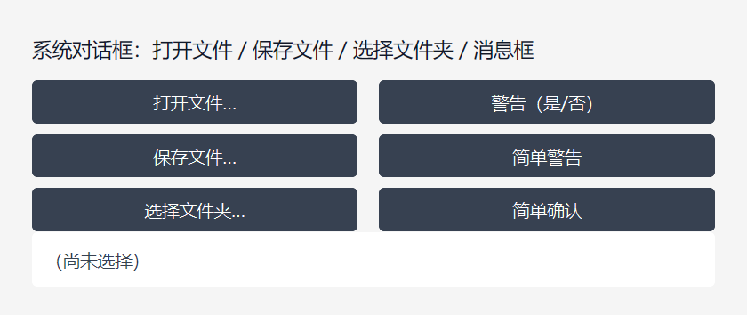

# DUI 对话框使用指南（Dialog 开发者文档）

## 1. 快速开始

在 `dui::Window` 派生类里直接调成员方法，同步拿到结果：

```cpp
auto files   = OpenFile(...);     // 打开文件（可多选）→ DialogResult<std::vector<String>>
auto target  = SaveFile(...);     // 保存文件          → DialogResult<String>
auto folder  = OpenFolder(...);   // 选择文件夹        → DialogResult<String>
auto clicked = MessageBox(...);   // 消息/警告         → MessageResult
```

只返回**路径**和**用户按了哪个按钮**，不替你读写文件 —— 保存对话框也**不会创建文件**。

| 能力       | 方法                             | 返回                                |
| ---------- | -------------------------------- | ----------------------------------- |
| 打开文件   | `OpenFile(OpenFileOptions)`      | `DialogResult<std::vector<String>>` |
| 保存文件   | `SaveFile(SaveFileOptions)`      | `DialogResult<String>`              |
| 选择文件夹 | `OpenFolder(OpenFolderOptions)`  | `DialogResult<String>`              |
| 消息框     | `MessageBox(MessageOptions)`     | `MessageResult`                     |
| 便捷警告   | `Warn(text, title = nullptr)`    | `MessageResult`                     |
| 便捷确认   | `Confirm(text, title = nullptr)` | `bool`                              |



---

## 2. 文件类对话框

三个文件类对话框共用同一套底层实现，差别只在**强制选项**上。对话框是 **Windows 原生 Common Item Dialog**，由系统绘制，DPI 由系统按 Per-Monitor V2 自动缩放。

| 模式         | 框架强制的系统选项                        | 含义                         |
| ------------ | ----------------------------------------- | ---------------------------- |
| 打开         | `FOS_FILEMUSTEXIST`                       | 选中的文件**必须已存在**     |
| 打开（多选） | `+ FOS_ALLOWMULTISELECT`                  | 允许 Ctrl / Shift 多选       |
| 保存         | `FOS_OVERWRITEPROMPT`                     | 覆盖已有文件由**系统**弹确认 |
| 文件夹       | `FOS_PICKFOLDERS`                         | 只能选目录                   |
| 全部         | `FOS_FORCEFILESYSTEM` `FOS_PATHMUSTEXIST` | **只返回文件系统路径**       |

### 2.1 打开文件

```cpp
auto r = OpenFile(dui::OpenFileOptions{
    .title        = L"选择文件",
    .filters      = kFilters,
    .filterIndex  = 0,          // 0-based
    .multiSelect  = true,
});
if (r.IsOk()) {
    for (const dui::String& p : r.Value()) { /* 选中路径 */ }
}
```

- 单选时 `Value()` 只有一个元素，取 `Value()[0]` 即可。
- 多选时按**系统返回顺序**排列，不是点击顺序。
- 对话框右下角是**过滤器下拉**，`filterIndex = 0` 表示默认选中第一项。

### 2.2 保存文件

```cpp
auto r = SaveFile(dui::SaveFileOptions{
    .title            = L"保存为",
    .filters          = kFilters,
    .defaultExtension = L"txt",   // 不带点
});
if (r.IsOk()) {
    const dui::String& target = r.Value();   // 目标路径，框架不创建文件
}
```

- `defaultExtension` 在用户没填扩展名时由系统补上（**不带点**）。
- **框架不写文件、不创建文件** —— 拿到路径后由业务自己写。
- 覆盖已有文件的确认由系统弹出；在"另存为"里点"否"（不覆盖）会被系统内部消化，**不会**变成框架的 `Cancelled`。

### 2.3 选择文件夹

```cpp
auto r = OpenFolder(dui::OpenFolderOptions{ .title = L"选择目录" });
if (r.IsOk()) { /* r.Value() 是目录绝对路径 */ }
```

一期**单选**，不提供过滤器。

### 2.4 文件类型过滤器

```cpp
struct dui::FileTypeFilter { const wchar_t* name; const wchar_t* pattern; };

// 多个扩展名用 ';' 分隔
static constexpr dui::FileTypeFilter kFilters[] = {
    { L"文本文件", L"*.txt;*.md" },
    { L"图片文件", L"*.png;*.jpg;*.gif" },
    { L"所有文件", L"*.*" },
};
```

`filters` 的类型是 `std::span<const FileTypeFilter>`，**数组 / `std::array` / `std::vector` 都可以直接传**（C++20，无需再传 `filterCount`）：

```cpp
auto r = OpenFile(dui::OpenFileOptions{ .filters = kFilters });   // ✅
auto r = OpenFile(dui::OpenFileOptions{ .filters = { {L"文本", L"*.txt"} } });  // ❌ 编译不过
```

`std::span` 没有从花括号列表直接构造的推导路径，且临时量生命周期易踩坑 —— **先声明具名数组 / `std::array`**。

- `filterIndex` 是 **0-based** 的默认选中项；越界会被钳到 0。
- `filters` 为空 = 不设过滤器（系统显示"所有文件"）。

---

## 3. 消息框

### 3.1 `MessageBox`

`defaultButton = 2` 让「否(N)」成为默认按钮（带焦点框）—— 危险操作用它防误触。

```cpp
auto r = MessageBox(dui::MessageOptions{
    .text          = L"确定要删除所选内容吗？",
    .title         = L"警告",
    .icon          = dui::MessageIcon::Warning,
    .buttons       = dui::MessageButtons::YesNo,
    .defaultButton = 2,          // 默认「否」，防误触
});
if (r == dui::MessageResult::Yes) { /* 用户点了「是」 */ }
```

| 字段            | 取值                                                                                                     | 默认      | 说明                                                   |
| --------------- | -------------------------------------------------------------------------------------------------------- | --------- | ------------------------------------------------------ |
| `text`          | 字符串                                                                                                   | `L""`     | 正文，支持 `L"\n"` 换行                                |
| `title`         | 字符串                                                                                                   | `nullptr` | 标题；空时用**窗口标题**，窗口标题也为空时用 `L"提示"` |
| `icon`          | `None` / `Information` / `Warning` / `Error` / `Question`                                                | `Warning` | 图标                                                   |
| `buttons`       | `Ok` / `OkCancel` / `YesNo` / `YesNoCancel` / `RetryCancel` / `AbortRetryIgnore` / `CancelRetryContinue` | `Ok`      | 按钮组                                                 |
| `defaultButton` | 1..4                                                                                                     | `1`       | 默认按钮，从左往右数；越界钳到 1                       |

### 3.2 便捷糖：`Warn` / `Confirm`

```cpp
Warn(L"操作已完成。");                      // 警告图标 + 确定
if (Confirm(L"要继续吗？")) { /* 是 */ }     // 问号图标 + 是/否 → bool
```

两个都是 `Window` 成员方法，第二个参数是可选标题。

---

## 4. 结果：三态与按钮

### 4.1 `DialogResult<T>` —— 文件类对话框

```cpp
auto r = OpenFile(opt);
if (r.IsCancelled()) { /* 用户点了取消/关闭：不是错误，通常直接 return */ }
if (r.IsError())    { result_->SetText(r.Error()); }   // 失败原因（含 HRESULT）
if (r.IsOk())       { /* 用 r.Value() */ }
```

| 结果        | `IsOk` | `IsCancelled` | `IsError` | `Value()`       | `Error()`                      |
| ----------- | ------ | ------------- | --------- | --------------- | ------------------------------ |
| 确认选择    | ✔      |               |           | 路径列表 / 路径 | 空串                           |
| 取消 / 关闭 |        | ✔             |           | 空              | 空串                           |
| 系统错误    |        |               | ✔         | 空              | `L"… (HRESULT 0x80040154)"` 等 |

- 也可以用 `Status()` 做 `switch`：`DialogStatus::Ok` / `Cancelled` / `Error`。
- `DialogResult` 带 `[[nodiscard]]` —— 忘了检查返回值会有编译警告。

### 4.2 `MessageResult` —— 消息框

直接比较枚举即可：

```
Failed / Ok / Cancel / Yes / No / Retry / Abort / Ignore / TryAgain / Continue
```

注意 **`Cancel` 是"用户按了取消按钮"，不是"调用失败"**；调用失败是 `Failed`。

---

## 5. 使用约束

- **只在 UI 线程调用**（`OnCreate()`、`OnClick` 等事件回调里）。协程中须先 `co_await dui::Foreground()`。
- **必须在 `App::AddWindow()` 建好 HWND 之后**：只构造了 `Window` 还没交给 `App` 时调用 → 文件类对话框返回 `Error`，`MessageBox` 返回 `Failed`（单窗口写法 `App::Run(window)` 会先自动 `AddWindow`）。
- **UI 线程必须是 STA**：`App::Run` 内部已 `OleInitialize`；自建宿主若直接调用自由函数，框架自身会 `CoInitializeEx(STA)`，**未初始化 COM 也能工作**；但若 UI 线程已被初始化为 **MTA**，文件对话框返回明确错误（框架提前检测，不会死锁）。
- **同步阻塞**：函数返回 = 对话框已关闭。期间框架主消息循环挂起（界面不刷新、动画停摆），后台任务的 `PostUi` 回投**延后**到关闭后执行（不会丢）。
- **字符串一律 UTF-16**（`dui::String` / `const wchar_t*` / `L"..."`），中文路径直接可用；返回的是**绝对路径**。
- `title` / `initialPath` / `defaultExtension` / `filters[].name|pattern` 只需在**调用期间**有效。`filters` 是 `std::span` 视图 —— 底层数组必须活到调用返回，别把即将销毁的 `String::c_str()` 传进去。
- **DPI 不用管**：系统对话框按 Per-Monitor V2 自动缩放，框架不传坐标、不做换算。
- **owner 不用管**：由框架内部取，系统会自动禁用宿主窗口并在关闭后恢复。
- **`MessageBox` 与 Win32 宏**：先 `#include <windows.h>` 再 `#include "DUI/DUI.h"`；包含 `DUI.h` 之后要调 Win32 原生弹窗请写显式的 `::MessageBoxW(...)`。

---

## 6. 常见情形对照

| 需求                 | 写法                                                                                                                          |
| -------------------- | ----------------------------------------------------------------------------------------------------------------------------- |
| 只选一个图片         | `static constexpr dui::FileTypeFilter kImg[] = {{L"图片", L"*.png;*.jpg"}};` → `OpenFile({.filters = kImg})` → `r.Value()[0]` |
| 记住上次目录         | 业务自己保存上次返回的目录，下次填 `initialPath`                                                                              |
| 另存为并补扩展名     | `SaveFile({.filters = kFilters, .defaultExtension = L"txt"})`；**写文件由业务自己做**                                         |
| 让用户确认危险操作   | `MessageIcon::Warning` + `MessageButtons::YesNo` + `defaultButton = 2`                                                        |
| 仅通知，无需选择     | `Warn(L"操作已完成。")`                                                                                                       |
| 失败原因给用户看     | `if (r.IsError()) Warn(r.Error().c_str());`                                                                                   |
| 初始路径可能不存在   | 直接传；框架忽略无效的 `initialPath`，退回系统默认位置                                                                        |
| 用户取消时的正确处理 | `if (r.IsCancelled()) return;` —— 取消**不是错误**，别弹错误框                                                                |

---

## 7. 选项字段与自由函数

| 结构                | 字段                                                    | 默认       | 语义                                               |
| ------------------- | ------------------------------------------------------- | ---------- | -------------------------------------------------- |
| `OpenFileOptions`   | `title`                                                 | `nullptr`  | 对话框标题；空 = 系统默认「打开」                  |
|                     | `initialPath`                                           | `nullptr`  | 初始目录，或含文件名的完整路径；**无效路径被忽略** |
|                     | `filters`                                               | `{}`       | `std::span<const FileTypeFilter>`；空 = 所有文件   |
|                     | `filterIndex`                                           | `0`        | **0-based** 默认选中项；越界钳到 0                 |
|                     | `multiSelect`                                           | `false`    | 允许 Ctrl/Shift 多选                               |
| `SaveFileOptions`   | `title`                                                 | `nullptr`  | 空 = 系统默认「另存为」                            |
|                     | `initialPath`                                           | `nullptr`  | 初始目录或建议的完整文件名                         |
|                     | `filters` / `filterIndex`                               | `{}` / `0` | 同上                                               |
|                     | `defaultExtension`                                      | `nullptr`  | `L"txt"`（**不带点**）；用户没填扩展名时系统补     |
| `OpenFolderOptions` | `title` / `initialPath`                                 | `nullptr`  | 同上                                               |
| `MessageOptions`    | `text` / `title` / `icon` / `buttons` / `defaultButton` | 见 §3.1    |                                                    |

跨窗口调用、或 owner 不是 `Window` 时用自由函数（`owner` 传 `HWND`（`void*`），传 `nullptr` 直接得到失败语义的结果）：

| 函数                                                      | 返回                                |
| --------------------------------------------------------- | ----------------------------------- |
| `dui::PickFiles(void* owner, const OpenFileOptions&)`     | `DialogResult<std::vector<String>>` |
| `dui::SaveFile(void* owner, const SaveFileOptions&)`      | `DialogResult<String>`              |
| `dui::PickFolder(void* owner, const OpenFolderOptions&)`  | `DialogResult<String>`              |
| `dui::ShowMessageBox(void* owner, const MessageOptions&)` | `MessageResult`                     |

---

## 8. 已知边界与坑

1. **只返回文件系统路径**：选中「此电脑」里的库、虚拟 Shell 项等拿不到路径，会被跳过；一个都没取到时按失败报 `未取得文件路径`。
2. **不读写文件**：保存对话框返回后文件并不存在 —— 框架只给路径。
3. **UI 线程必须 STA**（§5）；`App::Run` 已处理好，自建宿主未初始化 COM 时框架会自行 `CoInitializeEx(STA)`，但被初始化成 MTA 会报错。
4. **弹窗期间 UI 停摆**（§5）—— 系统模态泵接管了主循环，进度条不动、动画停是预期行为。
5. **取消 ≠ 错误**。`Cancelled` 表示用户主动关闭，别弹错误提示。
6. **打开模式选不到不存在的文件**（强制 `FOS_FILEMUSTEXIST`）。
7. **弹窗期间的焦点**：框架用"弹窗深度计数"抑制宿主失活时清掉编辑控件焦点（避免回来后光标丢失）；自定义宿主没有这层保护。
8. `initialPath` 无效时**静默忽略**，退回系统默认位置，不报错。
