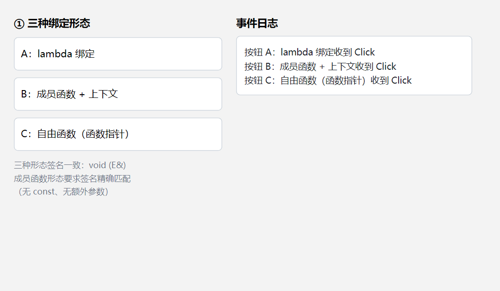
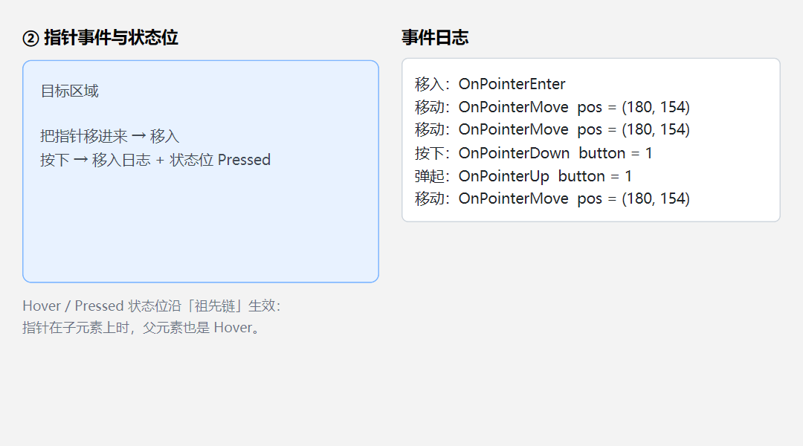
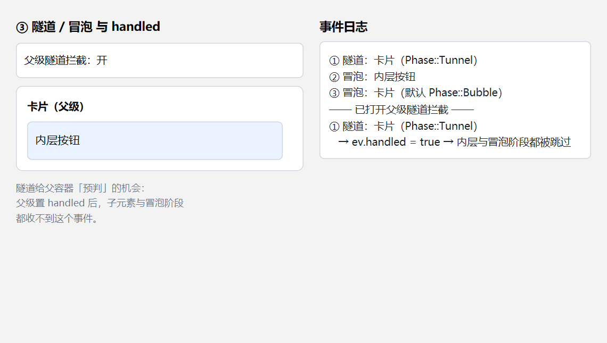
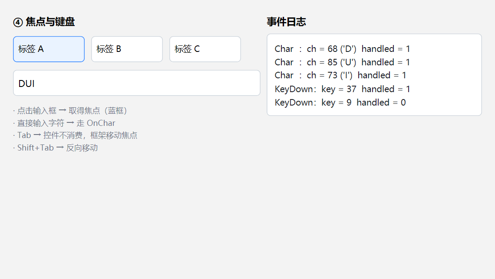
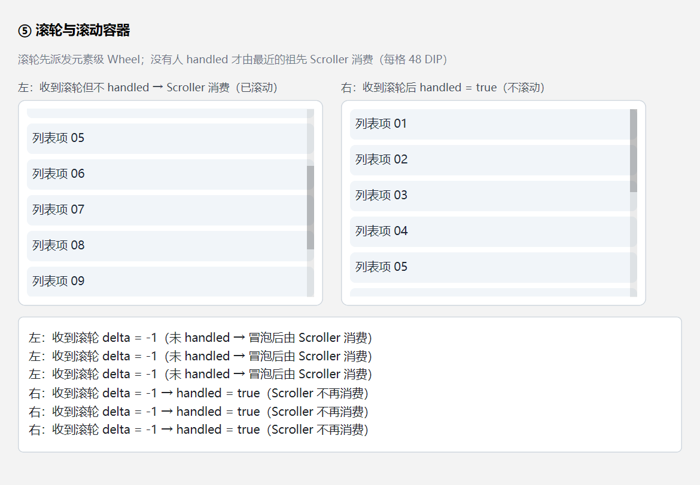
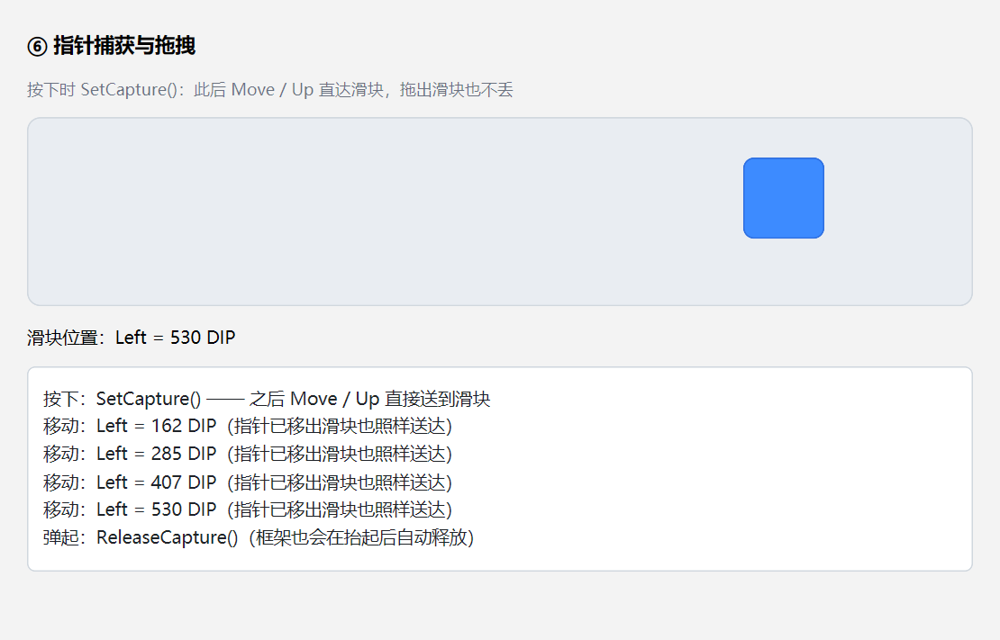

# DUI 事件系统使用指南（Event 开发者文档）

> **配套工程**：`Samples/Event/main.cpp`（9 个可交互演示：点击冒泡 / handled / Enter-Leave / Down-Up / 指针坐标 / 滚轮 / 键盘 / 状态变体 / 隧道）。
> **本文示例**：`Build/Temp/doc-event/`（`EV1-1` … `EV6-1`，每个都是可独立编译的小程序，**截图即由它们生成**）。
> **截图**：`Doc/Event/`，按 `EVN-M.png` 命名（NN = 章号，M = 该章第几个示例），均为**示例代码实机运行**后 1:1 截取。
> **相关文档**：[Styles.md](Styles.md)（状态变体与外观）、[Layout.md](Layout.md)（命中与层级）、[Input.md](Input.md)（输入控件）、[Arch/06-Events.md](Arch/06-Events.md)（架构稿）。

示例的做法：启动后用 `PostMessage` **合成真实的 Win32 输入消息**（`WM_MOUSEMOVE` / `WM_LBUTTONDOWN` / `WM_MOUSEWHEEL` / `WM_CHAR` …）投给自己的窗口 —— 消息完整走一遍「窗口过程 → 命中测试 → 路由 → 处理器」，所以截图里的日志与状态都是框架真实处理出来的结果。

---

## 1. 事件总览

### 1.1 元素级绑定清单

所有绑定都是 `Element` 的成员方法，任何控件（`Panel` / `Text` / `TextBox` / `RichEditor` / `Image` …）都有：

| 绑定 | 事件对象 | 阶段 | 说明 |
| --- | --- | --- | --- |
| `OnClick` | `PointerEvent` | 隧道 / 冒泡 | **合成**出来的语义事件（按下抬起同一元素） |
| `OnPointerEnter` | `PointerEvent` | 直达 | 悬停链差分驱动，不冒泡 |
| `OnPointerLeave` | `PointerEvent` | 直达 | 同上 |
| `OnPointerMove` | `PointerEvent` | 隧道 / 冒泡 | |
| `OnPointerDown` | `PointerEvent` | 隧道 / 冒泡 | |
| `OnPointerUp` | `PointerEvent` | 隧道 / 冒泡 | |
| `OnWheel` | `WheelEvent` | 隧道 / 冒泡 | 置 `handled` 可阻止滚动容器消费 |
| `OnKeyDown` | `KeyEvent` | 隧道 / 冒泡 | 从**焦点元素**出发 |
| `OnKeyUp` | `KeyEvent` | 隧道 / 冒泡 | 同上 |
| `OnChar` | `KeyEvent` | 隧道 / 冒泡 | 字符输入（IME 提交也走这里） |

**除 `OnPointerEnter` / `OnPointerLeave` 外，其余绑定都接受可选的 `Phase` 参数**（默认 `Phase::Bubble`）。

### 1.2 三种绑定形态

```cpp
// 1) lambda / std::function
btn->OnClick([](dui::PointerEvent& ev) { DoSomething(); });

// 2) 成员函数 + 上下文（最常用）
btn->OnClick(this, &MyPage::OnButtonClicked);

// 3) 自由函数（函数指针）
btn->OnClick(&OnButtonC);
```

要点：

- **签名统一为 `void (E&)`**；成员函数形态要求**精确匹配**（不能带 `const`、不能有额外参数）。
- 成员函数形态与 lambda 形态可以混用，**互不覆盖**。
- 同一个事件在同一阶段**重复绑定 → 后者覆盖前者**（槽是赋值语义）；隧道槽与冒泡槽各一个，互不覆盖。
- **所有绑定返回 `void`** —— 不能写成 `btn->OnClick(fn).Padding(8)` 那样链式。
- 处理器按需分配：没绑任何事件的元素不占这部分内存；派发时**只经过有绑定的元素**（无绑定直接跳过）。
- **不做防抖 / 节流**，高频事件（`OnPointerMove`）请自行限流。

### 1.3 事件对象

三个**扁平的**结构体（没有公共基类，也没有 `timestamp`）：

```cpp
struct PointerEvent {
    dui::Element* source = nullptr;   // 当前收到事件的元素（处理器宿主）
    dui::Vec2     pos{};               // 命中元素所在空间的坐标（DIP）
    dui::PointerButton button = dui::PointerButton::None;   // None/Left/Right/Middle
    bool          handled = false;     // 置 true 终止后续派发
};

struct WheelEvent {
    dui::Element* source = nullptr;
    dui::Vec2     pos{};
    float         delta = 0.f;         // 格数（notch）：正 = 向上
    bool          horizontal = false;  // Shift + 滚轮 → true
    bool          handled = false;     // 置 true 还会阻止滚动容器消费
};

struct KeyEvent {
    dui::Element* source = nullptr;
    int           key = 0;             // VK_* 虚拟键码
    wchar_t       ch = 0;              // 字符（仅 OnChar 有效）
    bool          ctrl = false;
    bool          shift = false;
    bool          alt = false;
    bool          handled = false;
};
```

- `source` 是**当前收到事件的元素**，不是原始命中目标 —— 点击落在子元素上时，冒泡到祖先的处理器里 `source` 就是那个祖先。
- `PointerEvent` **没有** `buttons` / `modifiers` 掩码；`KeyEvent` 的修饰键是三个独立 `bool`。
- `Click` 复用 `PointerEvent`（`button` 恒为 `Left`，`pos` = 抬起处坐标）。

### 1.4 坐标空间

`ev.pos` 与**命中元素的 `Bounds()` 同空间**：

- 常规元素 → **客户区绝对坐标（DIP）**；
- 滚动容器内的元素 → **内容空间**（= 客户区 + 该容器及其祖先的滚动偏移）。

控件内部的取法：`局部坐标 = ev.pos − 自己的内容盒原点`（`ContentRectOf()` 给出的矩形原点）。

> 坑：`ev.pos` **不是**"相对父容器"的坐标 —— 它与该元素的 `Bounds()` 同空间（客户区绝对）；滚动容器内的元素则是内容空间（客户区 + 滚动偏移）。控件要局部坐标，减自己的内容盒原点即可。

---

## 2. 点击 `OnClick`

`Click` 不需要自己写"按下 + 抬起"判断，框架会**合成**：

- 按下与抬起**必须是同一个元素**；
- 抬起点相对按下点的 x / y 偏移**各 ≤ 4 DIP**（方形阈值，不是圆形半径）；
- `button` 恒为 `Left`，`pos` = 抬起处坐标；
- `Click` 走**双阶段**路由（可绑隧道也可绑冒泡），**不经过**控件内部的 `Handle*` 钩子。

两种情况**不会**合成 `Click`：

- 指针**捕获期间**抬起（框架认为这是拖拽，不是点击）；
- 按下落在**滚动条**上（走滑块拖拽，既不合成 `Click`，也不派发元素级按下 / 弹起）。



上图三个按钮分别用 lambda、成员函数 + 上下文、自由函数绑定 `OnClick` —— 签名一致，写法不同。

```cpp
dui::Panel* btn = root->AddChild<dui::Panel>(buttonStyle);
btn->AddChild<dui::Text>(L"确定");
btn->OnClick([this](dui::PointerEvent& ev) {
    LogLine(L"按钮 A：lambda 绑定收到 Click");
});
btn->OnClick(this, &MyPage::OnButtonClicked);   // 成员函数 + 上下文
btn->OnClick(&OnButtonC);                       // 自由函数
```

> DUI 没有 `Button` 控件：**`Panel` + `OnClick` 就是按钮**。需要外观变化时用状态变体（见 [Styles.md](Styles.md) §6.2）：
> ```cpp
> btn->When(dui::State::Hover,   dui::Style().Background(0xFFEAF3FF));
> btn->When(dui::State::Pressed, dui::Style().Background(0xFFD8E8FF));
> ```
>
> 按钮里的文字**不会自动垂直居中**：`Panel` 默认 `Column` + `justify-content: start`，文字贴在内容盒顶部。要居中得显式写 `JustifyContent(dui::Justify::Center)`，并保证内容盒比文字行高够高（详见 [Layout.md](Layout.md) §2.2）：
> ```cpp
> dui::Style().Width(300.f).Height(48.f).Padding(10.f)
>            .JustifyContent(dui::Justify::Center);
> ```
> 居中按**文字墨迹**算（不是行盒）—— 行盒居中时文字视觉偏下 1~2 DIP，框架在居中排布时自动按墨迹中心补偿，肉眼看是真居中。

---

## 3. 指针事件与状态位

### 3.1 五个指针事件绑定

| 事件 | 路由 | 说明 |
| --- | --- | --- |
| `OnPointerEnter` / `OnPointerLeave` | **直达** | 按"悬停链"差分触发：旧链里不在新链的元素发 `leave`，新链里不在旧链的元素发 `enter`；**先发全部 leave，再发全部 enter** |
| `OnPointerMove` / `Down` / `Up` | 双阶段 | 默认冒泡；`Phase::Tunnel` 则根先收到 |

- **移到子元素上不算离开父元素**（父元素仍在两条链里）—— 这是 CSS 的直觉。
- 指针移出客户区 → 整条悬停链发 `leave`。

### 3.2 状态位由事件维护

框架在派发指针事件时同步维护状态位，样式只声明"状态成立时长什么样"：

| 状态位 | 何时置位 | 作用域 |
| --- | --- | --- |
| `State::Hover` | 指针在元素（含子元素）上 | **沿祖先链**生效 |
| `State::Pressed` | 按下置位、抬起清除 | **沿祖先链**生效 |
| `State::Focused` | 焦点变化 | 只落在焦点元素自身 |



上图：指针移入目标区 → `Hover` 变体生效（浅蓝底 + 蓝框）；按下 / 弹起各产生一条日志。

```cpp
target->OnPointerEnter([](dui::PointerEvent&) { /* 移入 */ });
target->OnPointerLeave([](dui::PointerEvent&) { /* 移出 */ });
target->OnPointerMove ([](dui::PointerEvent& ev) { /* ev.pos 是命中元素所在空间 */ });
target->OnPointerDown ([](dui::PointerEvent& ev) { /* ev.button */ });
target->OnPointerUp   ([](dui::PointerEvent& ev) { /*  */ });

target->When(dui::State::Hover,   dui::Style().Background(0xFFE8F2FF));
target->When(dui::State::Pressed, dui::Style().Background(0xFFC7DEFF));
```

> 提示：`State::Hover` / `State::Pressed` 沿祖先链生效，所以"列表项 hover 时父容器也变样"是默认行为，不需要额外代码。

---

## 4. 路由：隧道与冒泡

### 4.1 派发顺序

```
[隧道]  根 ──▶ … ──▶ 命中元素      父容器「预判」：可以拦截
[冒泡]  命中元素 ◀── … ◀── 根      常规处理
         任一阶段置 ev.handled = true → 其后全部阶段都不再派发
```

- 可路由事件都有两个阶段；处理器用**末尾的 `Phase` 参数**声明所属阶段（默认冒泡）。
- 同一元素可以在两个阶段**各绑一个**处理器（槽互不覆盖）。
- 隧道阶段**不执行**控件内部的 `Handle*` 钩子（钩子只在冒泡阶段跑）。
- 冒泡阶段每个元素上**先跑控件钩子、再跑该元素的绑定**；钩子消费（返回 `true`）或 `ev.handled` 为真 → **停止向上冒泡**，但**同一元素上的绑定仍然会收到**（此时 `ev.handled` 已被置位）。



上图：先点一次内层按钮 → 顺序是「① 隧道：卡片 → ② 冒泡：内层按钮 → ③ 冒泡：卡片」；打开"父级隧道拦截"再点一次 → 隧道阶段就截断，内层与整个冒泡阶段都收不到。

```cpp
// 父容器：预判 —— 需要时直接拦掉
card->OnPointerDown([](dui::PointerEvent& ev) {
    if (ShouldBlock()) ev.handled = true;   // 内层与冒泡阶段都不再派发
}, dui::Phase::Tunnel);

// 常规处理：命中元素 → 根
card->OnPointerDown([](dui::PointerEvent& ev) { /* 冒泡 */ });
```

### 4.2 直达事件

`OnPointerEnter` / `OnPointerLeave` **不走路由、没有阶段**，只送到目标元素自己。

---

## 5. 焦点与键盘

### 5.1 焦点

```cpp
dui::FocusedElement();        // 当前焦点元素（nullptr = 无焦点）
dui::IsFocused(element);      // 是否为焦点
dui::SetFocus(element);       // 设置焦点（会置 / 清 State::Focused）
element->Focus();              // 同上
element->Blur();               // 主动放弃焦点
element->HasFocus();           // 注意：元素上没有 IsFocused()，只有 HasFocus()
```

- 焦点**唯一**，挂在元素上；换焦点时旧元素清 `State::Focused`、新元素置位 → **状态变体自动生效**。
- **可聚焦**：默认否，需要显式 `SetFocusable(true)`（`TextBox` / `TextArea` / `RichEditor` 构造即置真）。
- **点击取得焦点**：按下时沿命中元素的祖先链找**最近的可聚焦元素**并 `SetFocus`。
- **Tab 链**：树序（深度优先）收集可聚焦元素，按 `tabIndex` 排序 ——
  `> 0` 组（数值升序）→ `0` 组（文档序）→ `< 0` 组（数值升序）；`Shift+Tab` 反向，到头循环。
- 窗口**失活**（切到别的应用）→ 清焦点（编辑控件随之失焦、选区消失、光标停闪）；**最小化除外**（保留焦点）；系统对话框弹出期间也不清。

### 5.2 键盘事件

键盘事件从**当前焦点元素**出发，同样是隧道 + 冒泡：

- `ev.key` = **VK_\* 虚拟键码**（`VK_RETURN` / `VK_LEFT` / `VK_TAB` …）；
- `ev.ch` = UTF-16 字符（**只有 `OnChar` 有值**；IME 提交也走 `OnChar`）；
- `ev.ctrl` / `ev.shift` / `ev.alt` = 三个独立 `bool`。



上图：点输入框取得焦点 → 输入 `DUI`（三条 `Char`）→ 按左箭头（`KeyDown key=37`，**控件消费** → `handled = 1`）→ 按 `Tab`（`KeyDown key=9`，**控件不消费** → `handled = 0`，框架把焦点移到下一个可聚焦元素 —— 图中"标签 A"获得了蓝框）。

```cpp
dui::TextBox* box = ...;
box->OnKeyDown([](dui::KeyEvent& ev) {
    if (ev.key == VK_ESCAPE) ev.handled = true;   // 终止后续派发
});
box->OnChar([](dui::KeyEvent& ev) {
    // ev.ch 是字符；控件已消费（ev.handled = true），但同元素的绑定仍会收到
});
```

要点：

- **控件行为与外部绑定并存**：`TextBox` 的编辑逻辑走 `Element::HandleKeyDown/HandleChar` 钩子，钩子**先于**同元素的绑定执行；钩子消费后事件不再向上冒泡，但**绑定仍会收到**（`ev.handled` 已是 `true`）。
- **没有焦点元素时，键盘事件被丢弃**（`OnChar` / `OnKeyUp` 同理）；但 `Tab` 是例外 —— 框架的默认处理在"未被消费"时生效，即使当前没有焦点，`Tab` 也会把焦点移到第一个可聚焦元素。
- `Tab` 键输入框**不消费** → 框架移动焦点（不会往文本里插制表符）。

---

## 6. 滚轮与滚动容器

滚轮的顺序：**先派发元素级 `Wheel`；没有人 `handled` 时，才由滚动容器消费**。

- `ev.delta` 单位是**格（notch）**，正 = 向上；`ev.horizontal` 由 **Shift** 判定。
- 消费规则：沿命中元素的祖先链找**最近的、该轴还能滚**（`MaxScroll > 0`）的 `Scroller`；每格滚动 **48 DIP**。
- 内层滚不动时滚轮会冒泡给外层（内层 `MaxScroll == 0` 就跳过它）。
- 元素级 `Wheel` 置 `ev.handled = true` → **滚动容器不再消费**（适合做"横向滚轮映射""滚轮缩放"等自定义行为）。



上图：左侧的元素收到滚轮但**不** `handled` → 事件继续冒泡 → `Scroller` 消费 → 列表滚动了；右侧的元素 `handled = true` → `Scroller` 不再消费 → 列表没动。

```cpp
scroller->OnWheel([](dui::WheelEvent& ev) {
    if (ev.horizontal) { /* 自定义横向行为 */ ev.handled = true; }
    // 不设置 handled → 事件继续冒泡，最后由 Scroller 消费
});
```

> 滚动条**滑块拖拽**由框架接管（按下 → 拖动 → 抬起），这条路径**不派发**元素级按下 / 弹起，也不合成 `Click`。

---

## 7. 指针捕获与拖拽

框架**不会自动**为按下的元素设置捕获 —— 需要拖拽就自己调：

```cpp
void Element::SetCapture();     // 设为捕获目标（窗口级唯一）
void Element::ReleaseCapture();
bool  Element::HasCapture() const;
```

捕获期间：

- `Move` / `Up` **不再做命中测试**，直接送到捕获者（仍从它开始冒泡）；
- 坐标用 `ClientToLocal()` 换算到捕获者所在空间；
- **抬起后框架自动释放**；元素销毁、窗口失活也会释放。

典型拖拽：

```cpp
slider->OnPointerDown([this, slider](dui::PointerEvent& ev) {
    dragging_ = true;
    grabDx_ = ev.pos.x - slider->Bounds().x;   // 指针相对滑块左边的偏移
    slider->SetCapture();                       // 之后 Move / Up 直达滑块
});

slider->OnPointerMove([this, slider](dui::PointerEvent& ev) {
    if (!dragging_) return;
    slider->Set(dui::Prop::Left, ev.pos.x - grabDx_);   // 相对定位只认 Left / Top
});

slider->OnPointerUp([this, slider](dui::PointerEvent&) {
    dragging_ = false;
    slider->ReleaseCapture();                  // 框架也会在抬起后自动释放
});
```



上图：滑块按下后捕获指针，即使指针移出滑块（乃至移出轨道），`Move` 依然送达滑块，位置一路跟到 `Left = 530 DIP`。

> 滑块的位移用 `Set(dui::Prop::Left, v)` —— 这是**运行时覆盖**（`Element::Set`），静态外观仍写在 `Style` 里。相对定位（`Position::Relative`）**只认 `Left` / `Top`**。

---

## 8. 控件语义事件与窗口钩子

元素级的 10 个绑定之外，还有各自的"语义事件"：

| 对象 | API | 说明 |
| --- | --- | --- |
| `TextBox` / `TextArea` | `OnTextChanged(std::function<void(const String&)>)` | 文本变化（输入 / 退格 / 删除 / 剪切 / 粘贴 / 撤销 / 重做都会触发；密码模式也传**明文**） |
| `TextBox` / `TextArea` | `OnSubmit(std::function<void()>)` | 单行回车提交（多行回车是插入换行） |
| `dui::Menu` | `Add(text, cb)` / `AddCheck(text, checked, cb)` / `AddSubMenu` / `Separator` | 菜单项回调；**框架不自动挂钩右键**，何时弹由业务决定 |
| `dui::Window` | `OnCreate` / `OnDpiChanged` / `OnClosing` / `OnNcHitTest` / `OnStateChanged` | 窗口级虚钩子（非元素级绑定） |
| 动画 | `AnimationHandle::OnFinished(std::function<void()>)` | 动画结束回调 |

```cpp
// 菜单：右键抬起时自己弹
panel->OnPointerUp([this](dui::PointerEvent& ev) {
    if (ev.button != dui::PointerButton::Right) return;
    dui::Menu menu;
    menu.Add(L"复制", [this] { Copy(); });
    menu.AddCheck(L"只读", false, [this](bool on) { SetReadOnly(on); });
    this->ShowMenu(menu, ev.pos);
});
```

> `RichEditor` **没有**内容变更事件（只能靠继承来的元素级绑定自行桥接，或在业务侧轮询文档）。

---

## 9. API 速查

| 分类 | API |
| --- | --- |
| 指针 | `OnClick` / `OnPointerEnter` / `OnPointerLeave` / `OnPointerMove` / `OnPointerDown` / `OnPointerUp` |
| 滚轮 | `OnWheel` |
| 键盘 | `OnKeyDown` / `OnKeyUp` / `OnChar` |
| 焦点 | `dui::FocusedElement()` / `dui::IsFocused(e)` / `dui::SetFocus(e)` / `e->Focus()` / `e->Blur()` / `e->HasFocus()` / `e->SetFocusable(bool)` / `e->SetTabIndex(int)` |
| 捕获 | `e->SetCapture()` / `e->ReleaseCapture()` / `e->HasCapture()` |
| 状态 | `e->SetState(dui::State, bool)` / `e->HasState(dui::State)` / `e->When(dui::State, const Style&)` |
| 阶段 | `dui::Phase::Bubble`（默认） / `dui::Phase::Tunnel` |
| 事件对象 | `dui::PointerEvent` / `dui::WheelEvent` / `dui::KeyEvent`（字段见 §1.3） |

---

## 10. 已知限制

以下是**当前没有实现**的能力（架构稿 [Arch/06-Events.md](Arch/06-Events.md) 里描述过，但代码中搜不到）：

1. **无双击 / 右键语义事件**：只有 `OnClick`；右键只有"抬起"被转发（`WM_RBUTTONUP`），要弹菜单得自己判 `ev.button`。
2. **无 `PointerCancel`、无触摸 / 触控笔**：平台层只转发左键按下 / 抬起与右键抬起；`PointerButton::Middle` 有定义但不下发。
3. **无 IME 组合串事件**（`Composition*`）与组合串内联预览；IME 提交经 `WM_IME_CHAR` 走 `OnChar`。
4. **无加速键 / 快捷键表**：键盘事件只冒泡到根，框架不做匹配。
5. **无焦点事件绑定**（`GotFocus` / `LostFocus`）：只有 `protected` 虚钩子 `OnFocusChanged(bool)`；焦点变化通常用 `State::Focused` 状态变体感知。
6. **无 `Loaded` / `Unloaded` 生命周期事件**。
7. **分发中销毁元素不安全**：派发循环直接持裸指针遍历，**没有**延迟删除队列；处理器里不要销毁自己或祖先（要删就延后到下一轮）。
8. **处理器上下文是裸指针**，生命周期自负 —— 没有 weak token / `Lifetime` 托管。
9. **绑定不能链式**（返回 `void`）。
10. **同一元素同一阶段的同一事件重复绑定 → 后者覆盖前者**。
11. **无防抖 / 节流**：`OnPointerMove` 之类高频事件需自行限流。
12. **事件对象不可扩展**：三个扁平结构体，没有基类、没有 `timestamp`、没有 `buttons` / `modifiers` 掩码。
13. **`Enter` / `Leave` 的 `pos` 是新命中元素的坐标**（`leave` 也用新坐标，不是离开时的位置）。
14. **`Scroller` 没有自己的事件 API**（滚动进度、滚动结束都无通知）；滚动消费发生在 App 层。
15. **`RichEditor` 没有内容变更事件**。
16. **指针形态（`cursor`）不是事件**：由 `WM_SETCURSOR` + 命中链就近者胜决定，不走事件系统。

---

## 11. 相关文档

- [Styles.md](Styles.md) —— 状态变体（`When`）、悬停 / 按下 / 焦点的外观写法
- [Layout.md](Layout.md) —— 元素树、命中顺序、`Absolute` / `Fixed` 的命中规则
- [Input.md](Input.md) —— 输入控件的语义事件（`OnTextChanged` / `OnSubmit`）与键盘处理
- [Menu.md](Menu.md) —— 右键弹出菜单（`dui::Menu`）：§4 触发时机、§5 复选状态由业务保存
- [Async.md](Async.md) —— 在事件处理器里发起异步：协程 `Task`、切线程、元素生命周期令牌
- [Window.md](Window.md) —— 自定义窗口边框与异形窗口：无边框窗口、`OnNcHitTest` 命中区、标题栏按钮
- [Arch/06-Events.md](Arch/06-Events.md) —— 事件系统架构稿（设计意图，含尚未实现的规划）
 
