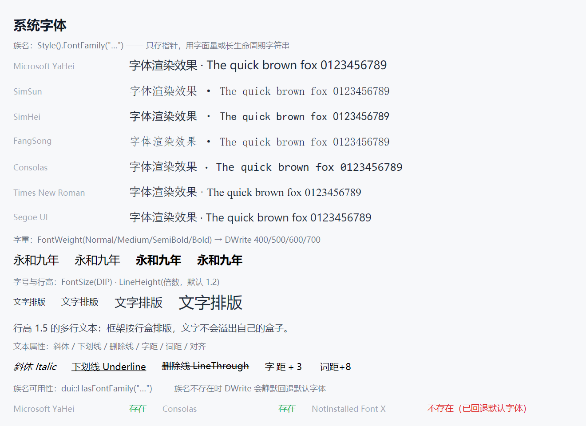

# DUI 字体与图标指南（Font 开发者文档）

> 状态：**已实现** —— 系统字体 / 自定义字体文件 / exe 内置字体 / 字体图标（iconfont）/ 框架内置矢量图标（`dui::Icon`）。
> 可运行示例 `Samples/CustomFont`（字体图标）、`Samples/Icon`（内置图标）。
> 本文有两处**必读**：§2.2（族名指针契约）与 §5.4（MSVC 的 `static` + 三元坑）。

---

## 1. 快速开始

### 1.1 字体相关属性

| 属性 | 类型 | 继承 | 说明 |
| --- | --- | --- | --- |
| `FontFamily` | `const wchar_t*` | 是 | 字体族名。**只存指针不拷字符串**（§2.2） |
| `FontSize` | `float`（DIP） | 是 | 字号，默认 14 |
| `FontWeight` | `dui::FontWeight` | 是 | `Normal` / `Medium` / `SemiBold` / `Bold`（枚举，不是 CSS 数字） |
| `FontStyle` | `dui::FontStyle` | 是 | `Normal` / `Italic` |
| `TextDecoration` | `dui::TextDecoration` | 否（同 CSS） | `Underline` / `LineThrough`，位标志可组合 |
| `LineHeight` | `float`（倍数） | 是 | 行高倍数，默认 1.2 |
| `LetterSpacing` | `float`（DIP） | 是 | 字距 |
| `WordSpacing` | `float`（DIP） | 是 | 词距（只加宽词间空格） |
| `TextAlign` | `dui::TextAlign` | 是 | `Start` / `Center` / `End` |
| `TextOverflow` | `dui::TextOverflow` | 是 | `Clip` / `Ellipsis` |

```cpp
root->AddChild<dui::Text>(L"中文与 English 混排", dui::Style()
    .FontFamily(L"Microsoft YaHei")   // 系统族名
    .FontSize(16.f)
    .FontWeight(dui::FontWeight::SemiBold)
    .Color(0xFF1F2937));
```

### 1.2 默认字体

不设 `FontFamily` 时，引擎用**微软雅黑**（`Microsoft YaHei`），字号 14 DIP，行高 1.2，字重 `Normal`（= DWrite 400）。

字体相关属性都是**继承属性**：在父级设一次，下面整棵树跟着走（与 CSS 一致）。

### 1.3 跑一下



---

## 2. 系统字体

### 2.1 用族名

`FontFamily` 填**系统已安装的字体族名**（不是字体文件名，是族名）：

```cpp
dui::Style().FontFamily(L"Microsoft YaHei");   // 微软雅黑
dui::Style().FontFamily(L"SimSun");            // 宋体
dui::Style().FontFamily(L"Consolas");          // Consolas
```

### 2.2 族名是"只存指针" ★

```cpp
Style& FontFamily(const wchar_t* name);   // 零拷贝共享，生命周期由调用方保证
```

**框架不拷贝这个字符串** —— 它只把指针存进样式值。所以：

| 写法 | 结果 |
| --- | --- |
| `FontFamily(L"Microsoft YaHei")` | ✅ 字符串字面量，静态存储期 |
| `FontFamily(family.c_str())`，`family` 是**成员**或 **`static` 局部** | ✅ 活到使用期结束 |
| `FontFamily(local.c_str())`，`local` 是**函数局部 `String`** | ❌ **悬空** |

悬空的后果很隐蔽：排版时读到垃圾族名，**DWrite 静默回退默认字体** —— 不报错、不抛异常。表现是：字体图标（PUA 码位）**全部渲染成方框 □**。

```cpp
// ❌ 错：local 出函数即析构
void Setup() {
    dui::String family = dui::LoadFontFamily(path);
    text->SetStyle(dui::Style().FontFamily(family.c_str()));   // 悬空
}

// ✅ 对：static 局部（活到进程结束）
static const dui::String family = dui::LoadFontFamily(path);
text->SetStyle(dui::Style().FontFamily(family.c_str()));
```

### 2.3 族名不存在 → 静默回退

族名拼错、或目标机器没装这个字体，**没有任何报错**，只是回退到默认字体（微软雅黑）。想要"找不到就降级"，用公共 API 显式判定：

```cpp
if (!dui::HasFontFamily(L"SimSun")) {
    // 降级：换族名，或提示用户安装
}
```

`dui::HasFontFamily(family)` 的判定范围：**系统已安装的族** + **经 `LoadFontFamily` / `LoadFontFamilyFromMemory` 装入的自定义族**（装进去的图标字体族名也能查到）。空串 / `nullptr` → `false`。


### 2.4 字重：必须用枚举

`dui::FontWeight` 是 4 值小枚举 `{Normal=0, Medium=1, SemiBold=2, Bold=3}`，进文本引擎前由 `Style.h` 的 `DWriteWeight()` 换算成合法的 `DWRITE_FONT_WEIGHT`：

| 枚举 | DWrite 字重 |
| --- | --- |
| `Normal` | 400 |
| `Medium` | 500 |
| `SemiBold` | 600 |
| `Bold` | 700 |

**为什么不能直接用 CSS 数字**：DWrite 的合法字重是 100~1000，把枚举序号 0/1/2/3 原样塞进去属非法值，DWrite 会"就近匹配"到字体家族里**最细的那个面**（微软雅黑 Light）→ 整段文字偏细偏灰。这是"全局文字发虚"的经典根因。

```cpp
// ❌ 错：0/1/2/3 不是字重
dui::Style().FontWeight(dui::FontWeight::SemiBold);   // ✅ 枚举 → 600
```

### 2.5 行高 / 字距 / 词距

```cpp
dui::Style().LineHeight(1.5f)        // 行高倍数（相对字号）
            .LetterSpacing(1.f)       // 字距：DIP，字符之后加距（同 CSS）
            .WordSpacing(4.f);        // 词距：只加宽词间空格
```

字距 / 词距由引擎换算成 DWrite 的 `trailingSpacing` 下发（进程内标定一次该运行时的单位语义），加宽后的宽度由 DWrite 自己算进排版 → **测量与折行天然一致**，不会把文本撑散成多行。

### 2.6 CSS 路径的字体栈（代码路径不支持）

**CSS 文件**里的 `font-family` 支持逗号分隔的字体栈，取**第一个本机可用**的族名：

```css
font-family: "Times New Roman", SimSun, serif;
```

- 成对引号（`"…"` / `'…'`）会被剥掉；
- 泛型关键字映射到本机代表字体：`sans-serif` → 微软雅黑，`serif` → Times New Roman，`monospace` → Consolas。

**代码里的 `Style::FontFamily()` 只接受单个族名**，没有列表语义（要字体栈就自己挑一个存在的族名）。

---

## 3. 自定义字体文件

### 3.1 装入字体文件

```cpp
dui::String family = dui::LoadFontFamily(L"C:\\fonts\\iconfont.ttf");
// 失败返回空串
```

- 装入的是**进程内字体集合**（DWrite FontSet，Win10+），**不写注册表、不影响别的进程**；
- 可多次调用装入不同字体，每个字体自带一个集合，族名各自独立；
- 建议在 `OnCreate` 阶段调用。

### 3.2 族名从哪来

返回的族名 = 字体文件里**第一个字体面的族名**（iconfont 这类单字体重通常就叫 `iconfont`）。拿它去 `FontFamily`：

```cpp
static const dui::String family = dui::LoadFontFamily(path);
if (family.empty()) { /* 加载失败 */ }
text->SetStyle(dui::Style().FontFamily(family.c_str()));
```

### 3.3 格式限制

| 格式 | 支持 | 说明 |
| --- | --- | --- |
| `ttf` / `otf` | ✅ | |
| `ttc` | ✅ | 字体集合 |
| `woff` / `woff2` | ❌ | Web 字体封装（Brotli 压缩 + 表变换），DirectWrite 只认 SFNT |

`woff2` 需先用工具（Google `woff2` 或 `fontTools`）转成 `ttf` 再加载。

### 3.4 字体文件放哪

两种常见做法：

1. **随 exe 分发**：字体文件拷到 exe 目录，运行时按 `GetModuleFileNameW` 定位（`Samples/CustomFont` 的做法）；
2. **嵌进 exe 资源**：见下一节。

---

## 4. exe 内置字体

### 4.1 从内存装入

```cpp
dui::String family = dui::LoadFontFamilyFromMemory(bytes, size);
```

- `bytes` 指向**完整的 SFNT 文件字节**，`size` 是长度；
- 引擎内部**拷贝一份**（DWrite 的 in-memory loader，`ownerObject` 传 `nullptr`）→ **调用返回后源缓冲可以立即释放**；
- 底层是 `IDWriteFactory5::CreateInMemoryFontFileLoader`（Win10 1703+）；
- 失败返回空串。

### 4.2 资源嵌入的做法

字体作为 exe 资源（`RT_RCDATA`）：

```cpp
HRSRC    hres  = FindResourceW(nullptr, L"IDR_FONT", L"RT_RCDATA");
HGLOBAL  hglob = LoadResource(hres);
const void* bytes = GlobalLock(hglob);
dui::String family =
    dui::LoadFontFamilyFromMemory(bytes, SizeofResource(hres, RT_RCDATA));
GlobalUnlock(hglob);
```

配套的 `.rc`：

```rc
IDR_FONT RCDATA "fonts/iconfont.ttf"
```

> 资源里的字体是**原始二进制**，RC 不会压缩它；注意 `RCDATA` 是按字节存，不做资源转换。

### 4.3 跑一下


示例从磁盘读出字体字节再交给 `LoadFontFamilyFromMemory` —— 与"资源嵌入"走的是同一条引擎通路（`Build/Temp/doc-font/FNT-3.cpp`）。

---

## 5. 字体图标（iconfont）

### 5.1 原理

**图标字体就是普通字体**，图标是字体里的**私有区（PUA）码位**（`U+E000`~`U+F8FF`）。渲染时把它当一个字符画出来：

```cpp
wchar_t glyph[2] = {0xE694, 0};      // "map" 图标的码位
text->SetText(glyph);
```

码表来自字体包附带的 `iconfont.json`（`font_class` → `unicode`）。

### 5.2 四步

```cpp
// ① 装入字体（文件或内存）→ ② 拿族名
static const dui::String family = dui::LoadFontFamily(path);   // "iconfont"
// ③ 用该族渲染码位
cell->AddChild<dui::Text>(glyph, dui::Style()
    .FontFamily(family.c_str())
    .FontSize(30.f)
    .Color(0xFF2563EB));
// ④ 文字标签照常用系统字体
cell->AddChild<dui::Text>(L"map", dui::Style().FontSize(12.f));
```


### 5.3 坑：族名悬空 → 全部方框 □

见 §2.2。图标字体最容易撞上这个坑：族名一悬空，**所有图标同时变成 □**（而不是"某个图标不对"），因为整段文本都回退到了默认字体。

排查顺序：先确认 `LoadFontFamily` 返回非空 → 再确认 `family` 的存储期够长 → 最后确认 `FontSize` 够大（太小可能挤成方块）。

### 5.4 坑：`static` 的初始化器里别写条件运算符 ★

**MSVC 对「函数内 `static` + 非平凡类型 + 条件运算符初始化」会生成错误代码**（VS 18 Community / MSVC 14.51，`/Od` 与 `/O2` 均复现）：

```cpp
// ❌ 错：结果恒为空串（有时连分支都走错）
static const dui::String family =
    bytes.empty() ? dui::String() : dui::LoadFontFamilyFromMemory(bytes.data(), bytes.size());
```

最小复现（`std::wstring`）：

| 写法 | 结果 |
| --- | --- |
| `const std::wstring a = cond ? X() : f();`（非 static） | ✅ 正常 |
| `static const std::wstring b = cond ? X() : f();` | ❌ **空串** |
| `static const std::wstring c = cond ? X() : Y();`（无函数调用） | ❌ **空串** |
| `static const int d = cond ? 0 : 42;`（平凡类型） | ✅ 正常 |
| `static const std::wstring e = f();`（直接调用，无三元） | ✅ 正常 |
| `static const std::wstring g = [&]{ if (c) return X(); return f(); }();` | ✅ 正常 |

**规避写法**：

```cpp
// ✅ 直接调用，失败自然返回空串
static const dui::String family = dui::LoadFontFamilyFromMemory(bytes.data(), bytes.size());

// ✅ 需要分支就用 if/else 或 lambda，别用三元
static const dui::String family = [&]() -> dui::String {
    if (bytes.empty()) return dui::String();
    return dui::LoadFontFamilyFromMemory(bytes.data(), bytes.size());
}();
```

> 框架与现有示例里只有 `Samples/CustomFont` 用到这种 `static` 族名，且**没有三元** → 不受影响。

### 5.5 字号与颜色

- 图标字体通常要 **24~32 DIP 起**（PUA 字形按 em 缩放，太小会糊成一团）；
- 颜色走 `Color` —— 它是**文字**，不是矢量图标，没有独立的描边色；
- 图标之间要用 `Gap` / `Padding` 排布，别指望字体自带边距。

---

## 6. 框架内置矢量图标（`dui::Icon`）

### 6.1 9 个图样

| `dui::IconName` | 用途 |
| --- | --- |
| `Check` / `CheckChecked` | 复选框（未选 / 选中） |
| `Radio` / `RadioChecked` | 单选框 |
| `Minimize` / `Maximize` / `Restore` / `Close` | 窗口按钮（自绘标题栏用） |
| `Search` | 搜索 |

### 6.2 用法

```cpp
dui::Icon* icon = cell->AddChild<dui::Icon>(dui::Style()
    .Width(20.f).Height(20.f)
    .Color(0xFF2563EB));          // 颜色是继承属性
icon->SetIcon(dui::IconName::Check);

// 悬停换色
icon->When(dui::State::Hover, dui::Style().Color(0xFFE81123));

// 运行时换图样
icon->SetIcon(checked ? dui::IconName::Check : dui::IconName::CheckChecked);
```

- **尺寸**：`Style().Width/Height` 自由定义；不设时自然尺寸 16×16 DIP；
- **描边**：按盒尺寸**等比缩放**（16px 与 48px 的线宽比例一致）；
- **实现**：全部由 `Painter` 的形状指令绘制 → 不依赖字体、不依赖位图资源、任意尺寸不失真。


### 6.3 什么时候用哪个

| | 内置 `dui::Icon` | 字体图标（iconfont） |
| --- | --- | --- |
| 图样数量 | 9 个固定 | 几十上百个（一个字体文件打包） |
| 资源 | 零依赖 | 需要字体文件 |
| 任意尺寸 | ✅ 矢量等比 | ✅ 字号缩放（但小尺寸会糊） |
| 颜色 | `Color`（继承 / 悬停变体） | `Color` |
| 适合 | 勾选 / 单选 / 窗口按钮 | 业务图标集 |

**勾选框、单选框、窗口按钮 → 用内置 Icon**（形状精确、状态齐全）；**几十个业务图标 → 用 iconfont**（一个字体文件搞定）。

---

## 7. 底层：字形光栅与图集

| 环节 | 做法 |
| --- | --- |
| 光栅 | DWrite `IDWriteBitmapRenderTarget`（GDI 同源的 ClearType）白底黑字 → 反解覆盖率进 RGBA8 图集；测量模式 `DWRITE_MEASURING_MODE_NATURAL`（笔画纤细，与 Direct2D 文本路径同款） |
| 子像素定位 | 4 相位（1/4 像素，对齐 Qt/Skia 的量化粒度）：光栅原点 = 整数基座 + phase/4，相位烘焙进覆盖率位图，图集键含 phase |
| 合成 | dual-source 混合（`ONE` / `INV_SRC1_COLOR` / `INV_SRC1_ALPHA`），文字色 × 逐通道覆盖率 |
| 图集 | 512×512 的 RGBA8 页（1 MB/页），行式（shelf）打包；LRU 上限 **8 MB**，超出淘汰最久未用；页内字形全淘汰才整页释放 |
| DPI 换档 | 字号 / 缩放变化是离散事件 → 新 `pixelSize` 的字形进新档位，旧档位靠 LRU 淘汰（不做跨尺度复用采样） |

**字体面的怪癖**：微软雅黑 Bold 的**英文**面名是 `"Negreta"`（已知怪癖，不是字体名写错）；要读字形面的真实字重用 `IDWriteFontFace3::GetWeight()`。

---

## 8. 已知限制与坑

1. **`FontFamily` 只存指针**（★）：族名串必须活过整个使用期；局部 `String` 出函数即悬空 → 静默回退默认字体（图标表现为全方框 □）。
2. **`static` 的初始化器里别写条件运算符**（★ MSVC codegen bug）：非平凡类型 + 函数内 `static` + 三元 → 结果恒空或走错分支；直接调用 / if-else lambda 正常（§5.4）。
3. **族名不存在不报错**：DWrite 静默回退默认字体 —— 拼错族名的表现是"字体没变"，不是异常。要显式降级用 `dui::HasFontFamily()`（§2.3）。
4. **字重必须用 `dui::FontWeight` 枚举**：枚举序号 0~3 不是合法 `DWRITE_FONT_WEIGHT`，直接传会被就近匹配到最细的字面（Light）→ 全局文字偏细偏灰。
5. **只支持 `ttf` / `otf` / `ttc`**：`woff` / `woff2` 是 Web 封装，需先转换。
6. **自定义字体只在进程内**：不写注册表、不影响别的进程；卸载即失效。
7. **图标字体的方框 □ = 族名没生效**：先查 `LoadFontFamily` 返回值，再查族名存储期，最后查字号。
8. **图集 LRU 上限 8 MB**：字体集很大 + 字号很多时会反复淘汰；换档（DPI 变化）会批量产生新 `pixelSize` 的字形。
9. **`Style::FontFamily()` 不支持字体栈**：只有 CSS 路径支持逗号分隔列表（§2.6）。
10. **`Icon` 的描边按盒尺寸等比缩放**：很小的尺寸（<12 DIP）下线宽会偏粗，很大时会偏细 —— 必要时换 iconfont。
11. **透明窗口下半透明叠加是近似的**：预乘 Alpha 合成下，深底亮字与半透明层叠的表现与不透明窗口不完全一致（ADR-003 的取舍）。
12. **字体图标按普通文字排版**：基线、字距、行高都跟着系统字体走；想精确控制位置得用 `Canvas` 自绘。

---

## 9. API 速查

### 9.1 加载字体

| 函数 | 说明 |
| --- | --- |
| `dui::String LoadFontFamily(const wchar_t* fontFilePath)` | 从文件加载（ttf/otf/ttc）；返回族名，失败返回空串 |
| `dui::String LoadFontFamilyFromMemory(const void* fontData, size_t fontDataSize)` | 从内存（SFNT 字节）加载；引擎内部拷贝一份；失败返回空串 |
| `dui::bool HasFontFamily(const wchar_t* family)` | 本机是否有该族（系统已装 + 自定义已装入）；空串 / `nullptr` → false |

### 9.2 字体样式属性

| 属性 | 说明 |
| --- | --- |
| `Style::FontFamily(const wchar_t*)` | 族名（只存指针） |
| `Style::FontSize(float)` | 字号（DIP） |
| `Style::FontWeight(dui::FontWeight)` | 字重（枚举） |
| `Style::FontStyle(dui::FontStyle)` | 斜体 |
| `Style::TextDecoration(dui::TextDecoration)` | 下划线 / 删除线 |
| `Style::LineHeight(float)` | 行高倍数 |
| `Style::LetterSpacing(float)` / `Style::WordSpacing(float)` | 字距 / 词距（DIP） |
| `Style::TextAlign(dui::TextAlign)` / `Style::TextOverflow(dui::TextOverflow)` | 对齐 / 溢出表现 |

### 9.3 内置图标

| 成员 | 说明 |
| --- | --- |
| `dui::IconName` | `None` / `Check` / `CheckChecked` / `Radio` / `RadioChecked` / `Minimize` / `Restore` / `Maximize` / `Close` / `Search` |
| `dui::Icon` | 图标元素；`SetIcon(name)` / `Name()` |
| `dui::DrawIcon(painter, name, dipBox, color, scale)` | 底层矢量绘制（自定义控件可复用） |

---

## 10. 相关文档

- [Styles.md](Styles.md) —— 样式属性与状态变体（`When(State::Hover)`）、颜色与背景
- [Layout.md](Layout.md) —— 图标与文字的排布（`Gap` / `Padding` / `FlexGrow`）
- [Event.md](Event.md) —— 图标上的点击与悬停（命中沿祖先链冒泡）
- [Arch/11-Text.md](Arch/11-Text.md) —— 文本架构稿：排版、光栅、图集的设计意图
- `Samples/CustomFont/main.cpp` —— 字体图标（iconfont.ttf 随 exe 分发）
- `Samples/Icon/main.cpp` —— 内置矢量图标（尺寸 / 颜色 / 运行时换图样）


