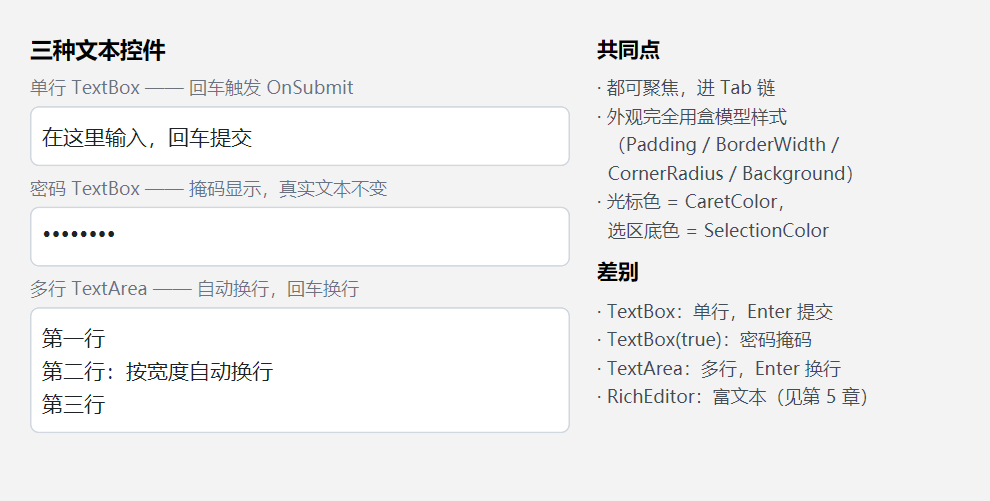
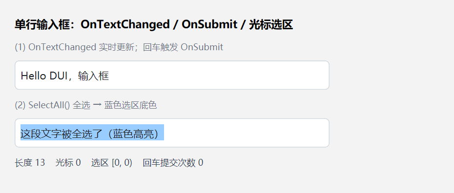
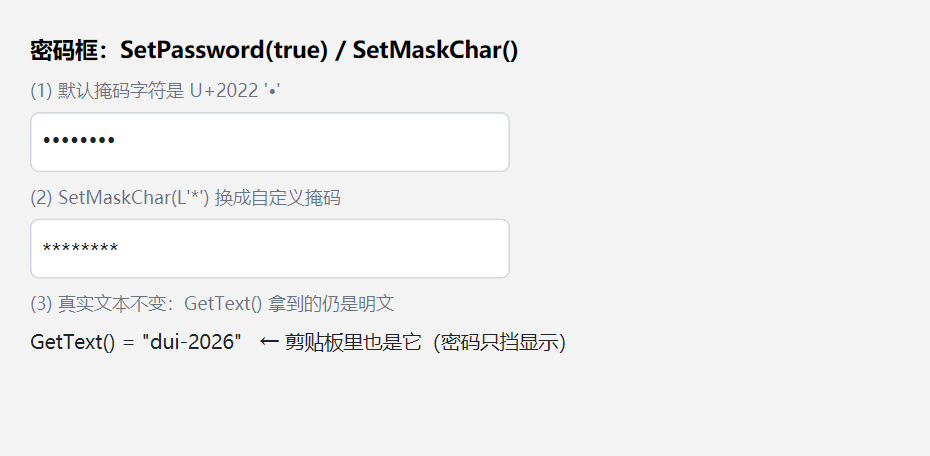
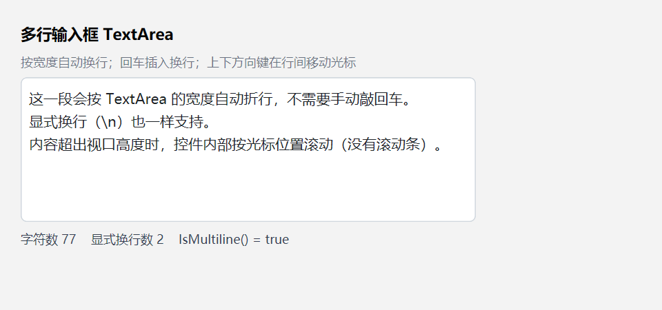
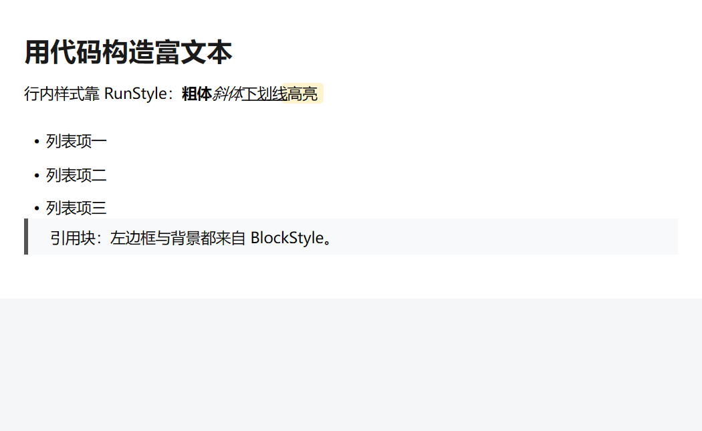
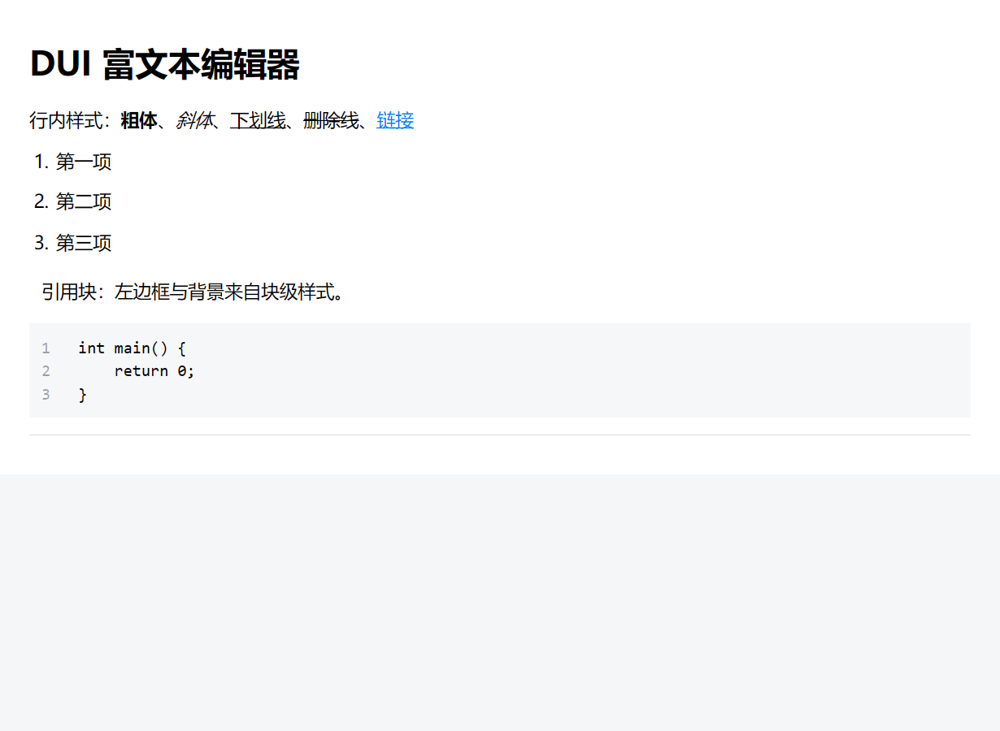

# DUI 输入控件使用指南（Input 开发者文档）

> **配套工程**：`Samples/TextInput/main.cpp`（TextBox / 密码框 / TextArea）、`Samples/RichEditor/main.cpp`（RichEditor + JSON 导入）。
> **截图**：`Doc/Input/`，按 `INN-M.png` 命名（NN = 章号，M = 该章第几个示例），均为**按示例代码实机运行**后 1:1 截取。
> **相关文档**：[Styles.md](Styles.md)（外观与文本样式）、[Layout.md](Layout.md)（布局与焦点链）、[Event.md](Event.md)（事件绑定与键盘路由）、[Pitfalls.md](Pitfalls.md)。

---

## 1. 选型：四种输入控件

| 需求 | 控件 | 类 | 说明 |
| --- | --- | --- | --- |
| 一行文本 | 单行输入框 | `dui::TextBox` | 回车触发 `OnSubmit` |
| 密码 | 密码框 | `dui::TextBox(true)` | 单行 + 掩码显示 |
| 多行纯文本 | 多行输入框 | `dui::TextArea` | 按宽度自动换行 |
| 富文本（标题 / 列表 / 引用 / 代码块） | 富文本编辑器 | `dui::RichEditor` | 块级文档模型 + 行内样式 |

```cpp
dui::TextBox*  single = root->AddChild<dui::TextBox>(fieldStyle);  // 单行
dui::TextBox*  secret = root->AddChild<dui::TextBox>(fieldStyle);  // 密码
secret->SetPassword(true);
dui::TextArea* area   = root->AddChild<dui::TextArea>(fieldStyle); // 多行
dui::RichEditor* rich = root->AddChild<dui::RichEditor>();        // 富文本
```



### 1.1 共同点

- **外观完全由盒模型样式决定**：`Padding` / `BorderWidth` / `BorderColor` / `CornerRadius` / `Background` / `Color` / `FontSize` 等，与普通 `Panel` 一模一样；输入框没有单独的"皮肤"。
- **可聚焦、进 Tab 链**：构造即 `SetFocusable(true)`；`Tab` / `Shift+Tab` 在可聚焦控件间移动焦点（控件自己不消费 `VK_TAB`）。
- **选区与光标可配**：`SelectionColor`（选区底色，默认 `0x803399FF` 半透明蓝）、`CaretColor`（光标色，未设时取文本色 `Color`）。
- **文本样式走继承**：`FontFamily` / `FontSize` / `FontWeight` / `FontStyle`（斜体）/ `TextDecoration`（下划线、删除线）都能用，写在父容器上对子输入框生效。
- **不支持 `TextAlign`**：属性存在，但输入框控件不读它。
- **有自然尺寸下限**：单行至少 120 DIP 宽、高至少是"字号 × 行高"；多行至少 200 × 80 DIP。下限只作用于**自然尺寸** —— 显式写了 `Width` / `Height` 就不受它约束。
- **显式高度不够会被裁**：控件按**内容盒**裁剪绘制，而内容盒高 = `Height` − `Padding` 上下 − 边框上下。若它小于文字的实际行高（默认 `LineHeight = 1.2`，配上雅黑行距系数后 14 DIP 的行高约 **22.2 DIP**），**文字底部（以及选区色带底部）会被切掉**。所以 14 DIP 文字配 `Padding(8)` 时，`Height` 要给到 **40 DIP**（内容盒 24 DIP ≥ 22.2）；或者干脆**不设 `Height`**，让控件按自然尺寸自适应（≈ 行高 + 内边距）。

### 1.2 焦点

```cpp
dui::FocusedElement();      // 当前焦点元素（nullptr = 无焦点）
element->Focus();           // 让某个元素取得焦点
dui::SetFocus(element);     // 同上（会置/清 State::Focused 状态）
```

焦点态样式用状态变体写：

```cpp
input->When(dui::State::Focused, dui::Style().Background(0xFFDCEEFF));
```

获得焦点时若没有选区，**光标会跳到文本末尾**；失去焦点时**选区被清除**（避免留下看不见的选区）。

---

## 2. 单行输入框 `TextBox`

### 2.1 读写文本

```cpp
dui::String s = box->GetText();   // 真实文本
box->SetText(L"你好，DUI");
box->Clear();                     // 等价于 SetText(L"")
```

`SetText` 的三个要点：

- **换行归一**：`\r\n` / `\r` 统一成 `\n`；
- **清空撤销栈**（`Ctrl+Z` 不能再撤回到 `SetText` 之前）；
- **光标只做 clamp，不归零也不移到末尾** —— `SetText` 之后光标仍在原下标（可能超出新长度则被夹住）。要显式定位用 `SetCaret()`。

### 2.2 事件

```cpp
// 文本变化：参数是新的真实文本（密码模式也传明文）
box->OnTextChanged([](const dui::String& text) { /* ... */ });

// 回车提交：只在单行 TextBox 上触发（TextArea 的回车是插入换行）
box->OnSubmit([]() { /* ... */ });
```

`OnTextChanged` 在**输入、退格、删除、剪切、粘贴、撤销、重做**时都会触发 —— 撤销也会回调，别在里面做重活。

元素级 `OnKeyDown` / `OnChar` / `OnPointerDown` 与这两个语义事件**并存**：控件内部先处理（消费），绑定仍然能收到。

### 2.3 光标与选区

```cpp
uint32_t caret = box->Caret();          // 光标下标
box->SetCaret(5);                       // 定位光标（会清掉选区）
uint32_t a = box->SelectionStart();     // 选区起点
uint32_t b = box->SelectionEnd();       // 选区终点（不含）
bool has = box->HasSelection();
dui::String picked = box->SelectedText();
box->SelectAll();                       // 全选
box->Deselect();                        // 取消选区（光标不动）
```

**下标口径是 UTF-16 码元**（不是"第几个汉字"）：`GetText().size()` 就是下标上限；代理对（emoji 等）占 2 个码元，光标可能落在代理对中间。



### 2.4 键盘与鼠标

| 按键 | 行为 |
| --- | --- |
| `←` / `→` | 按码点移动；**有选区时先跳到选区端点**；`Shift` 扩展选区 |
| `↑` / `↓` | **仅多行**；单行不消费（继续冒泡） |
| `Home` / `End` | 行首 / 行尾；`Ctrl+Home` / `Ctrl+End` = 全文首 / 尾 |
| `Backspace` / `Delete` | 删除选区或前 / 后一个码点 |
| `Enter` | 多行插入 `\n`；**单行触发 `OnSubmit`** |
| `Ctrl+A` / `C` / `X` / `V` | 全选 / 复制 / 剪切 / 粘贴（**没有 Ctrl 不消费**） |
| `Ctrl+Z` / `Ctrl+Y` | 撤销 / 重做 |
| `Tab` | **不消费** → 框架移动焦点（不会插入制表符） |

鼠标：**单击定位光标**、**按住拖动选区**。注意：

- **没有双击选词 / 三击选行**（控件不统计点击次数）。
- **不做指针捕获**：拖出控件边界后事件不再回到它，选区拖不出边界。
- **滚轮不滚动自身内容**（控件没有 `HandleWheel`），滚轮会冒泡给**最近的祖先 `Scroller`**；输入框自身的滚动只由"光标跟随可见"驱动。

---

## 3. 密码框

```cpp
dui::TextBox* pwd = root->AddChild<dui::TextBox>(fieldStyle);
pwd->SetPassword(true);        // 也可构造时传参：dui::TextBox(true)
pwd->SetMaskChar(L'*');        // 自定义掩码字符（默认是 U+2022 '•'）
bool on = pwd->IsPassword();
wchar_t ch = pwd->MaskChar();
```



要点：

- **只挡显示**：真实文本不变，`GetText()` 拿到的仍是明文，`OnTextChanged` 的参数也是明文。
- **剪贴板里也是明文**：`Ctrl+C` / `Ctrl+X` 复制的是真实文本 —— 密码框只防"看肩膀"，不防剪贴板。
- 默认掩码用 `•`（U+2022）而不是 `●`（U+25CF）：大实心圆和 1px 光标条同色紧邻时会看成一条粗竖线；框架还对掩码字形做了垂直居中补偿。
- `SetPassword` 切换不会丢文本，只重建显示串。

---

## 4. 多行输入框 `TextArea`

`TextArea` 继承 `TextBox`，只是把 `multiline_` 打开：

```cpp
dui::TextArea* area = root->AddChild<dui::TextArea>(dui::Style()
    .Width(440.f).Height(140.f)
    .Padding(8.f)
    .Background(0xFFFFFFFF)
    .BorderWidth(1.f).BorderColor(0xFFD0D7DE)
    .CornerRadius(6.f));
area->SetText(L"第一行\n第二行");
```



与单行的差别：

| | 单行 `TextBox` | 多行 `TextArea` |
| --- | --- | --- |
| 回车 | 触发 `OnSubmit` | 插入 `\n` |
| `↑` / `↓` | 不消费 | 在行间移动光标（记住目标列） |
| 折行 | 不折行（横向溢出） | **按宽度自动折行**（换行宽取 `Width` 减 padding，否则取可用宽） |
| 溢出 | 横向内部滚动 | 纵向内部滚动 |

内容超出视口时，控件**按光标位置内部滚动**（光标始终可见），但**没有滚动条**；滚轮不会滚它（会冒泡给祖先 `Scroller`）。

> 撤销栈上限 100 步，且**每个按键一步**（不像 `RichEditor` 那样把连续输入合并成一步）。

---

## 5. 富文本编辑器 `RichEditor`

`RichEditor` 作用于 **`richtext::RichDoc` 文档模型**：块级结构（标题 / 列表 / 引用 / 代码块 / 图片 / 分割线）+ 行内 run 样式（粗 / 斜 / 下划线 / 删除线 / 链接 / 高亮）。

### 5.1 结构：必须外套 `Scroller`

`RichEditor` **不生成块级子元素、也不画滚动条**（视口与滚动条归外层 `Scroller`）。它只暴露文档总高，外层据此算滚动范围。

```cpp
dui::Scroller*  page  = root->AddChild<dui::Scroller>(dui::Style()
    .FlexGrow(1.f)
    .Background(0xFFF5F6F8));
dui::Panel*     sheet = page->AddChild<dui::Panel>(dui::Style()
    .Padding(dui::Thickness(24.f, 28.f, 24.f, 32.f))
    .Background(0xFFFFFFFF));
dui::RichEditor* view = sheet->AddChild<dui::RichEditor>();
view->SetDoc(doc);
```

**没有祖先 `Scroller` 就不会滚动**（连"光标跟随"也失效：光标滚不进视口）。

### 5.2 文档模型 `RichDoc`

```cpp
namespace rt = dui::richtext;

rt::RichDoc doc;                 // 文档
doc.defaultFont = L"Microsoft YaHei";
doc.defaultFontSize = 15.f;

rt::Block block;                 // 块
block.kind  = rt::BlockKind::Heading;   // Paragraph/Heading/List/ListItem/Quote/Code/Image/Rule
block.level = 1;                          // Heading 的 1..6 级

rt::Run run;                     // 行内片段
run.text  = L"粗体";
run.style.weight = 700;          // 粗体（DWRITE 字重；0 = 继承）
run.style.italic = true;         // 斜体
run.style.underline = true;      // 下划线
run.style.strike = true;         // 删除线
run.style.href = L"https://…";   // 链接
run.style.background = 0xFFFFF3CD;  // 高亮底色（A == 0 = 无）
run.style.padding = dui::Thickness(2.f, 6.f);
run.style.radius = 4.f;               // 高亮盒圆角
run.style.color = 0xFF1A1A1A;         // 文字色（A == 0 = 继承）

block.runs.push_back(run);
doc.blocks.push_back(block);
```

块级样式在 `BlockStyle`：`align`（`Start`/`Center`/`End`）、`lineHeight`（倍数）、`lineHeightDip`（绝对行高，优先）、`margin`、`indent`、`background`、`borderLeftWidth` / `borderLeftColor`（引用块左边框）。

**样式"空值即继承"**：`fontSize == 0` / `weight == 0` / `color.A == 0` / `family` 空串 → 沿用文档默认或父级。



### 5.3 喂数据：JSON 导入

```cpp
rt::RichDoc doc;
rt::ParseRichDoc(dui::Utf8ToWide(kDocJson), doc);   // 返回 false = 根结构非法
if (!doc.Diagnostics().Clean()) {
    // doc.report：未知块 / 未知行内 / 未知样式键 / 非法值的计数与首条问题
}
```

支持的 JSON 形态：

| JSON | 含义 |
| --- | --- |
| `paragraph` / `heading` / `quote` / `codeBlock` / `image` / `horizontalRule` / `list` | 块 |
| `text` / `bold` / `italic` / `underline` / `strikethrough` / `hyperlink` | 行内容器 |
| `settings.defaultFont` / `defaultFontSize` | 文档默认字体与字号 |

解析策略是**坏数据不中断**：未知键跳过并计数，文档继续解析。



> **只有导入，没有导出** —— 框架目前**没有**把 `RichDoc` 序列化回 JSON 的 API。

### 5.4 编辑交互

| 操作 | 行为 |
| --- | --- |
| 回车 | 分裂块；列表项 → 新增同级项；空列表项回车 → **退出列表**；代码块内 → 只换行不拆块 |
| 退格 | 段内按码点删；块首退格 → 与**上一块合并**（代码块不合并） |
| Delete | 段内后删；块尾 Delete → 与**后一块合并**（代码块不合并） |
| `Ctrl+A` / `C` / `X` / `V` / `Z` / `Y` | 全选 / 复制 / 剪切 / 粘贴 / 撤销 / 重做 |
| `Tab` | 不消费 → 框架切焦点 |

- **撤销粒度 = 整文档快照**（上限 100 步），但**连续输入会合并成一步**。
- 分割线是只读装饰块（只能被相邻的退格 / Delete 删掉）；图片不可编辑内容，但可作光标定位点（图前 / 图后）。
- 代码块的正文放在 `block.code`（不在 `runs` 里），`showLineNumbers` 控制行号。

### 5.5 只读模式

```cpp
view->SetEditable(false);       // 默认 true
bool editable = view->IsEditable();
```

只读后：不可聚焦（不进 Tab 链）、不响应点击聚焦、键盘事件照常冒泡但不处理、不画光标、不闪烁。

### 5.6 取回文档

```cpp
const rt::RichDoc& d = view->Doc();     // 内部副本的引用（编辑后随之变化）
float h = view->ContentHeight();        // 排版后的文档总高（DIP，不含 padding）
```

`Doc()` 返回的是**内部副本的引用** —— 它会跟着编辑变化，但**不能用来回写宿主的模型**；要拿当前内容得自己拷一份。

> `SetDoc()` 是**值语义拷贝**，并且会**清空撤销栈**、复位光标。

---

## 6. API 速查

### 6.1 `TextBox` / `TextArea`

| 分类 | API |
| --- | --- |
| 构造 | `TextBox(bool password = false)`、`TextArea()` |
| 文本 | `GetText()` / `SetText(String)` / `SetText(const wchar_t*)` / `Clear()` |
| 光标 | `Caret()` / `SetCaret(index)` |
| 选区 | `SelectionStart()` / `SelectionEnd()` / `HasSelection()` / `SelectedText()` / `SelectAll()` / `Deselect()` |
| 事件 | `OnTextChanged(fn)` / `OnSubmit(fn)` |
| 密码 | `IsPassword()` / `SetPassword(bool)` / `MaskChar()` / `SetMaskChar(wchar_t)` |
| 其它 | `IsMultiline()` |

### 6.2 `RichEditor`

| 分类 | API |
| --- | --- |
| 文档 | `SetDoc(const RichDoc&)` / `Doc()` / `ContentHeight()` |
| 状态 | `SetEditable(bool)` / `IsEditable()` / `HasSelection()` |
| 模型 | `richtext::RichDoc` / `Block` / `BlockStyle` / `Run` / `RunStyle` / `BlockKind` / `ListType` / `Align` |
| JSON | `richtext::ParseRichDoc(json, out)`（**只有导入**） |
| 编辑原语 | `richtext::RichDocEditor.h`：`InsertText` / `DeleteRange` / `SplitBlock` / `MergeRuns` 等（纯函数，段内 UTF-16 偏移） |

---

## 7. 已知限制与坑

**TextBox / TextArea**

1. 不支持双击选词、三击选行。
2. 不支持滚轮滚动自身内容，也没有滚动条（滚动只由光标跟随驱动）。
3. 不支持 `TextAlign`。
4. 自然尺寸有下限（单行 120 DIP 宽、多行 200 × 80 DIP），显式设 `Width` / `Height` 才不受限。
5. **显式 `Height` 小于"内容盒所需高度"时，文字底部与选区色带会被裁掉**（内容盒高 = `Height` − `Padding`×2 − 边框；需 ≥ 文字实际行高，14 DIP 雅黑约 22.2 DIP）。要么给足高度，要么不设 `Height` 让它自适应。
6. 撤销栈上限 100 步，且**每个按键一步**（连续输入不合并）。
7. `SetText` **清空撤销栈**、**不重置光标**（只 clamp）。
8. **密码模式下复制到剪贴板的是明文**。
9. 没有 placeholder、没有 maxLength、没有输入校验。
10. 拖选不能拖出控件边界（不做指针捕获）。
11. IME 只走系统隐形 caret，**没有内联 preedit**（组合中的文字不在控件里显示）。

**RichEditor**

12. **必须外套 `Scroller`** 才能滚动；否则连"光标跟随可见"都没有。
13. 撤销是**整文档快照**（上限 100 步）→ 大文档内存与重排成本高。
14. **没有 JSON 导出 API**。
15. **没有变更事件**（无 `OnTextChanged` / `OnChange`），宿主只能轮询 `Doc()` 对比。
16. 代码块正文在 `block.code` 而非 `runs`；JSON 的 `language` 字段被丢弃。
17. 分割线不可编辑；图片只有"图前 / 图后"两个光标位，不能改尺寸。
18. 引用块的 `attribution` 字段只在模型里，**渲染层暂不绘制**。
19. `Doc()` 返回内部副本的引用，不能用于回写宿主模型；`SetDoc()` 会清空撤销栈。
20. IME 同样没有内联 preedit。

---

## 8. 相关文档

- [Styles.md](Styles.md)：颜色 / 圆角 / 边框 / 文本样式 / 继承属性。
- [Layout.md](Layout.md)：布局与焦点链、状态变体 `When(State::Focused, …)`。
- [Event.md](Event.md)：事件绑定形态、隧道 / 冒泡路由、键盘与滚轮路由。
- [Arch/06-Events.md](Arch/06-Events.md)：焦点、键盘、指针事件契约。
- [Arch/RichEditor.md](Arch/RichEditor.md)：富文本控件的设计规格（块级模型、编辑语义、验收）。
- [Pitfalls.md](Pitfalls.md)：踩坑记录。  
