# DUI 布局使用指南（Layout 开发者文档）

> **配套工程**：`Samples/Layout/main.cpp`（Flex / 尺寸 / 对齐 / Grid / 换行）、`Samples/Position/main.cpp`（Relative / Absolute / Fixed / zIndex）、`Samples/Scroller/main.cpp`（滚动容器）。
> **截图**：`Doc/Layout/`，按 `LNN-M.png` 命名（NN = 章号，M = 该章第几个示例），均为**按示例代码实机运行**后 1:1 截取。
> **相关文档**：[Styles.md](Styles.md)（颜色 / 圆角 / 边框 / 文本 / 继承属性）、[Input.md](Input.md)（输入控件）、[Event.md](Event.md)（事件绑定与命中）、[Pitfalls.md](Pitfalls.md) §4（布局与样式）。

---

## 1. 布局模型

### 1.1 两趟：Measure → Arrange

布局分两趟，都在**同一帧内全量重算**（无增量布局、无跨帧缓存）：

1. **Measure（自底向上）** —— 算每个元素的自然尺寸：
   内容尺寸 → 加内边距（`BorderBox` 模式下再加边框宽度）→ 被 `Width` / `Height` 覆盖 →
   主轴方向再被 `FlexBasis` 覆盖 → 用 `Min*` / `Max*` 夹紧 → 得到**元素盒**尺寸，
   再向外扩出 `Margin` 占位 → **外边距盒**尺寸（父布局的聚合 / grow / shrink / Grid 轨道 / 换行装箱都按它算）。
2. **Arrange（自顶向下）** —— 定位置：按父容器的方向与对齐规则摆放子项，
   并在这趟里分配 `FlexGrow` 的剩余空间、计算 `FlexShrink` 的收缩量。

一句话：**尺寸在 Measure 定、位置在 Arrange 定**；`Width`/`Height` 影响前者，`JustifyContent`/`AlignItems` 影响后者。

### 1.2 谁是容器、谁是项

容器与普通元素是同一个类（`dui::Panel` 等），区别只在样式：

| `Display` | 行为 |
| --- | --- |
| `Flex`（默认） | 子项按 flex 规则排列 |
| `Grid` | 子项按网格规则排列（见 §5） |
| `None` | 既不画、也不占位（见 §7.1） |

没有"行/列"这种专用元素：一个 `Panel` 设了 `FlexDirection::Row` 就是行，设 `Column` 就是列（默认值）。

### 1.3 单位与坐标系

- 所有长度都是 **DIP**（1/96 英寸；96 DPI 下 1 DIP = 1 物理像素），高 DPI 下由框架按窗口 DPI 换算。
- **只有 float 长度**：没有 `auto`、没有百分比尺寸 —— `Width(200.f)` 就是 200 DIP。
- `Element::Bounds()` 返回的是**相对根元素原点的绝对坐标**（不是相对父容器）。

---

## 2. Flex 容器

### 2.1 `FlexDirection`：Row / Column

**默认是 `Column`**（竖排）。要横排必须显式写 `FlexDirection::Row`。

```cpp
// 默认 Column：三个子项竖着排
dui::Panel* col = root->AddChild<dui::Panel>(dui::Style().Gap(6.f));

// 显式 Row：三个子项横着排
dui::Panel* row = root->AddChild<dui::Panel>(dui::Style()
    .FlexDirection(dui::FlexDirection::Row)
    .Gap(6.f));
```

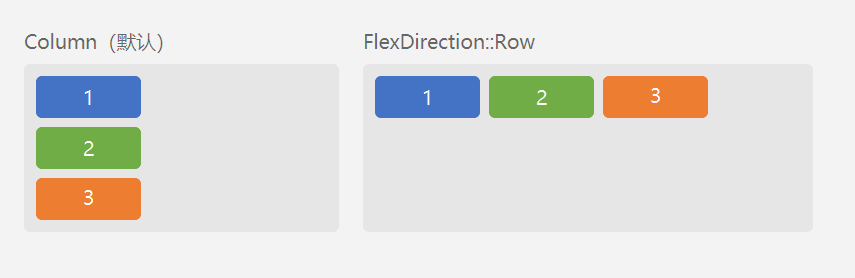

左右两个容器的子项完全一样，只有方向不同 —— 这决定了后面所有"主轴 / 交叉轴"的方向。

### 2.2 主轴分布：`JustifyContent`

`JustifyContent` 决定**主轴上剩余空间**怎么分（主轴 = `Row` 的水平方向 / `Column` 的垂直方向）。六个取值：

| 取值 | 剩余空间怎么分 |
| --- | --- |
| `Start`（默认） | 全挤在起始边 |
| `Center` | 两侧各留一半 |
| `End` | 全挤在末端 |
| `SpaceBetween` | 首尾贴边，中间均分 |
| `SpaceAround` | 每个项两侧各留一半间距（两端间距是中间的 1/2） |
| `SpaceEvenly` | 所有间距相等 |

```cpp
// 注意：justify-content 作用在「装着这些方块的那个容器」上
dui::Panel* demo = cell->AddChild<dui::Panel>(dui::Style()
    .FlexDirection(dui::FlexDirection::Row)
    .Height(30.f)
    .JustifyContent(dui::Justify::SpaceBetween));
```

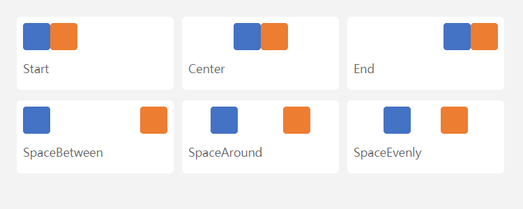

两点注意：

- **剩余空间按子项的最终尺寸算**：先 `grow` / `shrink` 定下子项尺寸，再把剩下的空间分掉。`Center` / `End` 在空间不足（剩余为负）时**照样生效** —— 内容仍居中 / 贴末端，并向另一侧溢出（同 CSS）；`SpaceBetween` 等在空间不足时退化为 `Start`。
- `SpaceBetween` 等分布的是**剩余空间**，不是子项之间的固定间距 —— 子项自己的宽度仍按 §3 算。

> **面板里的文字不会自动垂直居中**：`Column` 容器的主轴是垂直方向，默认 `Start` 就是"从上往下贴"，文字排在内容盒顶部；`AlignItems` 只管交叉轴（水平方向）。要垂直居中得显式写 `JustifyContent(dui::Justify::Center)`。
>
> 另外要给内容盒留够高度：内容盒高 = `Height` − 上下 `Padding`，而**文字的实际行高比 `FontSize` 大不少**（默认 `LineHeight = 1.2`，配上雅黑的行距系数，实际 ≈ `FontSize × 1.58`：13 DIP → **20.6 DIP**，14 DIP → **22.2 DIP**）。内容盒比行高还矮时 `Center` 仍会把文字**居中**，但文字会溢出内容盒（上下各溢出一点）—— 想让文字稳稳待在盒子里，就把内容盒留够一行行高（如 14 DIP 文字配 `Height 48 + Padding 10` → 内容盒 28 DIP > 22.2 DIP）。

> **居中按"墨迹"算，不是按"行盒"算**：行盒（`FontSize × 1.58`）里上下留白本来就不对称 —— DWrite 的比例行距把基线压在 `ascent × 1.2`（雅黑 = 1.27 em），而汉字墨迹只到 0.83 em，于是**行盒居中时文字视觉偏下 1~2 DIP**。框架在**居中排布**（主轴 `justify-content: center` 或交叉轴 `align-items: center`）且文本是**单行**时，会实测整段墨迹范围、按墨迹中心落位，所以肉眼看到的是真居中。多行文本、顶部对齐（`Start`）的文本不做补偿 —— 保持行盒语义与基线一致。


### 2.3 交叉轴：`AlignItems` / `AlignSelf`

`AlignItems` 决定**交叉轴上**子项怎么对齐（交叉轴 = `Row` 的垂直方向 / `Column` 的水平方向）：

| 取值 | 行为 |
| --- | --- |
| `Stretch`（默认） | 拉满交叉轴；子项**显式设了该轴尺寸**时用自然尺寸 |
| `Start` | 自然尺寸，贴起始边 |
| `Center` | 自然尺寸，居中 |
| `End` | 自然尺寸，贴末端 |
| `Baseline` | 按**首行基线**对齐（见 §2.4） |

`AlignSelf` 是**单个子项**的覆盖写法，优先级高于父容器的 `AlignItems`。

```cpp
dui::Panel* demo = cell->AddChild<dui::Panel>(dui::Style()
    .FlexDirection(dui::FlexDirection::Row)
    .Height(80.f).Padding(6.f).Gap(8.f)
    .AlignItems(dui::Align::Start));      // 父级：全部贴顶

// 这一项单独贴底
demo->AddChild<dui::Panel>(dui::Style()
    .Width(40.f).Height(24.f)
    .AlignSelf(dui::Align::End));
```

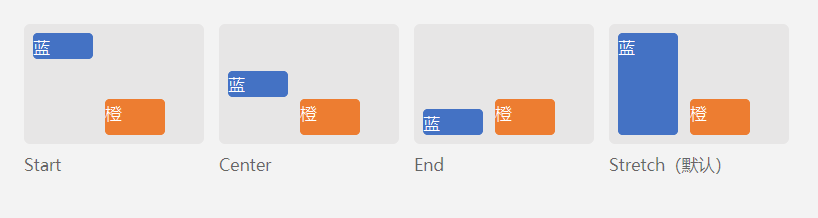

蓝块没有设高度：默认 `Stretch` 时被拉满整个交叉轴；其它取值下保持内容自然高度。橙块用 `AlignSelf::End` 单独贴底。

### 2.4 `Baseline`：按首行基线对齐

`AlignItems::Baseline` 让同组项按**首行文字的基线**对齐 —— 字号不同时，字的底部（基线）齐平，而不是底部边缘齐平。

```cpp
dui::Panel* row = wrap->AddChild<dui::Panel>(dui::Style()
    .FlexDirection(dui::FlexDirection::Row)
    .AlignItems(dui::Align::Baseline));
row->AddChild<dui::Text>(L"16 号", dui::Style().FontSize(16.f));
row->AddChild<dui::Text>(L"28 号", dui::Style().FontSize(28.f));
```

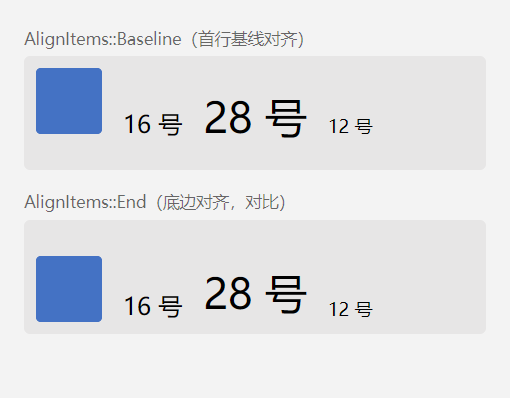

上面一行是 `Baseline`：蓝块的**底边**落在文字基线上（它没有基线，按外边距盒底边参与计算）；下面一行是 `End`：所有项的底边直接对齐。

> `Baseline` 在 `Column` 主轴下退化为 `Start`，在**换行布局（`FlexWrap`）**下退化为自然尺寸；Grid 里不支持基线对齐。

---

## 3. 尺寸与弹性

### 3.1 `Width` / `Height` 与 `Min*` / `Max*`

`Width` / `Height` 是**元素盒**尺寸（含内边距；`BorderBox` 时含边框），直接覆盖内容自然尺寸。

`MinWidth` / `MaxWidth` / `MinHeight` / `MaxHeight` 在测量末尾做夹紧：

```cpp
.Width(300.f).MaxWidth(160.f)   // → 实际 160
.Width(80.f).MinWidth(160.f)     // → 实际 160
```

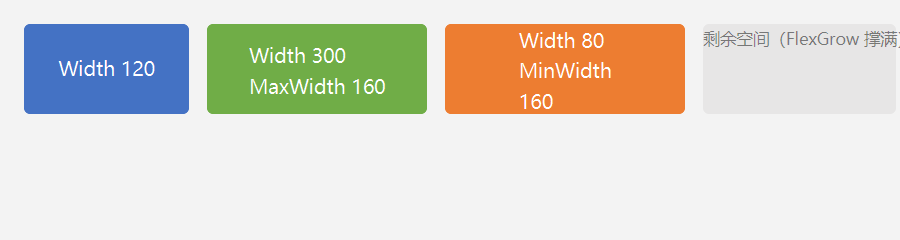

三个盒子都没撑满容器，右侧灰块是 `FlexGrow` 撑出来的剩余空间。

> **夹紧顺序是 min → max**，即 `Min` 与 `Max` 冲突时 **`Max` 胜**（与 CSS 相反）。

### 3.2 `FlexGrow`：分剩余空间

容器主轴上有剩余空间时，按 `FlexGrow` 的**比例**分配：

```cpp
// 三个 grow=1 → 等分剩余空间
NewBox(row, L"grow = 1", 0xFF4472C4, 0.f, 46.f, 1.f);
```

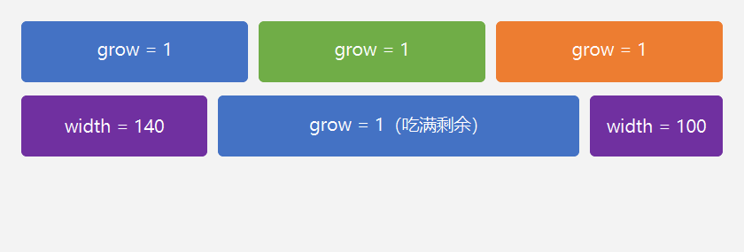

要点：

- **定宽项不参与分配**：第二行里两侧写死 140 / 100 DIP，中间 `grow = 1` 的项吃满全部剩余。
- 只有**存在剩余空间**时才分配；放不下时不会先压缩别人（那是 `FlexShrink` 的事）。
- `FlexGrow` 分配之后**不再回查 `MaxWidth`** —— 想限宽就写 `MaxWidth`，但它不会在 grow 之后再夹一次。

### 3.3 `FlexShrink`：放不下时收缩

子项总尺寸**超出**容器时，按 `FlexShrink` 收缩。框架的收缩量按 **`shrink × 当前尺寸`** 加权（CSS 用的是 shrink 因子与基准尺寸，数值接近但不完全等价）。

```cpp
dui::Style s = dui::Style()
    .Width(320.f)
    .FlexShrink(shrink)      // 显式给值：0 = 不参与收缩
    .MinWidth(60.f);          // 收缩下限
```

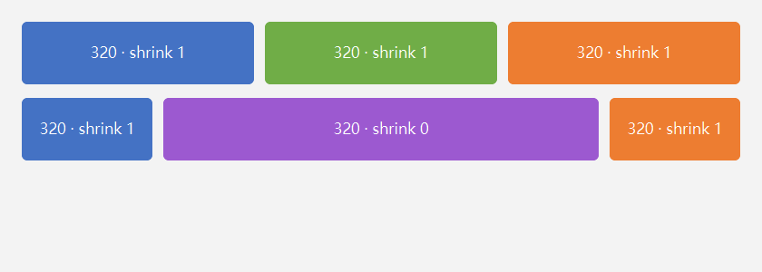

第一行三个 320 DIP 的盒子超出容器宽度 → 一起收缩到放得下为止；第二行中间那个 `FlexShrink(0)` 不参与收缩，保持 320 DIP，把右边的邻居挤到容器外（默认 `overflow: visible`，所以看得见）。

> **默认 `FlexShrink = 1`**：不写也会收缩。要"固定宽度"必须显式写 `FlexShrink(0.f)`。
>
> 纵向收缩时，**文本子项有内容下限**（同 CSS `min-height: auto`，取排版出来的首行行高）：不会被压到比一行还矮 —— 否则盒子被压扁、文字仍按整段绘制，文字就从自己的盒子里"漏"出来（见 §7.4）。显式写了 `Height` 的文本按你的意图走，不受此下限保护。

### 3.4 `FlexBasis`：主轴基准尺寸

`FlexBasis` 是主轴方向的**基准尺寸**（元素盒语义，同 `Width`），优先于内容自然尺寸；配合 `FlexGrow` 时表示"先按 basis 起算，再分剩余空间"。

```cpp
dui::Style s = dui::Style()
    .FlexBasis(60.f).Height(46.f);
if (grow > 0.f) s.FlexGrow(grow);
```

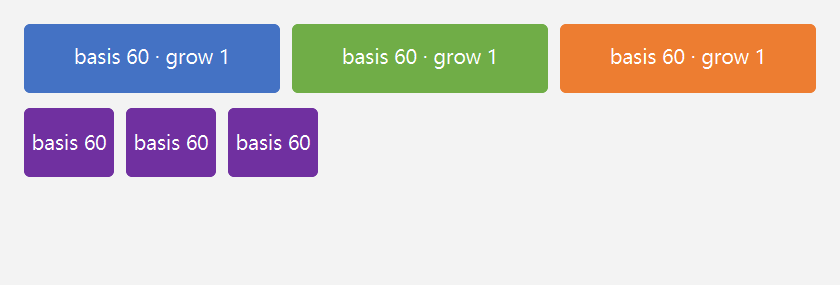

上排 `basis 60 + grow 1` → 三个等分剩余空间；下排只写 `basis 60` 不写 grow → 保持 60 DIP 宽，剩余空间留在末尾（`JustifyContent::Start`）。

> `FlexBasis` 只作用于**主轴**；交叉轴要用 `Width` / `Height`。

---

## 4. 间距与换行

### 4.1 `Gap` / `RowGap` / `ColumnGap`

三个间距属性都存在，但**归属的轴不同**：

| 属性 | 含义 |
| --- | --- |
| `Gap` | 兜底值：没设 `RowGap` / `ColumnGap` 时各自回落它 |
| `ColumnGap` | **列方向**间距 —— `Row` 主轴的项间距、`Grid` 的列间距 |
| `RowGap` | **行方向**间距 —— `Column` 主轴的项间距、`Grid` 的行间距 |

```cpp
dui::Style demoStyle = dui::Style()
    .FlexDirection(rowAxis ? dui::FlexDirection::Row : dui::FlexDirection::Column);
if (rowAxis) demoStyle.ColumnGap(gap);
else         demoStyle.RowGap(gap);
```

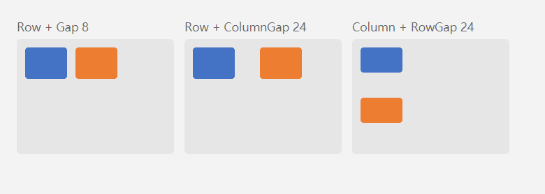

在 `Row` 容器里写 `RowGap` 不起作用，在 `Column` 容器里写 `ColumnGap` 也不起作用 —— 别写错轴。

### 4.2 `FlexWrap`：放不下就换行

`FlexWrap::Wrap` 让主轴放不下的项**断到下一行**（贪心装箱：能放就放，放不下才换行）。

```cpp
dui::Panel* wrap = root->AddChild<dui::Panel>(dui::Style()
    .FlexDirection(dui::FlexDirection::Row)
    .FlexWrap(dui::FlexWrap::Wrap)
    .ColumnGap(12.f)     // 行内（列方向）间距
    .RowGap(20.f)        // 行与行之间（行方向）间距
    .Width(320.f));
```

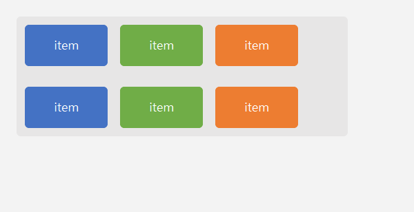

限制（务必知道）：

- **只有 `Row` 方向支持换行**；`Column` 容器写 `FlexWrap` 无效。
- **换行时不做 `FlexGrow` / `FlexShrink`** —— 换行是"放不下就换"，不是"压缩到放得下"。

---

## 5. Grid 布局

### 5.1 轨道类型：`Fixed` / `Flex` / `Auto` / `Percent`

把容器的 `Display` 设为 `Grid`，再用 `GridTemplateColumns` / `GridTemplateRows` 声明轨道：

```cpp
dui::Panel* grid = root->AddChild<dui::Panel>(dui::Style()
    .Display(dui::Display::Grid)
    .GridTemplateColumns({dui::Fixed(120.f), dui::Flex(1.f),
                          dui::Auto, dui::Percent(20.f)})
    .GridTemplateRows({dui::Fixed(60.f), dui::Auto})
    .Gap(8.f));
```

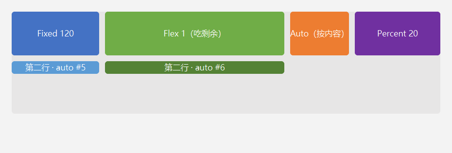

| 轨道 | 含义 |
| --- | --- |
| `dui::Fixed(120.f)` | 固定 120 DIP |
| `dui::Flex(1.f)` | 占剩余空间，按份额分（`Flex(2.f)` 就是两份） |
| `dui::Auto` | 按内容取下界（内容多大就多大） |
| `dui::Percent(20.f)` | 占父容器宽/高的 20% |

`Gap` 在 Grid 里就是**行列间距**的通用写法（`RowGap` 行间距、`ColumnGap` 列间距）。

> **测量阶段 vs 排布阶段**：容器尺寸还没确定时（Measure），`Percent` 与 `Flex` 轨道先按"内容下界"算；真正摆位时（Arrange）才按可用宽度解析出百分比与剩余空间份额。所以 Grid 容器最好给一个确定的 `Width`。
>
> `GridTemplate*` **只能写在 `Style` 链上**（`Set(Prop::GridTemplateColumns, …)` 无效，也不能用状态变体覆盖）。

### 5.2 自动放置、显式行列、跨格

子项**默认按序自动填空**；也可以显式指定行列（**0 基**）与跨格：

```cpp
dui::Panel* wide = NewCell(grid, L"显式 row0 col1 · 跨 2 列", 0xFFC00000);
wide->Set(dui::Prop::GridRow, 0);          // 0 基行号
wide->Set(dui::Prop::GridColumn, 1);       // 0 基列号
wide->Set(dui::Prop::GridColumnSpan, 2);   // 跨 2 列
```

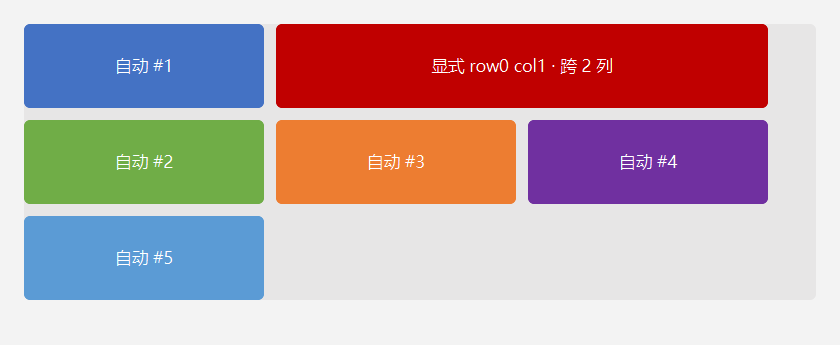

规则：

- 显式位置**已被占用**时放宽为按序自动放置；找不到空位时**追加隐式行**。
- `GridRow` / `GridColumn` / `GridRowSpan` / `GridColumnSpan` **没有 `Style` setter**，只能用 `element->Set(dui::Prop::…, 值)`；默认跨格数为 1。
- Grid 内支持 `AlignItems`（Stretch / Start / Center / End）与 `AlignSelf`；**不支持 `JustifyContent`，也不支持 `Baseline`**。

---

## 6. 定位

### 6.1 `Position::Relative`：偏移，不占位

`Relative` 的 `Left` / `Top` 是**偏移量**（不是定位）：元素仍占着流内原位，只是自己挪一挪，兄弟不动。

```cpp
dui::Panel* rel = row->AddChild<dui::Panel>(dui::Style()
    .Position(dui::Position::Relative).Left(28.f).Top(18.f)
    .Width(120.f).Height(48.f));
```

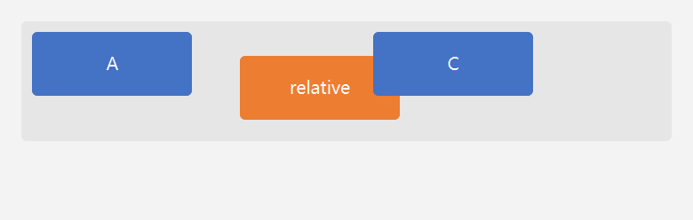

注意 `Relative` **只认 `Left` / `Top`**，`Right` / `Bottom` 对它无效。

### 6.2 `Position::Absolute`：脱离流 + 四边定位

`Absolute` 的元素**不参与父容器的排版**（不占位、不挤开兄弟），位置由四条边决定：

| 写法 | 效果 |
| --- | --- |
| `Left` + `Top` | 贴包含块左上角 |
| `Right` + `Bottom` | 贴包含块右下角 |
| `Left` + `Right` 同设 | 横向拉伸（宽度 = 盒宽 − 左 − 右） |
| `Top` + `Bottom` 同设 | 纵向拉伸 |

**包含块** = 最近的 `position != Static` 的祖先；找不到就用**根元素（窗口客户区）**。

> `Absolute` 的绘制与命中有统一的"锚点表"：按最近定位祖先分组消费。因此**即使中间隔着 `Scroller`，也不会被它的滚动原点或视口裁剪影响** —— 它始终相对包含块定位。

```cpp
// 容器显式设 Relative → 它就是下面 Absolute 的包含块
dui::Panel* stage = cell->AddChild<dui::Panel>(dui::Style()
    .Position(dui::Position::Relative)
    .Width(165.f).Height(140.f));

dui::Panel* abs = stage->AddChild<dui::Panel>(dui::Style()
    .Position(dui::Position::Absolute).Left(12.f).Top(12.f)
    .Width(120.f).Height(36.f));
```

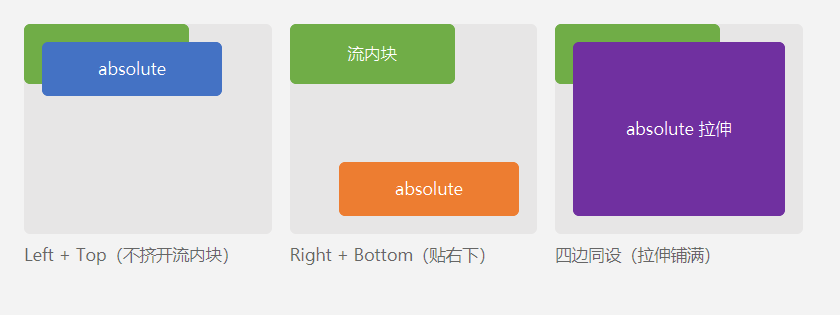

第一格里蓝色的 absolute 盖在绿色流内块上，但绿色块没有被挤开 —— 这就是"脱离流、不占位"。

### 6.3 `Position::Fixed`：相对窗口

`Fixed` 相对**窗口客户区**定位，不随祖先滚动：

```cpp
dui::Panel* fx = root->AddChild<dui::Panel>(dui::Style()
    .Position(dui::Position::Fixed).Right(16.f).Bottom(16.f)
    .Width(200.f).Height(40.f));
```

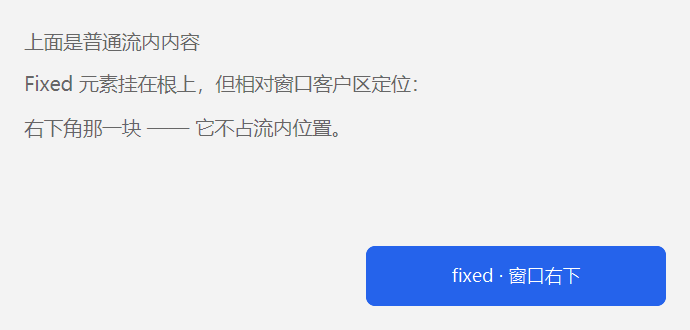

`Fixed` 走**窗口级层**（不进 `Absolute` 的锚点表）：即使把它挂在 `Scroller` 里面，它仍然钉在窗口上 —— 不随内容滚动，也不被那个 `Scroller` 的视口裁剪。适合做悬浮按钮、遮罩、状态条。

### 6.4 `ZIndex`：层叠顺序

同一个包含块内的 `Absolute` 按 `ZIndex` **升序绘制**（小的沉底，大的浮起）；值相同时按树序。

```cpp
dui::Style s = dui::Style()
    .Position(dui::Position::Absolute).Left(x).Top(y)
    .Width(120.f).Height(40.f);
if (z != 0) s.ZIndex(z);
```

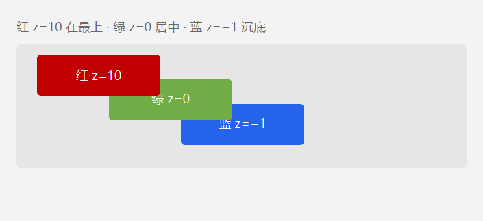

注意：

- `ZIndex` **只对 `Absolute` 生效**（`Fixed` 恒为 0，走窗口级浮层）。
- `ZIndex` 只影响**绘制与命中顺序**，不影响几何位置。
- 不同包含块之间的 `Absolute` 各自成组，`ZIndex` 不跨组比较。

---

## 7. 其它

### 7.1 `Display::None`：不画也不占位

```cpp
dui::Panel* hidden = row->AddChild<dui::Panel>(dui::Style()
    .Display(dui::Display::None)
    .Width(130.f).Height(52.f));
```


它既不绘制、也不占位 —— 后面的项直接顶上来。

> 只想"隐藏但保留位置"用 `Visibility::Hidden`（见 [Styles.md](Styles.md) §9.1）；`Display::None` 是**彻底不参与布局**。

### 7.2 内容超高：放进 `Scroller`

内容高度超过视口时，直接挂在根容器上会被 `FlexShrink` 压扁 —— 而内容**默认不裁剪**（`overflow: visible`），于是溢出到块外（见 [Pitfalls.md](Pitfalls.md) §4.1）。

正确做法是放进 `dui::Scroller`：视口固定，内容在视口内滚动，滚动条由框架自绘。

```cpp
dui::Scroller* sc = root->AddChild<dui::Scroller>(dui::Style()
    .Height(160.f)                 // 视口高度固定
    .Background(0xFFFFFFFF).CornerRadius(4.f));
sc->AddChild<dui::Text>(L"滚动内容第 1 行", dui::Style().Height(28.f));
```

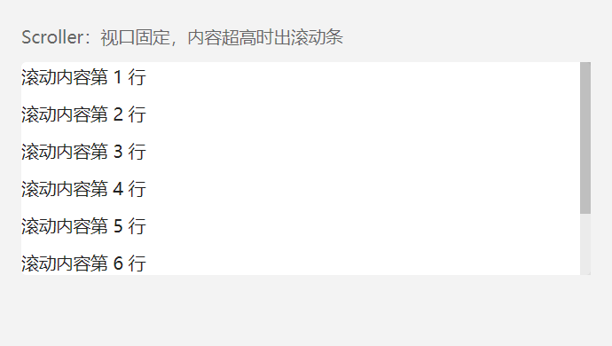

> **两种写法**（见 `Samples/Scroller/main.cpp`）：固定视口写 `Height(150.f).FlexShrink(0.f)`；撑满剩余空间写 `FlexGrow(1.f)` —— 但用 `FlexGrow` 时**父容器必须给出确定高度**（定高容器或窗口），否则视口会跟着内容一起长，永远不会出滚动条。

### 7.3 什么时候会重排

| 操作 | 触发 |
| --- | --- |
| `SetStyle(...)` | 重排 + 重绘 |
| `Set(布局类属性)`：尺寸 / 间距 / 对齐 / 定位 / `Display` … | 重排 + 重绘 |
| `SetText(...)`、挂载 / 摘除子节点 | 重排 + 重绘 |
| 窗口 resize、客户区 DIP 变化 | 重排 + 重绘 |
| `Set(颜色 / 圆角 / 阴影 / 边框 / 透明度 / transform / TextAlign / Overflow / 滚动条外观)` | **只重绘** |

也就是说：改视觉外观不会触发重排（不会动几何），改布局属性一定会。

### 7.4 内容溢出：父容器默认**不裁剪**

`Overflow` 默认是 `Visible`（= CSS 默认），**父容器不会裁剪子元素**：子元素内容比父容器大时直接画到外面（压在边框上）。

```cpp
dui::Panel* box = root->AddChild<dui::Panel>(dui::Style()
    .Height(60.f).Padding(12.f)
    .Background(0xFFFFFFFF).BorderWidth(1.f).BorderColor(0xFFD0D7DE));
box->AddChild<dui::Text>(L"很长很长的一段文字……", dui::Style().FontSize(14.f));
// ↑ 内容盒只有 36 DIP，装不下一行 22.2 DIP 的字 + 第二行 → 文字压到下边框上
```

三种应对方式：

| 场景 | 做法 |
| --- | --- |
| 内容可能变长（日志、状态栏、列表项） | 父容器加 `Overflow::Hidden`（裁到元素盒 = padding box）；或干脆不定高，让内容把容器撑开 |
| 单行放不下、想要"…" | 文本 `TextOverflow::Ellipsis`（继承属性，单行截断加省略号） |
| 内容确实要能滚 | 放进 `dui::Scroller`（见 §7.2） |

```cpp
dui::Panel* box = root->AddChild<dui::Panel>(dui::Style()
    .Height(120.f).Padding(12.f)
    .Overflow(dui::Overflow::Hidden)        // ← 裁到盒子，文字不再越界
    .Background(0xFFFFFFFF).BorderWidth(1.f).BorderColor(0xFFD0D7DE));
```

**为什么默认不裁剪**：与 CSS / WPF / Qt 一致（都是 `visible`）；而且隐式裁剪会把"内容放不下"这类**布局错误静默吞掉** —— 看到"文字被切了一半"比看到"文字压在边框上"更难排查。真要裁剪时一行样式就能打开，不必改全局默认。

> 顺带记住两个尺寸：
>
> - **行高 ≈ `FontSize × 1.58`**（默认 `LineHeight = 1.2` × 雅黑行距系数）：14 DIP → 22.2 DIP，13 DIP → 20.6 DIP。定高容器放一行字，内容盒高要 ≥ 行高（`Height` ≥ 行高 + 上下 `Padding`）。
> - 定高容器里的**文本子项不会被压到比一行还矮**（框架给文本加了内容下限，同 CSS `min-height: auto`）；但**容器本身仍会被 `FlexShrink` 压扁**（默认 shrink = 1），内容放不下时整体溢出。此时要么给容器 `Overflow::Hidden`，要么把长内容放进 `dui::Scroller`（见 §7.2）。

---

## 8. 属性速查

### 8.1 布局

| 属性 | 取值 | 默认 | 说明 |
| --- | --- | --- | --- |
| `Display` | `Flex` / `Grid` / `None` | `Flex` | 容器如何排子项 |
| `FlexDirection` | `Row` / `Column` | `Column` | 主轴方向 |
| `FlexWrap` | `NoWrap` / `Wrap` | `NoWrap` | 断行（**仅 Row**） |
| `JustifyContent` | `Start` / `Center` / `End` / `SpaceBetween` / `SpaceAround` / `SpaceEvenly` | `Start` | 主轴剩余空间分配 |
| `AlignItems` | `Stretch` / `Start` / `Center` / `End` / `Baseline` | `Stretch` | 交叉轴对齐 |
| `AlignSelf` | `Stretch` / `Start` / `Center` / `End` / `Baseline` | 未设 = 跟随父级 | 单项覆盖 `AlignItems`（**没有 `Auto` 哨兵**：不写即跟随父级） |
| `Width` / `Height` | `float`（DIP） | 按内容 | 元素盒尺寸 |
| `MinWidth` / `MaxWidth` / `MinHeight` / `MaxHeight` | `float`（DIP） | 无限制 | 夹紧（**max 胜**） |
| `FlexGrow` | `float` | 0 | 剩余空间份额 |
| `FlexShrink` | `float` | **1** | 收缩权重 |
| `FlexBasis` | `float`（DIP） | 按内容 | 主轴基准尺寸 |
| `Gap` | `float`（DIP） | 0 | 间距兜底 |
| `RowGap` / `ColumnGap` | `float`（DIP） | 回落 `Gap` | 行 / 列方向间距 |
| `Padding` / `Margin` | `float` / `Thickness` | 0 | 见 [Styles.md](Styles.md) §5.1 |
| `GridTemplateColumns` / `GridTemplateRows` | `{Fixed / Flex / Auto / Percent}` | 无 | **只能 Style 设置** |
| `GridRow` / `GridColumn` | `uint32`（0 基） | 自动 | **只能 `Set`** |
| `GridRowSpan` / `GridColumnSpan` | `uint32` | 1 | **只能 `Set`** |

### 8.2 定位

| 属性 | 取值 | 默认 | 说明 |
| --- | --- | --- | --- |
| `Position` | `Static` / `Relative` / `Absolute` / `Fixed` | `Static` | 定位方式 |
| `Left` / `Top` | `float`（DIP） | Auto | `Relative` 下是**偏移量**；`Absolute` 下是**定位** |
| `Right` / `Bottom` | `float`（DIP） | Auto | `Absolute` 下定位；`Relative` 下无效 |
| `ZIndex` | `int32` | 0 | **只对 `Absolute` 生效**，同组内升序绘制 |

---

## 9. 与 CSS 的差异（实现现状）

写布局前先知道这些，免得按 CSS 直觉踩坑：

| 项 | CSS | 本框架 |
| --- | --- | --- |
| 长度 | 支持 `%` / `auto` | **只有 float DIP** |
| `min` / `max` 冲突 | `min` 胜 | **`max` 胜**（夹紧顺序 min → max） |
| `flex-shrink` 基准 | shrink 因子 × flex base size | **`shrink × 当前尺寸`** 加权（近似） |
| `min-height: auto`（内容下限） | 生效 | **文本类生效**（取首行行高；显式写了 `Height` 的不受限） |
| `justify-content` 空间不足时 | `Center`/`End` 仍生效，向另一侧溢出 | **同 CSS**（`Space*` 退化为 `Start`） |
| `flex-wrap` | 行列都支持 | **仅 `Row`** |
| 换行时的 grow / shrink | 仍生效 | **不生效** |
| `position: relative` 的 `right`/`bottom` | 生效 | **无效**（只认 `Left`/`Top` 偏移） |
| Grid 的 `justify-content` | 生效 | **不支持**（Grid 不读该属性） |
| Grid 的 `align-content` / 基线 | 生效 | **不支持 Baseline** |
| Grid 行列定位 | `grid-row: 2`（1 基） | **`Set(Prop::GridRow, 1)`（0 基）** |
| Grid 轨道声明 | 可在任意处覆盖 | **只能 `Style` 链** |
| `overflow` 默认 | `visible` | 一致 |

另有一条容易误判的：`Element::Bounds()` 是**根原点绝对坐标**（`Element.h` 里"相对父"的注释与实现不符，按实现为准）。

---

## 10. 相关文档

- [Styles.md](Styles.md)：颜色 / 圆角 / 边框 / 阴影 / 文本 / 继承属性 / 级联优先级。
- [Event.md](Event.md)：事件绑定、命中顺序与状态位。
- [Pitfalls.md](Pitfalls.md) §4.1：flex-shrink 压扁容器导致文字溢出块外。
- [Arch/04-Layout.md](Arch/04-Layout.md)：布局模块的设计规格（度量、仲裁、属性表）。
