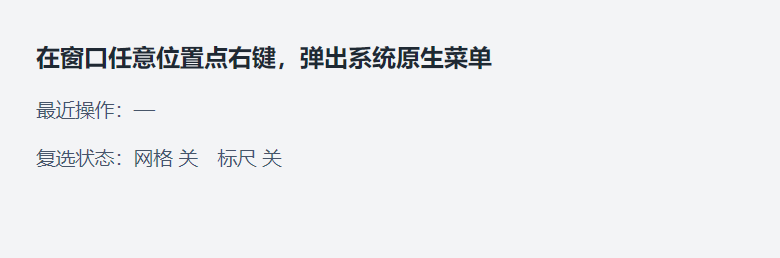

# DUI 菜单使用指南（Menu 开发者文档）

## 1. 快速开始

链式构建一个 `dui::Menu`，调 `ShowMenu(...)` 弹出来：

```cpp
dui::Menu m;
m.Add(L"打开", [this] { /* ... */ })
 .Separator()
 .Add(L"退出", [this] { Close(); });

ShowMenu(m);        // 弹在鼠标当前位置
```



菜单是 **Windows 原生 USER32 窗口**，不是框架自绘的 —— 外观跟随系统主题，框架不接管绘制。

---

## 2. 构建菜单

`dui::Menu` 是链式构造器，四种项：

| 方法                                | 效果                                       |
| ----------------------------------- | ------------------------------------------ |
| `Add(text, onClick)`                | 普通命令项，点击后调用 `onClick()`         |
| `Separator()`                       | 分隔条                                     |
| `AddSubMenu(text, sub)`             | 子菜单，右侧带箭头                         |
| `AddCheck(text, checked, onToggle)` | 复选项（可打勾），回调收到**切换后的新值** |

### 2.1 普通项

```cpp
m.Add(L"撤销", [this] { Note(L"撤销"); })
 .Add(L"重做", [this] { Note(L"重做"); });
```

回调是 `std::function<void()>`，可以是 lambda、成员函数包装、`std::bind`。

### 2.2 分隔条

```cpp
m.Add(L"新建", [this] { ... })
 .Separator()
 .Add(L"退出", [this] { Close(); });
```

### 2.3 子菜单

```cpp
dui::Menu recent;
recent.Add(L"撤销", [this] { Note(L"撤销"); })
      .Add(L"重做", [this] { Note(L"重做"); });

m.AddSubMenu(L"最近操作", recent);
```

> **子菜单是"拷贝定格"**：`AddSubMenu` 会把 `sub` **拷贝**一份存进去 —— 之后再改 `sub` 不影响已经加入的菜单。所以每次弹出前按当前状态重建菜单（见 §5）。

### 2.4 复选项

```cpp
m.AddCheck(L"显示网格", grid_,  [this](bool on) { grid_  = on; RefreshState(); })
 .AddCheck(L"显示标尺", ruler_, [this](bool on) { ruler_ = on; RefreshState(); });
```

- `checked` 是**初始勾选状态**，回调 `onToggle` 收到的是**切换后的新值**（不是旧值）—— 直接 `state = on` 即可。
- 多个复选项可以**同时勾上**（不是单选按钮组）。要"单选"语义就自己在业务里互斥。

---

## 3. 弹出菜单

### 3.1 `Window::ShowMenu` 两个重载

```cpp
void ShowMenu(const Menu& menu);                 // 弹在鼠标当前位置
void ShowMenu(const Menu& menu, Vec2 posDip);    // 弹在指定位置（客户区 DIP）
```

### 3.2 坐标空间

| 入口                                           | 坐标含义                                                             |
| ---------------------------------------------- | -------------------------------------------------------------------- |
| `Window::ShowMenu(menu, posDip)`               | **客户区绝对坐标（DIP）** —— 与 `PointerEvent::pos` 同空间，可直接传 |
| `dui::ShowPopupMenu(menu, owner, posScreenPx)` | **屏幕物理像素**                                                     |

`Window::ShowMenu(menu, posDip)` 内部会乘上缩放系数转成屏幕物理像素；菜单默认**左对齐、上对齐**于该点。

### 3.3 自由函数 `ShowPopupMenu`

```cpp
void ShowPopupMenu(const Menu& menu, void* owner, Vec2 posScreenPx);
```

`owner` 传 `HWND`（`void*`）。传 `nullptr` 直接返回（不弹）。需要跨窗口调用、或 owner 不是 `dui::Window` 时用这个。

---

## 4. 触发时机

### 4.1 右键：按下与抬起都有

框架**不挂钩 `WM_CONTEXTMENU`**，业务自己判断。右键按下与抬起都会派发元素级事件，按键是 `PointerButton::Right`：

```cpp
root->OnPointerUp([this](dui::PointerEvent& ev) {
    if (ev.button == dui::PointerButton::Right) {
        ShowMenu(BuildMenu(), ev.pos);      // ev.pos 就是客户区 DIP，直接传
    }
});
```

> **右键的"按下"只派事件，不改状态**：`OnPointerDown` 能收到 `PointerButton::Right`，但框架**不会**因此设置 `State::Pressed`、**不会**改焦点、**不会**取指针捕获（这些都是左键语义，见 `Doc/Event.md` §1.1 与 §3）。所以右键按下不会让按钮亮起，也不会抢焦点。中键（`PointerButton::Middle`）同此规则。
>
> `OnPointerUp` 是**冒泡**事件 —— 挂在根面板上就能收到整个客户区的右键；挂在具体元素上则只收到该元素及其子树。

### 4.2 标题栏右键是系统菜单

无边框窗口没有系统标题栏，框架在 `WM_NCRBUTTONUP` + `HTCAPTION` 时弹**系统菜单**（还原 / 移动 / 大小 / 关闭）。这与业务菜单互不冲突：标题栏右键 = 系统菜单，客户区右键 = 你的菜单。

---

## 5. 复选状态由业务保存

**每次弹出菜单都会按当前状态重建一份原生菜单**。因此：

- 勾选状态**不在菜单里**，要由业务自己保存；
- 弹出前用当前状态重建菜单，勾选才对；
- `AddCheck` 的回调给出新值，业务保存下来即可。

```cpp
dui::Menu BuildMenu() {
    dui::Menu m;
    m.AddCheck(L"显示网格", grid_,  [this](bool on) { grid_  = on; RefreshState(); })
     .AddCheck(L"显示标尺", ruler_, [this](bool on) { ruler_ = on; RefreshState(); });
    return m;                     // 每次弹出都重建 → 勾选状态总是最新
}
```

---

## 6. 同步模态

`ShowMenu` 是**同步阻塞**的，函数返回 = 菜单已关闭、回调已执行完。

- 菜单弹出期间系统接管消息泵，框架主循环挂起：界面不刷新、动画 / 光标闪烁停摆；
- 菜单项的回调在**菜单关闭之后**才被调用；
- 框架用"弹窗深度计数"抑制宿主失活时清掉编辑控件焦点（与系统对话框同一套机制）；
- 右键也能选菜单项。

---

## 7. 已知限制与坑

1. **只有弹出菜单**：没有菜单栏、没有停靠式菜单、没有图标、没有快捷键解析（`Ctrl+S` 这类要业务自己在键盘事件里处理）。
2. **没有单选组**：复选项可以同时勾上多个，单选语义要业务自己互斥。
3. **框架不弹上下文菜单**：`WM_CONTEXTMENU` 完全不挂钩 —— 业务不写 `OnPointerUp` 就什么都不会发生。
4. **菜单项回调在菜单关闭后执行**：不是"点到的瞬间"回调。
5. **勾选状态不在菜单里**：菜单每次弹出都重建，状态必须由业务保存（见 §5）。
6. **子菜单是拷贝**：往已加入的菜单里 `AddSubMenu` 后再改源 `Menu` 不生效。
7. **菜单期间 UI 停摆**：同步模态，框架主循环挂起（见 §6）。
8. **标题栏右键是系统菜单**：框架已接管，别重复弹自己的（见 §4.2）。
