# DUI 样式使用指南（Style 开发者文档）

> **配套工程**：`Samples/Style/main.cpp` 是本文示例的可运行版本，可直接编译运行对照。
> **截图**：`Doc/Sytles/`，按 `NN-M.png` 命名（NN = 章号，M = 该章第几个示例），均为**按示例代码实机运行**后 1:1 截取。
> **相关文档**：[Layout.md](Layout.md)（Flex / Grid / 尺寸 / 定位 / 速查）、[Input.md](Input.md)（输入控件）、[Event.md](Event.md)（事件绑定与状态位）、[Pitfalls.md](Pitfalls.md) §4（布局与样式）。

---

## 1. 快速开始

### 1.1 `dui::Style` 是什么

`dui::Style` 是**一份属性集合**，同时也是**链式构建器**——两种用法同一个类型：

```cpp
dui::Style s = dui::Style().Background(0xFF70AD47).CornerRadius(14.f);  // 声明
panel->SetStyle(s);                                                    // 挂到元素
```

要点：

- **挂载方式**：`element->SetStyle(style)`（运行时替换）或 `AddChild<dui::Text>(L"文本", style)`（创建时给一份）。
- **视觉属性与布局属性同层**：`Background` / `CornerRadius` / `FontSize` 和 `Width` / `Padding` / `FlexGrow` 都写在同一个 `Style` 里，不需要分"视觉样式"和"布局样式"。
- **长度单位是 DIP**（1/96 英寸；96 DPI 下 1 DIP = 1 像素），**倍数无量纲**（`LineHeight(1.6f)` = 1.6 倍行高）。
- **颜色是 `0xAARRGGBB`**（`dui::Color`）。
- 样式**持有拷贝**：`SetStyle` 会把样式拷进元素内部，链式临时对象不会悬空；但 `FontFamily(const wchar_t*)` 只存指针，字符串需活到样式使用期（建议字面量）。

### 示例 1.1 第一个带样式的界面

左边一块：圆角 + 半透明背景 + 内边距；右边一块：18 号粗体、行高 1.6。

```cpp
#include <windows.h>          // wWinMain 入口；必须先于 DUI.h
#include "DUI/DUI.h"

// 最小窗口：只做一件事——给元素加样式
class QuickStartWindow final : public dui::Window {
public:
    QuickStartWindow()
        : dui::Window(dui::WindowOptions{
              .title  = L"Styles · 快速开始",
              .width  = 620.f,
              .height = 220.f,
          }) {}

protected:
    void OnCreate() override {
        dui::Panel* root = Root();
        root->SetStyle(dui::Style()
            .Padding(16.f)          // 内边距
            .Gap(10.f)              // 子项间距
            .FontSize(13.f)         // 根上设字号 → 子 Text 继承（默认 14）
            .Background(0xFFF3F3F3));

        // ① 一行两块：Row + Gap
        dui::Panel* row = root->AddChild<dui::Panel>(dui::Style()
            .FlexDirection(dui::FlexDirection::Row)
            .Gap(8.f));

        // ② 链式设置视觉属性：圆角 + 背景 + 透明度 + 内边距
        dui::Panel* card = row->AddChild<dui::Panel>(dui::Style()
            .Width(280.f)           // 不写 Height → 高度随内容
            .Background(0xFF70AD47)
            .CornerRadius(14.f)
            .Opacity(0.55f)
            .Padding(10.f)
            .Color(0xFFFFFFFF));
        card->AddChild<dui::Text>(L"圆角 14 + 背景透明度 0.55 + Padding 10");

        // ③ 文本样式挂在 Text 自己身上：字号 / 字重 / 行高
        dui::Panel* card2 = row->AddChild<dui::Panel>(dui::Style()
            .Width(280.f)
            .Background(0xFFFFFFFF)
            .CornerRadius(4.f)
            .Padding(10.f));
        card2->AddChild<dui::Text>(L"18 号粗体 · 行高 1.6\n第二行仍按 1.6 倍行距",
                                   dui::Style()
                                       .FontSize(18.f)
                                       .FontWeight(dui::FontWeight::Bold)
                                       .LineHeight(1.6f));
    }
};

int WINAPI wWinMain(HINSTANCE, HINSTANCE, PWSTR, int) {
    dui::Application app;
    QuickStartWindow win;
    return app.Run(win);
}
```

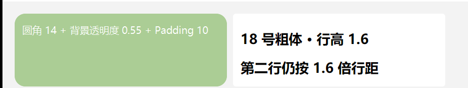

左块 `CornerRadius(14)` + `Opacity(0.55)` + `Padding(10)`；右块文本 18 号粗体、行高 1.6 倍（第二行同样按 1.6 倍行距）。根上的 `FontSize(13)` 由子 `Text` 继承 —— 换成默认的 14 DIP，左块文字就会挤到第二行。

> 本例代码可独立编译运行（工程基线见 `DUI.props`：C++20 / `/MT` / `/W4` + PerMonitorV2 DPI 清单）；
> `Samples/Style/main.cpp` 的"视觉属性"小节是同一段代码的演示版（外层多一层 `Scroller` 与小标题）。

---

## 2. 样式复用与派生

### 2.1 一份基样式，`Style::Derive` 只写差异

同一个界面里几十张卡片往往只差一两个属性。与其复制粘贴整段样式，不如定义一份**基样式**，再用 `Style::Derive(base)` 派生 —— 派生样式只存差异，解析时沿父链回溯。

注意：**派生样式持基样式的裸指针**，基样式必须是静态存储（`static const dui::Style`），不能是函数里的临时对象。

```cpp
#include <windows.h>
#include "DUI/DUI.h"

// 基样式：派生样式持它的裸指针（parent_），必须是静态存储
static const dui::Style kCard = dui::Style()
    .Height(64.f)
    .Padding(10.f)
    .CornerRadius(6.f)
    .Color(0xFFFFFFFF)
    .FontSize(14.f)
    .JustifyContent(dui::Justify::Center)
    .AlignItems(dui::Align::Center);

class DocWindow final : public dui::Window {
public:
    DocWindow()
        : dui::Window(dui::WindowOptions{
              .title  = L"Doc 02-1",
              .width  = 630.f,
              .height = 110.f,
          }) {}

protected:
    void OnCreate() override {
        dui::Panel* root = Root();
        root->SetStyle(dui::Style()
            .Padding(16.f)
            .FontSize(13.f)
            .Background(0xFFF3F3F3));

        dui::Panel* row = root->AddChild<dui::Panel>(dui::Style()
            .FlexDirection(dui::FlexDirection::Row)
            .Gap(8.f));

        // 派生 A：只写差异 —— 背景色
        dui::Panel* cardA = row->AddChild<dui::Panel>(dui::Style::Derive(kCard)
            .Width(190.f)
            .Background(0xFF4472C4));
        cardA->AddChild<dui::Text>(L"派生 A：只加蓝底");

        // 派生 B：差异覆盖两项（背景色 + 圆角）
        dui::Panel* cardB = row->AddChild<dui::Panel>(dui::Style::Derive(kCard)
            .Width(190.f)
            .Background(0xFF70AD47)
            .CornerRadius(18.f));
        cardB->AddChild<dui::Text>(L"派生 B：绿底 + 圆角");

        // 派生 C：差异覆盖背景色与字号
        dui::Panel* cardC = row->AddChild<dui::Panel>(dui::Style::Derive(kCard)
            .Width(190.f)
            .Background(0xFF7030A0)
            .FontSize(18.f));
        cardC->AddChild<dui::Text>(L"派生 C：紫底 + 字号");
    }
};

int WINAPI wWinMain(HINSTANCE, HINSTANCE, PWSTR, int) {
    dui::Application app;
    DocWindow win;
    return app.Run(win);
}
```

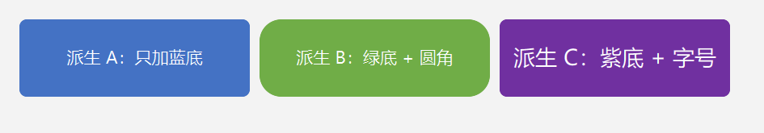

三张卡片共享基样式的尺寸、内边距、圆角、字号与居中，只分别改了背景色 / 圆角 / 字号。

### 2.2 运行时覆盖：`Set` 与 `SetStyle`

样式也可以在运行期改：`element->Set(prop, value)` 改单个属性，`element->SetStyle(style)` 整份替换。`Set` 接受标量、`dui::Thickness`、`dui::CornerRadii`、字体族指针等值类型。

```cpp
// 右：创建时与左边一样，随后用 Set 逐项改掉
dui::Panel* right = row->AddChild<dui::Panel>(dui::Style()
    .Width(200.f).Height(72.f)
    .Background(0xFF70AD47).CornerRadius(18.f).FontSize(18.f)
    .Color(0xFFFFFFFF)
    .JustifyContent(dui::Justify::Center).AlignItems(dui::Align::Center));
right->AddChild<dui::Text>(L"Set 之后：橙底 / 圆角 4 / 12 号");

// 运行时覆盖：标量直接给值
right->Set(dui::Prop::BackgroundColor, 0xFFED7D31);
right->Set(dui::Prop::CornerRadius, 4.f);
right->Set(dui::Prop::FontSize, 12.f);
```


左右两块创建时的样式完全相同，右侧随后被 `Set` 逐项改成橙底 / 小圆角 / 小字号。四边类属性用 `dui::Thickness` 给值：

```cpp
panel->Set(dui::Prop::Padding, dui::Thickness(16.f));        // 四边同值
panel->Set(dui::Prop::Margin,  dui::Thickness(0.f, 24.f));   // 上下 0 / 左右 24
```

---

## 3. 继承属性

### 3.1 哪些属性会往下传

字号、字重、字形、文字色、字体族、行高、字距、词距、文本对齐、文本溢出表现等是**继承属性**：父级算出的值沿元素树下传，子元素不必重复设置；子元素显式写的值只影响自己。

```cpp
// 父级设继承属性：字号 / 字重 / 文字色 / 字体族
dui::Panel* box = root->AddChild<dui::Panel>(dui::Style()
    .FontSize(16.f)
    .FontWeight(dui::FontWeight::SemiBold)
    .Color(0xFF2D7FF9)
    .FontFamily(L"SimSun")          // 字面量：指针需活到样式使用期
    .Padding(12.f)
    .Gap(8.f)
    .Background(0xFFFFFFFF)
    .CornerRadius(4.f));

// 子 Text 未设样式 → 全部继承父级
box->AddChild<dui::Text>(L"子 Text 未设样式 → 继承 16 号半粗 / 蓝色 / 宋体");

// 子 Text 显式覆盖字号与颜色（其余仍继承）
box->AddChild<dui::Text>(L"子 Text 显式覆盖字号与颜色",
                         dui::Style().FontSize(12.f).Color(0xFF777777));
```

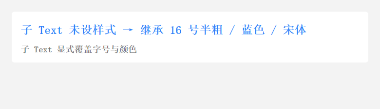

第一行是父级算出的 16 号半粗蓝字，第二行只改了字号与颜色，字重与字体族仍来自父级。

> `FontFamily(const wchar_t*)` 只存指针、不拷贝字符串：传字面量最稳；若传局部 `String` 的 `c_str()`，函数返回后指针悬空，排版会静默回退默认字体（图标字体表现为方框）。

---

## 4. 状态变体与光标

### 4.1 `When(State::Hover, …)` 与 `Cursor`

`When` 给元素挂一个**状态变体**：状态成立时（如指针悬停）该变体的属性立即生效，且**优先级高于本地 `Set` 与元素 Style**。变体随元素走，可以由运行时数据构造。

```cpp
dui::Panel* hover = root->AddChild<dui::Panel>(dui::Style()
    .Height(72.f)
    .Background(0xFF4472C4)
    .CornerRadius(6.f)
    .Color(0xFFFFFFFF)
    .Cursor(dui::Cursor::Hand)                 // 指针形态（继承给子元素）
    .JustifyContent(dui::Justify::Center)
    .AlignItems(dui::Align::Center));

// 状态变体：悬停时生效（优先级高于本地 Set）
hover->When(dui::State::Hover, dui::Style()
    .Background(0xFFED7D31)
    .Color(0xFFFFFFFF));

hover->AddChild<dui::Text>(L"悬停我：变体换橙底，指针为手型");
```

静止态：

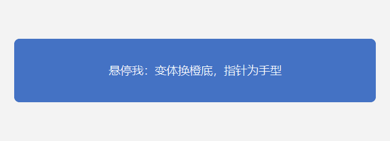

指针悬停后（截图由脚本把指针移到盒子上得到）：

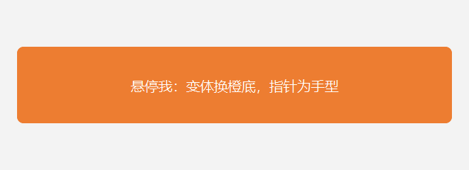

`Cursor` 是继承属性，只需声明一次，子元素同样生效。

### 4.2 级联优先级

同一个属性可能来自多处。优先级从高到低是：**状态变体 > 本地 `Set` > 元素 Style**。

```cpp
dui::Panel* cascade = root->AddChild<dui::Panel>(dui::Style()
    .Height(72.f)
    .Background(0xFFE7E6E6)        // 层 4：元素 Style
    .CornerRadius(4.f)
    .Color(0xFF222222)
    .JustifyContent(dui::Justify::Center)
    .AlignItems(dui::Align::Center));

// 层 2：状态变体（优先级最高）
cascade->When(dui::State::Hover, dui::Style()
    .Background(0xFFED7D31)
    .Color(0xFFFFFFFF));

// 层 3：本地 Set（盖过元素 Style，但盖不过状态变体）
cascade->Set(dui::Prop::BackgroundColor, 0xFF4472C4);

cascade->AddChild<dui::Text>(L"静止：Set 的蓝底 ／ 悬停：When 变体的橙底");
```

静止时是本地 `Set` 的蓝底：

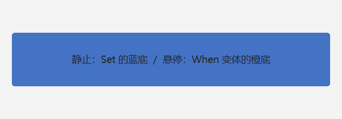

悬停时变体胜出，变成橙底：

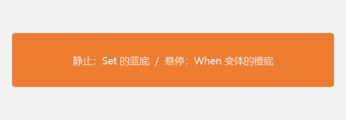

---

## 5. 盒模型

### 5.1 内边距与外边距

`Padding` 是元素**内部**的留白（内容到元素边缘的距离），`Margin` 是元素**外部**的留白（占位，但不属于元素盒）。两者都接受 `float`（四边同值）或 `dui::Thickness`（分边）。

```cpp
dui::Style box = dui::Style()
    .Width(140.f).Height(48.f)
    .Background(colors[i]).CornerRadius(4.f).Color(0xFFFFFFFF)
    .JustifyContent(dui::Justify::Center).AlignItems(dui::Align::Center);
if (i == 1) box.Margin(12.f);                       // 四边同值
if (i == 2) box.Margin(dui::Thickness(0.f, 24.f));  // 两参构造：上/下 0，左/右 24
```

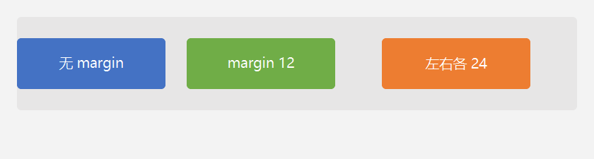

三格依次是「无 margin」「四周 12」「左右各 24」。相邻两格的间距 = `gap` + 各自的 margin（flex 布局**不塌陷** margin）；`Padding` 则只把内容往里推，不影响外部占位。

> `dui::Thickness` 的两参构造口径是 **(上/下, 左/右)**，四参构造是 **(左, 上, 右, 下)**；四参顺序与 CSS `border-width` 一致。

### 5.2 `box-sizing`：边框算不算盒内

框架默认 `PaddingBox`：**宽高含内边距、不含边框**；边框是**内描边**（画在盒内缘），所以会压住内容。
`BorderBox`：**宽高含内边距与边框**，边框占盒内空间 → 内容区 = 盒 − 边框 − 内边距。

```cpp
// 默认 PaddingBox：边框内描边 → 压在内容上
dui::Panel* paddingBox = row->AddChild<dui::Panel>(dui::Style()
    .Width(200.f).Height(90.f)
    .Background(0xFFFFFFFF)
    .BorderWidth(10.f).BorderColor(0xFF4472C4));

// BorderBox：边框占盒内空间 → 内容不被压住
dui::Panel* borderBox = row->AddChild<dui::Panel>(dui::Style()
    .Width(200.f).Height(90.f)
    .Background(0xFFFFFFFF)
    .BorderWidth(10.f).BorderColor(0xFFED7D31)
    .BoxSizing(dui::BoxSizing::BorderBox));
```

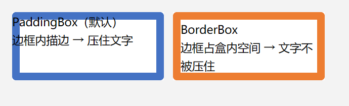

左边蓝框的 10 DIP 边框盖住了首行文字；右边橙框同样宽高，但因为边框被算进盒内，文字完整可见。

---

## 6. 边框与圆角

### 6.1 边框与圆角

`BorderWidth` + `BorderColor` 画一条**内描边**（画在盒内缘，**不改变布局盒**，因此不挤压内容）；`CornerRadius` 设圆角，边框会沿圆角路径绘制。

```cpp
// 四边等宽实线 + 四角同值圆角
dui::Panel* uniform = row->AddChild<dui::Panel>(dui::Style()
    .Width(195.f).Height(96.f)
    .Background(0xFFFFFFFF)
    .BorderWidth(3.f).BorderColor(0xFF2D7FF9)
    .CornerRadius(8.f)
    .Padding(10.f));

// 四角独立圆角（左上 / 右上 / 右下 / 左下）
dui::Panel* corners = row->AddChild<dui::Panel>(dui::Style()
    .Width(195.f).Height(96.f)
    .Background(0xFFFFFFFF)
    .BorderWidth(3.f).BorderColor(0xFFED7D31)
    .CornerRadius(dui::CornerRadii(20.f, 4.f, 20.f, 4.f))
    .Padding(10.f));
```

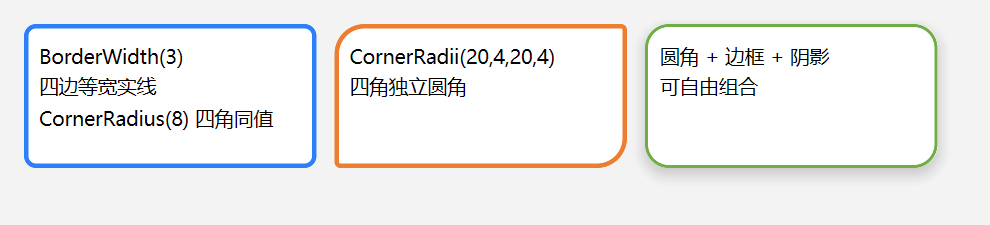

圆角、边框、阴影可自由组合（第三块）。圆角过大时相邻两角会按 CSS 规则同比例缩小，不会溢出元素盒。

### 6.2 分边宽度

`BorderWidth` 也接受 `dui::Thickness`，可以四边各写各的。

```cpp
.BorderWidth(dui::Thickness(2.f, 8.f))            // 上/下 2，左/右 8
.BorderWidth(dui::Thickness(8.f, 2.f))            // 上/下 8，左/右 2
.BorderWidth(dui::Thickness(2.f, 8.f, 2.f, 14.f)) // 左 2 / 上 8 / 右 2 / 下 14
```

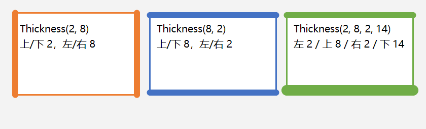

### 6.3 线型

`BorderStyle` 选线型：`Solid`（实线，默认）、`Dashed`（虚线）、`Dotted`（点线）。线型沿圆角路径离散，拐角处按弧长排布，不是直角折线。

```cpp
.BorderWidth(3.f).BorderColor(0xFF2D7FF9)
.BorderStyle(dui::BorderStyle::Dashed)
.CornerRadius(8.f)
```

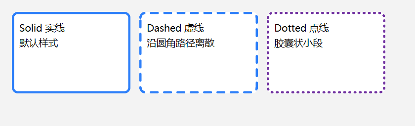

---

## 7. 文本样式

### 7.1 文本对齐

`TextAlign` 排的是**元素自己的文本**（继承属性）；`JustifyContent` / `AlignItems` 排的是**子元素**，两者不要混用。

```cpp
// 写在 Text 上
cell->AddChild<dui::Text>(L"Center 居中", dui::Style().TextAlign(dui::TextAlign::Center));

// 写在容器上 → 子 Text 继承
cellStyle.TextAlign(dui::TextAlign::End);
```

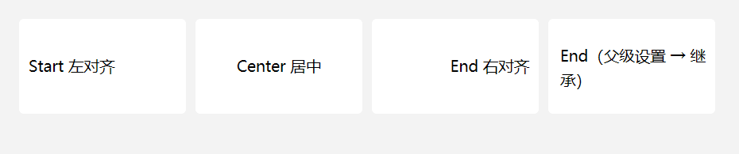

取值只有 `Start` / `Center` / `End` 三个（不做 RTL 翻转）。

### 7.2 斜体与装饰线

`FontStyle`（`Normal` / `Italic`）是**继承属性**，设在容器上对子 `Text` 生效；`TextDecoration`（`Underline` / `LineThrough` 位标志，可组合）**不继承**，必须写在 `Text` 自己身上。

```cpp
// 斜体：设在容器上，子 Text 继承
italic->AddChild<dui::Text>(L"斜体：父级设 fontStyle，子 Text 继承");

// 装饰线：必须写在 Text 上
deco->AddChild<dui::Text>(L"下划线 + 删除线", dui::Style()
    .TextDecoration(dui::TextDecoration::Underline | dui::TextDecoration::LineThrough));
```

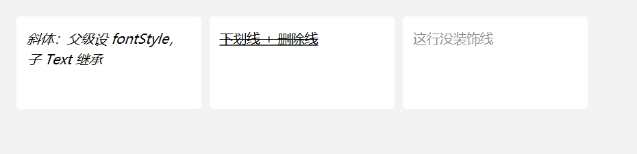

### 7.3 字距、词距与省略号

`LetterSpacing`（字距，DIP）、`WordSpacing`（词距，DIP，只加宽词间空格）都是继承属性，单位是 DIP 而不是 em；`TextOverflow::Ellipsis` 让超长单行在末尾显示省略号（继承属性）。

```cpp
// 字距 / 词距：设在容器上即可
ls->AddChild<dui::Text>(L"字距 3 DIP");

// 单行省略号
ell->AddChild<dui::Text>(L"这是一段很长很长很长很长很长的文字，用来演示省略号截断",
                         dui::Style().TextOverflow(dui::TextOverflow::Ellipsis));
```

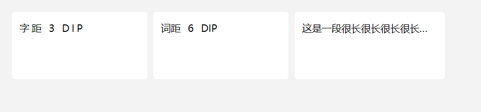

---

## 8. 阴影与透明

### 8.1 `Shadow` 与 `Opacity`

`Shadow(blur, color, offsetX, offsetY)`：模糊半径（DIP）、阴影颜色（`0xAARRGGBB`）、水平/垂直偏移（DIP）。阴影只投元素**边框盒**，`blur = 0` 时就是一块纯偏移的硬阴影。

`Opacity(0..1)`：整棵子树做**合成**半透明（不是只把背景调淡，文字一起淡）。

```cpp
// 柔和阴影：模糊 12，向下偏移 6
dui::Panel* blur = row->AddChild<dui::Panel>(dui::Style()
    .Width(170.f).Height(96.f)
    .Background(0xFFFFFFFF).CornerRadius(10.f)
    .Shadow(12.f, 0x59000000, 0.f, 6.f)
    .JustifyContent(dui::Justify::Center).AlignItems(dui::Align::Center));
blur->AddChild<dui::Text>(L"blur 12 · 向下偏移 6");

// 硬阴影：blur = 0
dui::Panel* hard = row->AddChild<dui::Panel>(dui::Style()
    .Width(170.f).Height(96.f)
    .Background(0xFFFFFFFF).CornerRadius(10.f)
    .Shadow(0.f, 0x59000000, 0.f, 8.f)
    .JustifyContent(dui::Justify::Center).AlignItems(dui::Align::Center));
hard->AddChild<dui::Text>(L"blur 0 · 纯偏移硬阴影");

// 整体半透明
dui::Panel* alpha = row->AddChild<dui::Panel>(dui::Style()
    .Width(170.f).Height(96.f)
    .Background(0xFF4472C4).Opacity(0.45f).CornerRadius(10.f)
    .Color(0xFFFFFFFF)
    .JustifyContent(dui::Justify::Center).AlignItems(dui::Align::Center));
alpha->AddChild<dui::Text>(L"Opacity(0.45)\n整体半透明");
```

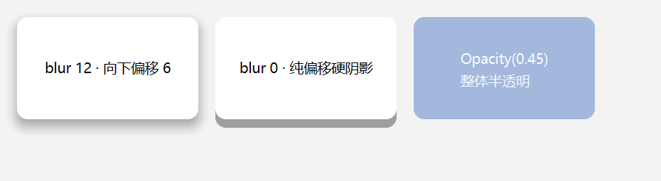

---

## 9. 溢出与可见性

### 9.1 `Overflow` 裁剪，`Visibility` 隐藏

`Overflow` 决定内容是否被裁到元素盒内：`Visible`（默认，同 CSS，不裁剪）、`Hidden`（裁剪到内容盒）、`Scroll`（裁剪但不画滚动条 —— 框架的滚动条用 `dui::Scroller` 控件实现）。

`Visibility::Hidden` 则相反：**不可见但仍占位**，后面的元素不会被前移，也不参与命中测试（继承属性，子元素可显式设 `Visible` 反转）。

```cpp
// 默认 Visible：内容溢出到盒外（与 CSS 一致）
dui::Panel* visible = row->AddChild<dui::Panel>(dui::Style()
    .Width(180.f).Height(70.f)
    .Background(0xFFE7E6E6).CornerRadius(4.f)
    .Padding(10.f));
visible->AddChild<dui::Text>(L"默认 Visible：\n这行字溢出了盒子（不裁剪）", dui::Style().FontSize(16.f));

// Hidden：内容裁到元素盒内
dui::Panel* hidden = row->AddChild<dui::Panel>(dui::Style()
    .Width(180.f).Height(70.f)
    .Background(0xFFE7E6E6).CornerRadius(4.f)
    .Padding(10.f)
    .Overflow(dui::Overflow::Hidden));
hidden->AddChild<dui::Text>(L"Hidden 显式裁剪：\n这行字被裁掉了", dui::Style().FontSize(16.f));

// Visibility::Hidden：不画但占位
dui::Panel* invisible = row->AddChild<dui::Panel>(dui::Style()
    .Width(180.f).Height(70.f)
    .Background(0xFFE7E6E6).CornerRadius(4.f)
    .Padding(10.f)
    .Visibility(dui::Visibility::Hidden));
```

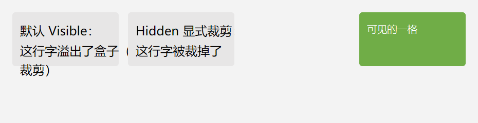

左边第一格文字溢出到盒外，第二格被裁掉，第三格不可见但留下空位，第四格正常显示。

---

## 10. 属性速查

「继承」列指该属性是否沿元素树下传（父级设置 → 子元素生效）。

### 10.1 视觉与盒模型

| 属性 | 取值 | 默认 | 继承 |
| --- | --- | --- | --- |
| `Background` | `0xAARRGGBB` | 透明 | 否 |
| `Color` | `0xAARRGGBB` | 黑 `0xFF000000` | 是 |
| `Opacity` | `0..1` | 1 | 否 |
| `CornerRadius` | `float` / `CornerRadii` | 0 | 否 |
| `BorderWidth` | `float` / `Thickness` | 0（无边框） | 否 |
| `BorderColor` | `0xAARRGGBB` | 透明 | 否 |
| `BorderStyle` | `Solid` / `Dashed` / `Dotted` | `Solid` | 否 |
| `BoxSizing` | `PaddingBox` / `BorderBox` | `PaddingBox` | 否 |
| `Shadow` | `(blur, color, offsetX, offsetY)` | 无 | 否 |
| `Padding` / `Margin` | `float` / `Thickness` | 0 | 否 |
| `Overflow` | `Visible` / `Hidden` / `Scroll` | `Visible` | 否 |
| `Visibility` | `Visible` / `Hidden` | `Visible` | 是 |

### 10.2 文本与字体

| 属性 | 取值 | 默认 | 继承 |
| --- | --- | --- | --- |
| `FontSize` | `float`（DIP） | 14 | 是 |
| `FontWeight` | `Normal` / `Medium` / `SemiBold` / `Bold` | `Normal` | 是 |
| `FontStyle` | `Normal` / `Italic` | `Normal` | 是 |
| `FontFamily` | `const wchar_t*`（只存指针） | 引擎默认 | 是 |
| `LineHeight` | `float`（倍数） | 1.2 | 是 |
| `LetterSpacing` | `float`（DIP） | 0 | 是 |
| `WordSpacing` | `float`（DIP） | 0 | 是 |
| `TextAlign` | `Start` / `Center` / `End` | `Start` | 是 |
| `TextDecoration` | `Underline` / `LineThrough`（可组合） | `None` | 否 |
| `TextOverflow` | `Clip` / `Ellipsis` | `Clip` | 是 |
| `Cursor` | `Arrow` / `IBeam` / `Hand` / … | `Arrow` | 是 |

### 10.3 布局

| 属性 | 取值 | 默认 | 继承 |
| --- | --- | --- | --- |
| `Width` / `Height` | `float`（DIP） | 按内容 | 否 |
| `MinWidth` / `MaxWidth` / `MinHeight` / `MaxHeight` | `float`（DIP） | 无限制 | 否 |
| `Padding` / `Margin` | `float` / `Thickness` | 0 | 否 |
| `Gap` / `RowGap` / `ColumnGap` | `float`（DIP） | 0 | 否 |
| `FlexDirection` | `Row` / `Column` | `Column` | 否 |
| `FlexWrap` | `NoWrap` / `Wrap` | `NoWrap` | 否 |
| `FlexGrow` / `FlexShrink` / `FlexBasis` | `float` | 0 / 1 / auto | 否 |
| `JustifyContent` | `Start` / `Center` / `End` / `SpaceBetween` / `SpaceAround` / `SpaceEvenly` | `Start` | 否 |
| `AlignItems` / `AlignSelf` | `Stretch` / `Start` / `Center` / `End` / `Baseline` | `Stretch` / `Auto` | 否 |
| `Position` + `Left`/`Top`/`Right`/`Bottom` / `ZIndex` | `Static` / `Relative` / `Absolute` / `Fixed` | `Static` | 否 |
| `Display` | `Flex` / `Grid` / `None` | `Flex` | 否 |

### 10.4 运行时改样式

| 用法 | 作用 | 优先级 |
| --- | --- | --- |
| `element->Set(prop, value)` | 改单个属性 | 高于元素 Style |
| `element->SetStyle(style)` | 整份替换（内部拷贝持有） | 高于元素 Style |
| `element->When(state, style)` | 状态变体（如 `State::Hover`） | **最高** |

> 级联优先级：**状态变体 > 本地 `Set` > 元素 Style**；继承属性在元素自身没写时才回退到父级计算值。
