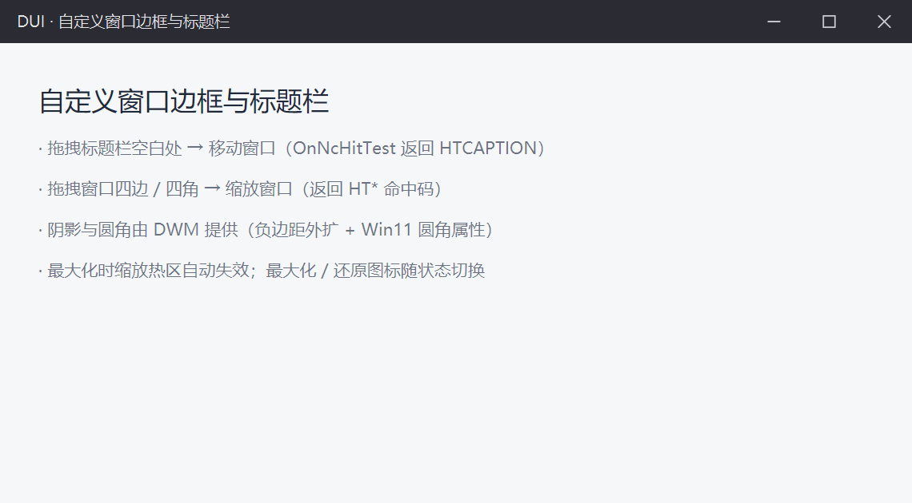

# DUI 自定义窗口边框与异形窗口指南（Window 开发者文档）

## 1. 快速开始

### 1.1 三种窗口形态

窗口形态在构造时声明，框架负责底层的系统对接：

| 形态                 | 构造参数                                  | 效果                                                                                                    |
| -------------------- | ----------------------------------------- | ------------------------------------------------------------------------------------------------------- |
| 系统窗口             | 默认                                      | 系统标题栏 + 边框 + 系统阴影                                                                            |
| **无边框窗口**       | `frameless = true`                        | 客户区覆盖整窗；标题栏 / 边框全部自绘；阴影与圆角由 DWM 提供；拖动区与缩放热区由样式 / `resizable` 声明 |
| **异形（透明）窗口** | `frameless = true` + `transparent = true` | 窗口背景透视桌面；再配 `SetWindowRgn` 裁剪出任意形状（圆、圆角、多边形…）                               |

```cpp
class MyWindow final : public dui::Window {
public:
    MyWindow()
        : dui::Window(dui::WindowOptions{
              .title     = L"我的窗口",
              .width     = 900.f,     // DIP
              .height    = 560.f,
              .frameless = true,     // 自绘标题栏
              // .transparent = true, // 需要透视桌面时再开
              // .resizable  = true, // 需要拖边框缩放时再开
          }) {}
};
```

### 1.2 跑一下



深色标题栏、最小化 / 最大化 / 关闭三个按钮、拖标题栏移动、拖四边缩放 —— 都是自绘的。


圆形窗口叠在 WIN-1 上面：圆**外**根本不属于这个窗口（点击穿过去），圆**内**半透明，能看见下面的文字。

### 1.3 多窗口

一个进程跑多个窗口：一个 `Application` 注册多个 `Window`，统一驱动，**关掉一个不影响其它窗口，最后一个关闭才退出**。

```cpp
int WINAPI wWinMain(...) {
    dui::Application app;
    MainWindow  mainWnd;
    SettingsWnd settingsWnd;

    if (!app.AddWindow(mainWnd))    return 1;   // 失败原因查 app.LastError()
    if (!app.AddWindow(settingsWnd)) return 2;  // 各自 OnCreate / 独立输入框 / 独立 DPI
    return app.Run();                            // 一起跑；关掉 mainWnd，settingsWnd 仍在
}
```

要点：

- **只建一个 `Application`**（焦点 / 任务队列是进程级全局的）；窗口对象要活到 `Run()` 返回（声明在 `wWinMain` 里即可）。
- 每个窗口独立 `OnCreate` 搭界面、独立事件与焦点切换、可各在不同 DPI 显示器。
- 单窗口场景仍可用老写法 `app.Run(window)`（等价于 `AddWindow` + `Run`）。
- 失活切到本进程另一个窗口时，焦点会正确转到新窗口，不会被旧窗口的失活处理清掉。

### 1.4 关窗后是否退出

系统托盘图标（`Tray`）的完整用法见 [Tray.md](Tray.md)。

默认：最后一个窗口关闭 → 应用退出（点关闭 = 退出）。这个行为**可以改**：

```cpp
dui::Application app;
app.SetQuitOnLastWindowClosed(false);   // 关掉所有窗口后进程继续
app.AddWindow(mainWnd);
return app.Run();                        // 不再随窗口关闭而返回
```

设成 `false` 后，业务要自己调 `app.Quit(code)` 结束（否则 `Run()` 不返回）；`code` 成为 `Run()` 的返回值，任意线程都能调。

三种常见做法：

| 想要的效果 | 怎么做 |
| --- | --- |
| 关窗口前弹确认 | 重写窗口的 `OnClosing()`：需要拦截就返回 `false`。`Confirm(L"确定退出？")` 可直接弹框；判断是不是最后一个窗口用 `App()->WindowCount() == 1`。窗口本身该关就返回 `true`。 |
| 托盘常驻（关窗藏进托盘、点图标唤回） | `SetQuitOnLastWindowClosed(false)` + `Tray`。完整写法见 [Tray.md](Tray.md)。 |
| 无窗口后台阶段（窗口全毁、继续跑任务、稍后退出） | `SetQuitOnLastWindowClosed(false)` + `app.SetTimer(ms, fn)` / 后台任务 + `app.Quit()`。 |

`app.SetTimer(ms, fn)` 是**窗口无关**的定时器（所有窗口关掉也照样触发，回调在 UI 线程），用 `app.KillTimer(id)` 取消；它与窗口内动画/光标闪烁的节拍互不相干。托盘图标的完整示例（含图标设置、回调、右键菜单、重开窗口）见 [Tray.md](Tray.md)。

---

## 2. 无边框窗口：框架自动做的事

设了 `frameless = true` 之后，下面这些**不用业务写一行代码**：

- 客户区覆盖整个窗口矩形（没有系统标题栏 / 边框）；
- 阴影与 Win11 圆角由 DWM 提供；
- 最大化时窗口不超出工作区；
- 标题栏右键 → 弹**系统菜单**（还原 / 移动 / 大小 / 最小化 / 最大化 / 关闭）；
- 任务栏有按钮、`Alt+F4` 正常关闭；
- 无边框时 `width` / `height` 就是**整窗尺寸**（不补边框宽度 —— 补了业务按 DIP 布局就错位）。

---

## 3. 自绘标题栏

### 3.1 结构

就是普通的 Flex 布局：一个标题栏 `Panel`（`FlexDirection::Row`）+ 一个内容区 `Panel`（`FlexGrow(1.f)`）：

```cpp
dui::Panel* bar = root->AddChild<dui::Panel>(dui::Style()
    .FlexDirection(dui::FlexDirection::Row)
    .AlignItems(dui::Align::Center)     // 子项垂直居中（图标 / 标题）
    .Height(36.f)
    .FlexShrink(0.f)                    // 标题栏不参与收缩
    .Background(0xFF2B2B33)
    .AppRegion(dui::AppRegion::Drag));  // ← 拖动区：这块可拖动窗口

bar->AddChild<dui::Text>(L"我的窗口", dui::Style()
    .FontSize(13.f).Color(0xFFE6E6EA).FlexShrink(0.f)
    .Padding(dui::Thickness(0.f, 14.f)));        // 左右留白（CSS 顺序：先上下后左右）

bar->AddChild<dui::Panel>(dui::Style().FlexGrow(1.f));   // 弹性占位：按钮靠右
```

### 3.2 标题栏按钮

框架内置**矢量图标**（`dui::Icon` / `dui::IconName`），不依赖字体 / 位图，尺寸随 `Style().Width/Height` 自由变化：

```cpp
dui::Panel* MakeIconButton(dui::Panel* bar, dui::IconName name, dui::Color hoverBg) {
    dui::Panel* btn = bar->AddChild<dui::Panel>(dui::Style()
        .Width(46.f).Height(36.f).FlexShrink(0.f)
        .AlignItems(dui::Align::Center)
        .JustifyContent(dui::Justify::Center)
        .Cursor(dui::Cursor::Hand)
        .AppRegion(dui::AppRegion::NoDrag));   // ← 挖洞：按钮不被标题栏的拖动区吃掉
    btn->When(dui::State::Hover, dui::Style().Background(hoverBg));   // 悬停底色
    dui::Icon* icon = btn->AddChild<dui::Icon>(dui::Style()
        .Width(12.f).Height(12.f).Color(0xFFC9C9D1));
    icon->SetIcon(name);
    return btn;
}

dui::Panel* minBtn  = MakeIconButton(bar, dui::IconName::Minimize, 0x26FFFFFF);
dui::Panel* maxBtn  = MakeIconButton(bar, dui::IconName::Maximize, 0x26FFFFFF);
dui::Panel* closeBtn = MakeIconButton(bar, dui::IconName::Close,    0xFFE81123);

minBtn->OnClick(this, &MyWindow::OnMinimizeClick);
maxBtn->OnClick(this, &MyWindow::OnMaximizeClick);
closeBtn->OnClick(this, &MyWindow::OnCloseClick);

void OnMinimizeClick(dui::PointerEvent&) { Minimize(); }
void OnMaximizeClick(dui::PointerEvent&) { MaximizeOrRestore(); }
void OnCloseClick(dui::PointerEvent&)    { Close(); }
```

点击沿祖先链冒泡 —— 点在图标上（命中 `Icon`）也能触发按钮。

### 3.3 最大化图标随状态切换

最大化后标题栏按钮的图样要换成"还原"，用 `OnStateChanged`：

```cpp
void OnStateChanged() override {      // 尺寸改变 / 最大化还原
    if (maximizeIcon_ == nullptr) return;
    maximizeIcon_->SetIcon(IsMaximized() ? dui::IconName::Restore : dui::IconName::Maximize);
}
```

---

## 4. 移动与缩放：声明式热区

无边框窗口的"哪里能拖、哪里能缩"**由内容声明**，不用自己算坐标。

### 4.1 两种声明

| 能力                     | 怎么写                                        | 效果                                  |
| ------------------------ | --------------------------------------------- | ------------------------------------- |
| **拖动区**（移动窗口）   | 元素样式 `.AppRegion(dui::AppRegion::Drag)`   | 该区域可拖动窗口（拖动由系统接管）    |
| **挖洞**（恢复交互）     | 元素样式 `.AppRegion(dui::AppRegion::NoDrag)` | 该区域**及其子树**不参与拖动          |
| **缩放热区**（缩放窗口） | `WindowOptions{ .resizable = true }`          | 框架生成四边 / 四角热区，拖边框即缩放 |

### 4.2 标题栏：drag + no-drag

标题栏设 `Drag`（整条可拖），里面的按钮设 `NoDrag`（挖洞，可正常点击）：

```cpp
// 标题栏：这块可拖动窗口
dui::Panel* bar = root->AddChild<dui::Panel>(dui::Style()
    .FlexDirection(dui::FlexDirection::Row)
    .Height(36.f)
    .Background(0xFF2B2B33)
    .AppRegion(dui::AppRegion::Drag));

bar->AddChild<dui::Text>(L"我的窗口", dui::Style().FontSize(13.f));   // 自动继承 Drag

// 按钮：从拖动区里挖洞，才能收到点击
dui::Panel* btn = bar->AddChild<dui::Panel>(dui::Style()
    .Width(46.f).Height(36.f)
    .AppRegion(dui::AppRegion::NoDrag));
btn->OnClick(this, &MyWindow::OnCloseClick);
```

窗口加 `resizable` 才有缩放热区：

```cpp
dui::Window(dui::WindowOptions{
    .title     = L"我的窗口",
    .width     = 900.f,
    .height    = 560.f,
    .frameless = true,
    .resizable = true,     // 四边 / 四角可拖拽缩放
});
```

### 4.3 语义细节

- **`app-region` 是继承属性**：父设 `Drag` → 子元素默认继承（所以点标题文字也能拖窗）；子元素设 `NoDrag` 即恢复交互。这与 Electron 的 `-webkit-app-region` 同语义。
- **判定顺序固定**：缩放热区 → 拖动区 → 客户区。缩放热区必须在最前，否则窗口上边那条窄带会被拖动区整条吃掉，只剩"移动"、没有"缩放"。
- **缩放热区厚度**取系统边框度量（按窗口 DPI 查询），与原生窗口同厚、随 DPI 自适应；最大化状态下自动失效。
- **只在无边框窗口有意义**：有边框窗口的缩放由系统自带。
- **双击拖动区默认会最大化 / 还原**（系统原生行为）；不想要就用 `WindowOptions::doubleClickMaximize = false` 关掉。

### 4.4 副作用（先知道再用）

1. **拖动区里的元素收不到鼠标消息**：系统接管后没有 hover 高亮、没有 click、没有滚轮 —— 这是"拖标题栏"的必然代价。
2. **忘记标 `NoDrag` → 控件静默点不动**（不报错，只是没反应）。标题栏里的按钮、输入框都要标。
3. **缩放热区盖住窗口最外圈几像素**：贴边的控件（含贴边滚动条）需要自行内缩。
4. **双击拖动区会最大化 / 还原**：整窗 drag 的窗口（如圆形小挂件）双击任意位置都会最大化，不想要就设 `doubleClickMaximize = false`。

### 4.5 完全自己接管（高级）

需要不规则形状（圆、多边形）的热区时，仍可重写 `OnNcHitTest`：

```cpp
virtual bool OnNcHitTest(Vec2 ptDip, HitTestCode& hit);
```

| `hit`                                                 | 系统的行为                           |
| ----------------------------------------------------- | ------------------------------------ |
| `HitTestCode::Caption`                                | 拖动 → **移动窗口**                  |
| `Left` / `Right` / `Top` / `Bottom`                   | 拖动 → 沿该边**缩放**窗口            |
| `TopLeft` / `TopRight` / `BottomLeft` / `BottomRight` | 拖动 → **沿角缩放**                  |
| `HitTestCode::Client`                                 | 当普通客户区处理（鼠标消息发给业务） |

入参 `hit` 已带**框架默认值**（缩放热区 + 拖动区）：直接改写后返回 `true` 即覆盖；返回 `false` 则沿用框架默认值。

---

## 5. 异形窗口

异形窗口是**两件事**叠加：

|              | 管什么                 | 手段                                                     |
| ------------ | ---------------------- | -------------------------------------------------------- |
| 看得见的形状 | 窗口里**画**出来的样子 | `transparent = true` + 自绘（`Canvas` 画圆 / 圆角矩形…） |
| 点不到的形状 | 窗口**之外**不接收鼠标 | `SetWindowRgn`（Win32 窗口区域裁剪）                     |

### 5.1 透明窗口

```cpp
dui::Window(dui::WindowOptions{
    .width      = 320.f,
    .height     = 320.f,
    .frameless  = true,
    .transparent = true,      // 预乘 Alpha 合成 + 每帧清屏为全透明
});
```

`transparent = true` 时每帧清屏为**全透明**，DWM 按视觉树的 alpha 与桌面合成 → 窗口背景可以透视桌面。

### 5.2 窗口区域裁剪（让形状"不存在"）

框架**没有**封装 `SetWindowRgn` —— 用 `NativeHandle()`（`OnCreate` 起有效）直接调 Win32：

```cpp
void ApplyCircleRegion() {
    HWND hwnd = NativeHandle();       // OnCreate 起有效
    RECT rc{};
    GetClientRect(hwnd, &rc);          // 物理像素，DPI 变化后必须重建
    HRGN rgn = CreateEllipticRgn(2, 2, rc.right - 2, rc.bottom - 2);
    SetWindowRgn(hwnd, rgn, TRUE);     // rgn 所有权移交系统，勿 DeleteObject
}
```

- `CreateEllipticRgn`（椭圆）/ `CreateRoundRectRgn`（圆角矩形）/ `CreatePolygonRgn`（多边形）都能用；
- **`SetWindowRgn` 之后 rgn 归系统所有**，不要再 `DeleteObject`；
- **DPI 变化后必须重建**（区域是物理像素）：在 `OnDpiChanged` 里再调一次；
- 尺寸变化（最大化 / 还原）同样要重建：`OnStateChanged` 里再调一次。

### 5.3 AA 问题：硬边让开、自绘收边

`SetWindowRgn` 是 **GDI 硬裁剪**：像素级阶梯，**没有抗锯齿**，边界会内凹 1~2 px，肉眼能看到锯齿和颗粒感。

标准解法（`Samples/CircleWindow` 的做法）：**rgn 的硬边藏到透明区里，可见轮廓交给自绘的矢量图元**。

```cpp
constexpr int   kRgnInsetPx   = 2;      // rgn 从窗口边界让开 2 物理像素
constexpr float kDrawInsetDip = 6.f;    // 自绘圆再内缩 6 DIP
```

- rgn 让开 2px → 硬边不与窗口边界相切，落在一圈全透明间隙里；
- 自绘圆内缩 6 DIP → 覆盖阶梯内凹 + 1px AA 过渡带 + 余量；
- 两条边之间留出全透明间隙 → 可见轮廓**完全**由 `Canvas` 的 SDF 圆决定（矢量、带 AA），颗粒感消失。

```cpp
dui::Canvas* surface = root->AddChild<dui::Canvas>(dui::Style()
    .FlexGrow(1.f)
    .JustifyContent(dui::Justify::Center)
    .AlignItems(dui::Align::Center)
    .Gap(8.f));

const dui::Vec2 center{kSize * 0.5f, kSize * 0.5f};
const float r = kSize * 0.5f - kDrawInsetDip;
surface->AddCircle(center, r, 0xB01E293B);            // 半透明填充
surface->AddCircleOutline(center, r, 0xFF00FFFF, 1.f); // 细线圆边框
```

`Canvas` 的图元坐标是**局部 DIP**（原点 = 画布左上角），圆 / 椭圆走 SDF 绘制，天然带 1 像素过渡带 AA。

### 5.4 整个客户区可拖动

圆形窗口没有"标题栏"的概念 —— 整块都是拖动区，给根容器设 `Drag` 即可：

```cpp
root->SetStyle(dui::Style()
    .FlexDirection(dui::FlexDirection::Column)
    .AppRegion(dui::AppRegion::Drag));   // 子元素自动继承 → 圆内任意位置可拖
```

注意：rgn 之外的区域根本不属于这个窗口（点不到），所以"可拖区域"实际是**圆内**。

---

## 6. 其它交互细节

| 交互       | 行为                                                                                                    |
| ---------- | ------------------------------------------------------------------------------------------------------- |
| 标题栏右键 | 弹**系统菜单**（还原 / 移动 / 大小 / 最小化 / 最大化 / 关闭）                                           |
| 标题栏双击 | **最大化 / 还原**（系统原生行为，无需代码）；不想要就设 `doubleClickMaximize = false`                   |
| 客户区右键 | 框架**不自动**弹菜单 —— 业务在 `OnPointerUp` 里判断 `ev.button == PointerButton::Right` 后调 `ShowMenu` |
| `Alt+F4`   | 走 `WM_CLOSE` → `OnClosing()` 可拦截（返回 `false` 阻止关闭）                                           |
| 拖边框缩放 | 框架生成的热区被系统接管，拖动过程中内容跟手（不等松手才更新）                                          |
| 最大化后   | `IsMaximized()` 为真 → 框架自动停用缩放热区                                                             |
| 失活       | `WM_ACTIVATE` → 编辑控件失焦（光标停闪）                                                                |

### 6.1 窗口操作与业务重写点

| 成员 / 虚函数                                    | 说明                                                 |
| ------------------------------------------------ | ---------------------------------------------------- |
| `Minimize()` / `MaximizeOrRestore()` / `Close()` | 最小化 / 最大化还原 / 请求关闭（`OnClosing` 可拦截） |
| `IsMaximized()`                                  | 当前是否最大化                                       |
| `ClientSizeDip()`                                | 客户区 DIP 尺寸（热区判定用）                        |
| `NativeHandle()`                                 | 原生句柄（`OnCreate` 起有效）                        |
| `bool OnNcHitTest(Vec2 ptDip, HitTestCode& hit)` | 完全自己接管热区判定（入参已带框架默认值）           |
| `void OnStateChanged()`                          | 尺寸改变 / 最大化还原（换最大化按钮图标、重建 rgn）  |
| `void OnDpiChanged(const DpiChanged&)`           | DPI 变化（重建 rgn、换资源）                         |
| `bool OnClosing()`                               | 返回 `false` 阻止关闭                                |

---

## 7. 已知限制与坑

1. **拖动区里的可交互元素必须标 `NoDrag`**：命中拖动区的点击会被系统当成"拖标题栏"，元素收不到 `WM_LBUTTONDOWN`，永远点不动。
2. **拖动区内的元素收不到鼠标消息**：没有 hover 高亮、没有 click、没有滚轮 —— 拖动窗口的必然代价。
3. **缩放热区会吃掉客户区边缘几像素**：内容贴边处点不到 —— 布局时留余量。
4. **缩放热区只在 `resizable = true` 时生成**：默认 false，无边框窗口的边缘像素仍归业务。
5. **最大化后缩放热区自动失效**；业务自己接管 `OnNcHitTest` 时仍需判断 `IsMaximized()`。
6. **无边框时 `width` / `height` 是整窗尺寸**：不补 `AdjustWindowRect` —— 补了会大出左右各 8px。
7. **`SetWindowRgn` 的硬边没有 AA**：必须让 rgn 藏进透明区、可见轮廓交给矢量自绘（§5.3）。
8. **rgn 是物理像素**：DPI 变化 / 尺寸变化后必须重建；`SetWindowRgn` 之后 rgn 归系统所有，勿 `DeleteObject`。
9. **透明窗口的半透明叠加是近似的**：预乘 Alpha 合成下，深底亮字 / 半透明层叠的表现与不透明窗口不完全一致。
10. **双击标题栏最大化是系统原生行为**：业务在拖动区收不到指针事件（系统接管），**别指望用 `OnPointerUp` 判双击**。`doubleClickMaximize` 是**整窗粒度**：开了则所有拖动区都不响应双击，关了则都响应。
11. **系统菜单只对标题栏生效**：框架靠 `WM_NCRBUTTONUP` + `HTCAPTION` 判定"点在标题栏上" —— 自绘标题栏的区域判定变了，系统菜单的触发区域也随之变。
