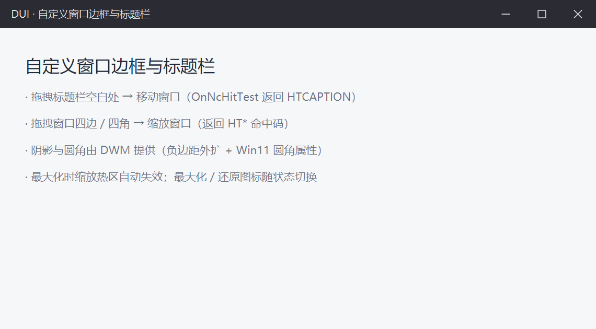
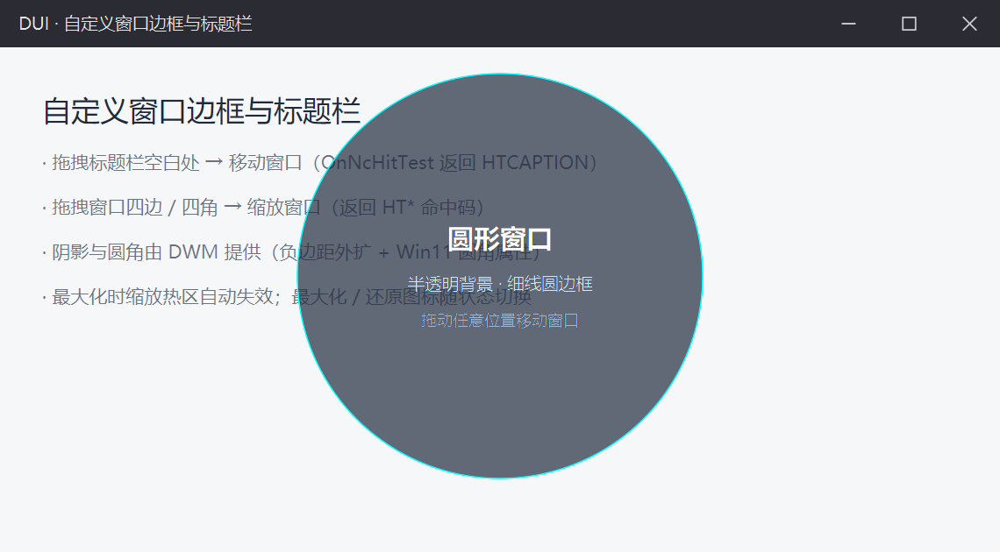

# DUI 自定义窗口边框与异形窗口指南（Window 开发者文档）

> 状态：**已实现** —— M5.11（无边框窗口 + 自绘标题栏）→ M5.x（透明窗口 / 窗口区域裁剪）。
> 两件事：
> ① **自定义边框**：无边框窗口 + 自绘标题栏（移动 / 缩放 / 按钮 / 阴影）；
> ② **异形窗口**：圆形等任意形状（透明合成 + 窗口区域裁剪）。
> 可运行示例 `Samples/CustomFrame`（自定义边框）、`Samples/CircleWindow`（圆形异形窗口）。

---

## 1. 快速开始

### 1.1 三种窗口形态

窗口形态在构造时声明，框架负责底层的系统对接：

| 形态 | 构造参数 | 效果 |
| --- | --- | --- |
| 系统窗口 | 默认 | 系统标题栏 + 边框 + 系统阴影 |
| **无边框窗口** | `frameless = true` | 客户区覆盖整窗；标题栏 / 边框全部自绘；阴影与圆角由 DWM 提供；移动与缩放通过 `OnNcHitTest` 交给系统接管 |
| **异形（透明）窗口** | `frameless = true` + `transparent = true` | 窗口背景透视桌面；再配 `SetWindowRgn` 裁剪出任意形状（圆、圆角、多边形…） |

```cpp
class MyWindow final : public dui::Window {
public:
    MyWindow()
        : dui::Window(dui::WindowOptions{
              .title     = L"我的窗口",
              .width     = 900.f,     // DIP
              .height    = 560.f,
              .frameless = true,     // 自绘标题栏
              // .transparent = true, // 需要透视桌面时再开
          }) {}
};
```

### 1.2 跑一下



深色标题栏、最小化 / 最大化 / 关闭三个按钮、拖标题栏移动、拖四边缩放 —— 都是自绘的。



圆形窗口叠在 WIN-1 上面：圆**外**根本不属于这个窗口（点击穿过去），圆**内**半透明，能看见下面的文字。

---

## 2. 无边框窗口：框架替你做了什么

设了 `frameless = true` 之后，下面这些**不用业务写一行代码**：

| 关注点 | 框架的做法 |
| --- | --- |
| 窗口样式 | `WS_POPUP | WS_THICKFRAME | WS_SYSMENU | WS_MINIMIZEBOX | WS_MAXIMIZEBOX` + `WS_EX_APPWINDOW`（进任务栏）。**`WS_THICKFRAME` 必须保留** —— `HTLEFT` 等缩放命中码只有带它才生效；`WS_POPUP` 去掉系统标题栏 |
| 阴影 | `DwmExtendFrameIntoClientArea(hwnd, {-1,-1,-1,-1})`：负边距 = 边框外扩 1px，DWM 在窗口外侧画投影（`WS_POPUP` 本身没有系统阴影） |
| Win11 圆角 | `DWMWA_WINDOW_CORNER_PREFERENCE = 33`（值 2 = 圆角）+ `DWMWA_BORDER_COLOR = 34`（`COLOR_NONE`）去掉系统 1px 边框色（Win10 SDK 无常量，手写） |
| 客户区 | `WM_NCCALCSIZE`（`wParam=TRUE`）**原样保留 `rgrc[0]` 并返回 0** → 客户区覆盖整个窗口矩形（不调 `DefWindowProc` 扣边框） |
| 最大化 | `WM_GETMINMAXINFO` 把 `ptMaxPosition` / `ptMaxSize` 约束到工作区 —— 否则系统把窗口放到比工作区还大，底边 / 右边被屏幕切掉 |
| 尺寸语义 | 无边框时 `width` / `height` 就是**整窗尺寸**（不做 `AdjustWindowRect` 边框补偿 —— 补了会大出左右各 8px，业务按 DIP 布局就错位） |
| 系统菜单 | 标题栏右键 → `GetSystemMenu` + `TrackPopupMenuEx` 弹系统菜单（还原 / 移动 / 大小 / 最小化 / 最大化 / 关闭），选中项转成 `WM_SYSCOMMAND` |
| 任务栏 / 快捷键 | `WS_EX_APPWINDOW` → 任务栏有按钮；`WS_SYSMENU` → `Alt+F4` 正常关闭 |
| 拖边框缩放 | 系统接管拖拽，框架在 `OnResized` 里**就地渲染** → 拖动过程中内容跟手，不等松手才更新 |

> **别改 `rgrc[0] = rgrc[1]`**：`rgrc[0]` 是系统建议的新窗口矩形（出参才是客户区），`rgrc[1]` 是**上一次**的窗口矩形 —— 最小化后还原时 `rgrc[1]` 正是离屏的图标矩形（`-32000,…`，199×34），客户区会被压成 199×34，窗口一片空白。

---

## 3. 自绘标题栏

### 3.1 结构

就是普通的 Flex 布局：一个标题栏 `Panel`（`FlexDirection::Row`）+ 一个内容区 `Panel`（`FlexGrow(1.f)`）：

```cpp
dui::Panel* bar = root->AddChild<dui::Panel>(dui::Style()
    .FlexDirection(dui::FlexDirection::Row)
    .AlignItems(dui::Align::Center)     // 子项垂直居中（图标 / 标题）
    .Height(36.f)
    .FlexShrink(0.f)                    // 标题栏不参与收缩
    .Background(0xFF2B2B33));

bar->AddChild<dui::Text>(L"我的窗口", dui::Style()
    .FontSize(13.f).Color(0xFFE6E6EA).FlexShrink(0.f)
    .Padding(dui::Thickness(0.f, 14.f)));        // 左右留白（CSS 顺序：先上下后左右）

bar->AddChild<dui::Panel>(dui::Style().FlexGrow(1.f));   // 弹性占位：按钮靠右
```

### 3.2 标题栏按钮

框架内置**矢量图标**（`dui::Icon` / `dui::IconName`），不依赖字体 / 位图，尺寸随 `Style().Width/Height` 自由变化：

```cpp
dui::Panel* MakeIconButton(dui::Panel* bar, dui::IconName name, dui::Color hoverBg) {
    dui::Panel* btn = bar->AddChild<dui::Panel>(dui::Style()
        .Width(46.f).Height(36.f).FlexShrink(0.f)
        .AlignItems(dui::Align::Center)
        .JustifyContent(dui::Justify::Center)
        .Cursor(dui::Cursor::Hand));
    btn->When(dui::State::Hover, dui::Style().Background(hoverBg));   // 悬停底色
    dui::Icon* icon = btn->AddChild<dui::Icon>(dui::Style()
        .Width(12.f).Height(12.f).Color(0xFFC9C9D1));
    icon->SetIcon(name);
    return btn;
}

dui::Panel* minBtn  = MakeIconButton(bar, dui::IconName::Minimize, 0x26FFFFFF);
dui::Panel* maxBtn  = MakeIconButton(bar, dui::IconName::Maximize, 0x26FFFFFF);
dui::Panel* closeBtn = MakeIconButton(bar, dui::IconName::Close,    0xFFE81123);

minBtn->OnClick(this, &MyWindow::OnMinimizeClick);
maxBtn->OnClick(this, &MyWindow::OnMaximizeClick);
closeBtn->OnClick(this, &MyWindow::OnCloseClick);

void OnMinimizeClick(dui::PointerEvent&) { Minimize(); }
void OnMaximizeClick(dui::PointerEvent&) { MaximizeOrRestore(); }
void OnCloseClick(dui::PointerEvent&)    { Close(); }
```

点击沿祖先链冒泡 —— 点在图标上（命中 `Icon`）也能触发按钮（见 [Event.md](Event.md)）。

### 3.3 最大化图标随状态切换

最大化后标题栏按钮的图样要换成"还原"，用 `OnStateChanged`：

```cpp
void OnStateChanged() override {      // 尺寸改变 / 最大化还原
    if (maximizeIcon_ == nullptr) return;
    maximizeIcon_->SetIcon(IsMaximized() ? dui::IconName::Restore : dui::IconName::Maximize);
}
```

---

## 4. 移动与缩放：`OnNcHitTest`

### 4.1 你只报"命中区"，系统干活

```cpp
virtual bool OnNcHitTest(Vec2 ptDip, HitTestCode& hit);
```

| 返回的 `hit` | 系统的行为 |
| --- | --- |
| `HitTestCode::Caption` | 拖动 → **移动窗口** |
| `Left` / `Right` / `Top` / `Bottom` | 拖动 → 沿该边**缩放**窗口 |
| `TopLeft` / `TopRight` / `BottomLeft` / `BottomRight` | 拖动 → **沿角缩放** |
| `HitTestCode::Client` | 当普通客户区处理（鼠标消息发给业务） |

返回 `false` → 交回系统默认命中测试（`WS_THICKFRAME` 会在窗口最外圈又报出一套 `HT*`，最大化时容易误触缩放）。

`ptDip` 是**客户区 DIP 坐标**（框架已把屏幕坐标换算好）；热区厚度用 `ClientSizeDip()` 取客户区尺寸。

### 4.2 判定顺序（关键）

**顺序错了就会出现"拖不动 / 点不动"**：

```
① 四边 / 四角（缩放热区）   ← 必须最先判
② 标题栏按钮区（Client）    ← 必须排除在 Caption 之外
③ 标题栏其余（Caption）     ← 移动窗口
④ 内容区（Client）
```

### 4.3 完整实现

```cpp
bool OnNcHitTest(dui::Vec2 pt, dui::HitTestCode& hit) override {
    const dui::Vec2 size = ClientSizeDip();
    const float w = size.x;
    const float h = size.y;

    // ① 四边 / 四角 → HT*：拖动即缩放窗口（最大化时无边框可拖，禁用）
    if (!IsMaximized()) {
        const bool left   = pt.x < kResizeBorder;          // 6 DIP
        const bool right  = pt.x > w - kResizeBorder;
        const bool top    = pt.y < kResizeBorder;
        const bool bottom = pt.y > h - kResizeBorder;
        if (top && left)     { hit = dui::HitTestCode::TopLeft;     return true; }
        if (top && right)    { hit = dui::HitTestCode::TopRight;    return true; }
        if (bottom && left)  { hit = dui::HitTestCode::BottomLeft;  return true; }
        if (bottom && right) { hit = dui::HitTestCode::BottomRight; return true; }
        if (top)    { hit = dui::HitTestCode::Top;    return true; }
        if (left)   { hit = dui::HitTestCode::Left;   return true; }
        if (right)  { hit = dui::HitTestCode::Right;  return true; }
        if (bottom) { hit = dui::HitTestCode::Bottom; return true; }
    }

    // ② 标题栏右侧按钮区 → 留作客户区：否则点击被系统当成"拖标题栏"，
    //    按钮收不到鼠标消息，永远点不动
    if (pt.y < kTitleBarHeight && pt.x >= w - 3.f * kButtonWidth) {
        hit = dui::HitTestCode::Client;
        return true;
    }

    // ③ 标题栏其余 → HTCAPTION：拖动即移动窗口
    if (pt.y < kTitleBarHeight) {
        hit = dui::HitTestCode::Caption;
        return true;
    }

    // ④ 内容区一律 HTCLIENT
    hit = dui::HitTestCode::Client;
    return true;
}
```

### 4.4 为什么交给系统

自己实现移动 / 缩放要处理：按下 / 移动 / 抬起、模态循环、边界约束、多显示器、DPI 换算、最大化禁止缩放……全部交给系统只要几行判定。业务只回答"这一点属于哪块热区"。

---

## 5. 异形窗口

异形窗口是**两件事**叠加：

| | 管什么 | 手段 |
| --- | --- | --- |
| 看得见的形状 | 窗口里**画**出来的样子 | `transparent = true` + 自绘（`Canvas` 画圆 / 圆角矩形…） |
| 点不到的形状 | 窗口**之外**不接收鼠标 | `SetWindowRgn`（Win32 窗口区域裁剪） |

### 5.1 透明窗口

```cpp
dui::Window(dui::WindowOptions{
    .width      = 320.f,
    .height     = 320.f,
    .frameless  = true,
    .transparent = true,      // 交换链 PREMULTIPLIED 合成 + 清屏全透明
});
```

`transparent = true` 时，交换链按 `PREMULTIPLIED` 合成、每帧清屏为**全透明**（`ClearRenderTargetView` 的 alpha = 0），DWM 按视觉树的 alpha 与桌面合成 → 窗口背景可以透视桌面（DirectComposition 承载，ADR-010）。

不透明窗口则清成不透明黑底，视觉与普通窗口一致。

### 5.2 窗口区域裁剪（让形状"不存在"）

框架**没有**封装 `SetWindowRgn` —— 用 `NativeHandle()`（`OnCreate` 起有效）直接调 Win32：

```cpp
void ApplyCircleRegion() {
    HWND hwnd = NativeHandle();       // OnCreate 起有效
    RECT rc{};
    GetClientRect(hwnd, &rc);          // 物理像素，DPI 变化后必须重建
    HRGN rgn = CreateEllipticRgn(2, 2, rc.right - 2, rc.bottom - 2);
    SetWindowRgn(hwnd, rgn, TRUE);     // rgn 所有权移交系统，勿 DeleteObject
}
```

- `CreateEllipticRgn`（椭圆）/ `CreateRoundRectRgn`（圆角矩形）/ `CreatePolygonRgn`（多边形）都能用；
- **`SetWindowRgn` 之后 rgn 归系统所有**，不要再 `DeleteObject`；
- **DPI 变化后必须重建**（区域是物理像素）：在 `OnDpiChanged` 里再调一次；
- 尺寸变化（最大化 / 还原）同样要重建：`OnStateChanged` 里再调一次。

### 5.3 AA 问题：硬边让开、自绘收边

`SetWindowRgn` 是 **GDI 硬裁剪**：像素级阶梯，**没有抗锯齿**，边界会内凹 1~2 px，肉眼能看到锯齿和颗粒感。

标准解法（`Samples/CircleWindow` 的做法）：**rgn 的硬边藏到透明区里，可见轮廓交给自绘的矢量图元**。

```cpp
constexpr int   kRgnInsetPx   = 2;      // rgn 从窗口边界让开 2 物理像素
constexpr float kDrawInsetDip = 6.f;    // 自绘圆再内缩 6 DIP
```

- rgn 让开 2px → 硬边不与窗口边界相切，落在一圈全透明间隙里；
- 自绘圆内缩 6 DIP → 覆盖阶梯内凹 + 1px AA 过渡带 + 余量；
- 两条边之间留出全透明间隙 → 可见轮廓**完全**由 `Canvas` 的 SDF 圆决定（矢量、带 AA），颗粒感消失。

```cpp
dui::Canvas* surface = root->AddChild<dui::Canvas>(dui::Style()
    .FlexGrow(1.f)
    .JustifyContent(dui::Justify::Center)
    .AlignItems(dui::Align::Center)
    .Gap(8.f));

const dui::Vec2 center{kSize * 0.5f, kSize * 0.5f};
const float r = kSize * 0.5f - kDrawInsetDip;
surface->AddCircle(center, r, 0xB01E293B);            // 半透明填充
surface->AddCircleOutline(center, r, 0xFF00FFFF, 1.f); // 细线圆边框
```

`Canvas` 的图元坐标是**局部 DIP**（原点 = 画布左上角），圆 / 椭圆走 SDF 绘制，天然带 1 像素过渡带 AA。

### 5.4 整个客户区可拖动

圆形窗口没有"标题栏"的概念 —— 整块都是拖动区：

```cpp
bool OnNcHitTest(dui::Vec2, dui::HitTestCode& hit) override {
    hit = dui::HitTestCode::Caption;   // 整个客户区都是标题栏，可拖任意位置
    return true;
}
```

注意：rgn 之外的区域根本不属于这个窗口（点不到），所以"可拖区域"实际是**圆内**。

---

## 6. 其它交互细节

| 交互 | 行为 |
| --- | --- |
| 标题栏右键 | 弹**系统菜单**（还原 / 移动 / 大小 / 最小化 / 最大化 / 关闭）。`WS_POPUP` 没有系统标题栏，框架在 `WM_NCRBUTTONUP` + `HTCAPTION` 时自己弹。选中项转 `WM_SYSCOMMAND`，由 `DefWindowProc` 执行 |
| 客户区右键 | 框架**不自动**弹菜单 —— 由业务在 `OnPointerUp` 里判断 `ev.button == PointerButton::Right` 后调 `ShowMenu`（见 [Menu.md](Menu.md)） |
| `Alt+F4` | 走 `WM_CLOSE` → `OnClosing()` 可拦截（返回 `false` 阻止关闭） |
| 拖边框缩放 | Windows 进入模态循环，主消息循环挂起，`WM_SIZE` 连续到达 → 框架在 `OnResized` 里就地渲染 |
| 最大化后 | `IsMaximized()` 为真 → 没有可拖的边框，缩放热区要自行禁用 |
| 失活 | `WM_ACTIVATE` → 编辑控件失焦（光标停闪），见 [Input.md](Input.md) |

---

## 7. API 速查

### 7.1 窗口形态

| 成员 | 说明 |
| --- | --- |
| `WindowOptions::frameless` | 无系统标题栏 / 边框，自绘 |
| `WindowOptions::transparent` | 交换链 PREMULTIPLIED + 全透明清屏，背景透视桌面 |
| `WindowOptions::width` / `height` | DIP。无边框时是**整窗**尺寸 |
| `WindowOptions::center` | 初始显示在显示器工作区正中（默认 true） |

### 7.2 窗口操作

| 成员 | 说明 |
| --- | --- |
| `void Minimize()` | 最小化 |
| `void MaximizeOrRestore()` | 最大化 / 还原 |
| `void Close()` | 请求关闭（走 `WM_CLOSE`，`OnClosing` 可拦截） |
| `bool IsMaximized() const` | 当前是否最大化 |
| `Vec2 ClientSizeDip() const` | 客户区 DIP 尺寸（热区判定用） |
| `HWND NativeHandle() const` | 原生句柄（`OnCreate` 起有效） |

### 7.3 业务重写点

| 虚函数 | 何时用 |
| --- | --- |
| `bool OnNcHitTest(Vec2 ptDip, HitTestCode& hit)` | 报标题栏 / 边框热区（移动、缩放） |
| `void OnStateChanged()` | 尺寸改变 / 最大化还原（换最大化按钮图标、重建 rgn） |
| `void OnDpiChanged(const DpiChanged&)` | DPI 变化（重建 rgn、换资源） |
| `bool OnClosing()` | 返回 `false` 阻止关闭 |

### 7.4 命中码

| `HitTestCode` | 值 | 含义 |
| --- | --- | --- |
| `Client` | 1 | 普通客户区 |
| `Caption` | 2 | 拖动可移动窗口 |
| `Left` / `Right` | 10 / 11 | 左右边缘可缩放 |
| `Top` / `Bottom` | 12 / 15 | 上下边缘可缩放 |
| `TopLeft` / `TopRight` / `BottomLeft` / `BottomRight` | 13 / 14 / 16 / 17 | 四角可缩放 |

---

## 8. 已知限制与坑

1. **缩放热区必须先于标题栏判定**：上边那条窄带压在标题栏上，若先判 `Caption`，上边与左上 / 右上角会全部变成"移动窗口"，大小拖不动。
2. **标题栏按钮必须排除在 `Caption` 热区之外**：命中标题栏的点击会被系统当成"拖标题栏"，按钮收不到 `WM_LBUTTONDOWN`，永远点不动。按钮区只需让出最上面一条 resize 带给上边 / 右上角缩放（原生窗口的标题栏顶端同样是一条 resize 带）。
3. **边框热区会吃掉客户区边缘几像素**：缩放热区（示例 6 DIP）覆盖客户区四边，内容贴边处点不到 —— 布局时留余量，或把热区做窄。
4. **热区之外要显式返回 `Client`**（不要 `return false` 落到 `DefWindowProc`），否则 `WS_THICKFRAME` 会在窗口最外圈又报出一套 `HT*`，最大化时容易误触缩放。
5. **最大化后 `IsMaximized()` 为真**：此时没有可拖的边框，缩放热区要自行禁用。
6. **无边框时 `width` / `height` 是整窗尺寸**：不补 `AdjustWindowRect` —— 补了会大出左右各 8px，按 DIP 布局就错位。
7. **`SetWindowRgn` 的硬边没有 AA**：必须让 rgn 藏进透明区、可见轮廓交给矢量自绘（§5.3）。
8. **rgn 是物理像素**：DPI 变化 / 尺寸变化后必须重建（`OnDpiChanged` / `OnStateChanged`）。
9. **`SetWindowRgn` 之后 rgn 归系统所有**：不要再 `DeleteObject`。
10. **透明窗口的半透明叠加是近似的**：预乘 Alpha 合成下，深底亮字 / 半透明层叠的表现与不透明窗口不完全一致（ADR-003 的取舍）。
11. **双击标题栏最大化未提供**：框架没有双击事件，要么自己判断 `OnPointerUp` 的连续两次，要么不管。
12. **系统菜单只对标题栏生效**：`WS_POPUP` 没有系统标题栏，框架靠 `WM_NCRBUTTONUP` + `HTCAPTION` 判定"点在标题栏上" —— 自绘标题栏的区域判定变了，系统菜单的触发区域也随之变。

---

## 9. 相关文档

- [Event.md](Event.md) —— 指针事件、冒泡与 `handled`（标题栏按钮的点击靠它冒泡）
- [Styles.md](Styles.md) —— 悬停 / 按下状态变体（`When`）、背景与圆角
- [Layout.md](Layout.md) —— Flex 布局：标题栏 + 内容区的排布、`Gap` / `Padding` / `FlexGrow`
- [Menu.md](Menu.md) —— 客户区右键弹菜单（`ShowMenu`）
- [Input.md](Input.md) —— 编辑控件与焦点（失活清焦点）
- [Arch/12-Windowing.md](Arch/12-Windowing.md) —— 窗口架构稿：§6.1 无边框窗口与自定义标题栏（设计意图与框架侧实现要点）
- `Samples/CustomFrame/main.cpp` —— 自定义边框与标题栏（移动 / 缩放 / 按钮 / 阴影）
- `Samples/CircleWindow/main.cpp` —— 圆形半透明异形窗口（`SetWindowRgn` + `Canvas`）

