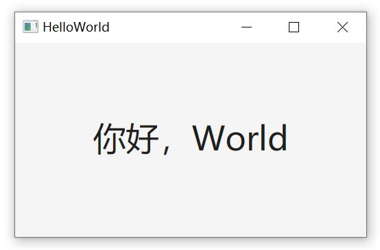

# DUI

仅支持Windows（1703），体积小（300KB），零依赖，性能好，内存占用低，使用方便，功能齐全的 C++ GUI 开发框架。

## 文档

**使用指南**：

- [事件系统指南](Doc/Event.md) —— 冒泡、捕获、滚轮、键盘、拖拽、捕获等。
- [布局使用指南](Doc/Layout.md) —— Flex、绝对定位、主轴、交叉轴、弹性布局等。
- [样式使用指南](Doc/Styles.md) —— 字体、颜色、圆角、边框、阴影、对齐、继承等。
- [输入控件指南](Doc/Input.md) —— 单行输入、多行编辑、富文本、撤销重做等。
- [对话框使用指南](Doc/Dialog.md) —— 打开/保存文件、选择文件夹、消息框等。
- [菜单使用指南](Doc/Menu.md) —— 系统原生弹出菜单：右键菜单、子菜单、复选项。
- [异步使用指南](Doc/Async.md) —— 协程异步：后台线程干活，切回 UI 线程刷新界面。
- [窗口外观指南](Doc/Window.md) —— 自定义窗口边框与异形窗口：自绘标题栏、拖动缩放、圆形窗口。

## 构建

用 Visual Studio 2026 （C++ 20）打开 `DUI.slnx`（x64）即可执行构建。

构建产物：

- `DUI.lib`（静态库）
- `Samples` （示例项目）
  - `HelloWorld`
  - `Layout`
  - `Style`
  - `Icon`
  - `Position`
  - `Canvas`
  - `Input`
  - `Event`
  - `Scroller`
  - `Dialog`
  - `CircleWindow`
  - `CustomFrame`
  - `Menu`
  - `Async`
